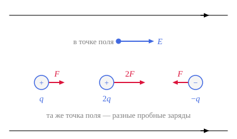

В уроке 2.1 мы выяснили: в одной точке поля сила пропорциональна заряду. Вдвое больше заряд — вдвое больше сила. Значит, отношение силы к заряду в этой точке одно и то же, какой бы заряд мы ни взяли. Это отношение и описывает поле.

## Сила на единицу заряда

**Напряжённость** электрического поля — сила, с которой поле действует на пробный заряд, делённая на этот заряд:

$$
\vec E = \frac{\vec F}{q}.
$$

Проще говоря, это сила, которая действовала бы на заряд ${+1\ \text{Кл}}$. Единица — ньютон на кулон, Н/Кл. Её чаще пишут как вольт на метр, В/м: это одно и то же, а почему — увидим в уроке 2.6.

Напряжённость — свойство **поля** в данной точке. Возьмём заряд вдвое больше — сила будет вдвое больше, а их отношение $E$ останется прежним. Пробный заряд ничего не меняет, он только измеряет.

Это точь-в-точь как ускорение $g$ в механике (урок 7.2 из механики). Сила тяжести пропорциональна массе тела, и ${g = F/m}$ — сила на один килограмм, ${10\ \text{Н/кг}}$, одна для всех тел. Поле тяготения действует на массу, электрическое — на заряд. $E$ — это «$g$ для зарядов».

## Направление

Напряжённость — **вектор**. За её направление принимают направление силы, которая действует на **положительный** заряд.

Из ${\vec F = q\vec E}$ видно, что будет с другими зарядами:

- на положительный заряд сила направлена **по** $\vec E$;
- на отрицательный — **против** $\vec E$: при $q < 0$ вектор $q\vec E$ смотрит в обратную сторону;
- модуль силы ${F = |q|E}$.

Так что электрон в поле толкает против линий поля, а протон — вдоль.

## Как считать

**Пример.** На заряд $7\ \text{нКл}$ поле действует с силой $28\ \text{мкН}$. Напряжённость:

$$
E = \frac{F}{q} = \frac{28 \cdot 10^{-6}}{7 \cdot 10^{-9}} = 4 \cdot 10^3\ \text{Н/Кл} = 4\ \text{кВ/м}.
$$

А какая сила подействует в той же точке на электрон? Обратная задача, ${F = |q|E}$:

$$
F = 1{,}6 \cdot 10^{-19} \cdot 4 \cdot 10^3 = 6{,}4 \cdot 10^{-16}\ \text{Н}.
$$

Сила направлена против $\vec E$ — электрон заряжен отрицательно.

<pp-task id="ks-field-01"></pp-task>

Сила $qE$ — такая же сила, как остальные, и для неё работают законы Ньютона. Если заряженное тело в поле покоится, электрическая сила уравновешивает другие силы (урок 5.3 из механики). Если не уравновешивает — тело разгоняется с ускорением ${a = qE/m}$ (урок 5.4 из механики).

<pp-task id="ks-field-09"></pp-task>

Проверь себя: в точке поля на пробный заряд +1 нКл действует сила, направленная на север. Куда направлена напряжённость? А сила на заряд −1 нКл в той же точке?

Напряжённость направлена на север — по силе на положительный заряд. На заряд $-1\ \text{нКл}$ сила той же величины, но направлена на юг, против $\vec E$.

## Частые ловушки

- **«Напряжённость зависит от пробного заряда».** Не зависит: вдвое больше заряд — вдвое больше сила, а их отношение то же.
- **Путают направление силы для отрицательного заряда.** Сила на отрицательный заряд — против $\vec E$.
- **Не переводят в СИ.** Нанокулоны и микроньютоны — в кулоны и ньютоны; ответ в кВ/м — раздели В/м на тысячу.

## Коротко

- ${\vec E = \vec F/q}$ — сила на заряд $1\ \text{Кл}$; единица Н/Кл = В/м.
- Направление $\vec E$ — как у силы на положительный заряд; на отрицательный сила против $\vec E$.
- $E$ — свойство поля, как $g$ — свойство поля тяготения.
- ${F = |q|E}$.

Дальше — урок 2.3: какое поле создаёт один точечный заряд.
