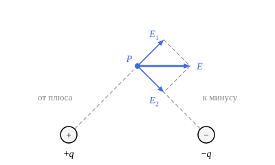
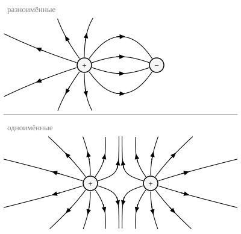
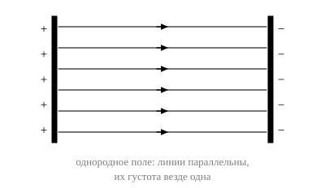

В уроке 1.6 мы складывали силы, с которыми несколько зарядов действуют на один. Поля складываются точно так же — ведь напряжённость это сила, делённая на пробный заряд. А чтобы увидеть поле целиком, а не в одной точке, его рисуют линиями.

## Поля складываются как векторы

**Принцип суперпозиции**: напряжённость поля нескольких зарядов равна **векторной сумме** напряжённостей, которые создаёт каждый заряд в отдельности:

$$
\vec E = \vec E_1 + \vec E_2 + \ldots
$$

Каждый заряд создаёт поле так, будто других нет. План тот же, что в уроке 1.6:

1. Для каждого заряда найди модуль его поля в нужной точке: ${E_i = k|q_i|/r_i^2}$, где $r_i$ — расстояние **от этого заряда** до точки.
2. Нарисуй направление: от положительного заряда, к отрицательному.
3. Сложи векторы: на одной прямой — проекции со знаками, под прямым углом — по теореме Пифагора.

**Пример.** В точке поле первого заряда $7\ \text{кВ/м}$, второго — $4\ \text{кВ/м}$. Если они направлены в одну сторону, ${E = 7 + 4 = 11\ \text{кВ/м}}$; если в противоположные — ${7 - 4 = 3\ \text{кВ/м}}$, в сторону большего. А если под прямым углом, например $5$ и $12\ \text{кВ/м}$:

$$
E = \sqrt{5^2 + 12^2} = 13\ \text{кВ/м}.
$$

<pp-task id="ks-field-03"></pp-task>

<pp-task id="ks-field-11"></pp-task>

## Модель: поле двух зарядов

В модели два заряда на одной прямой. Задай их величину и знак. Маленькие стрелки показывают направление поля в разных местах — ярче там, где поле сильнее. В точке $P$ нарисованы поля обоих зарядов $\vec E_1$ и $\vec E_2$ и их сумма $\vec E$ — толстая стрелка. Все три в одном масштабе, но сам масштаб подстраивается, чтобы стрелки помещались; точное значение — в строке под моделью. Точку $P$ двигай ползунками или нажатием на картинку.

<pp-field q1="5" q2="-5" x="9" y="2">Модель: поле двух точечных зарядов. Ползунками задаются заряды от −10 до +10 нКл и положение точки P; в точке P показаны поля обоих зарядов и их векторная сумма, вокруг — направление поля в разных местах.</pp-field>

Попробуй:

- найди точку, где $\vec E_1$ и $\vec E_2$ направлены в одну сторону, и точку, где в противоположные;
- сделай заряды одинаковыми и найди точку, где ${E = 0}$;
- сделай один заряд нулём — что осталось от параллелограмма?

## Линии поля

Стрелки в каждой точке — громоздко. Поле удобнее рисовать **линиями напряжённости** (силовыми линиями). Их проводят так:

- касательная к линии в каждой точке показывает направление $\vec E$;
- там, где поле сильнее, линии гуще.

Линии начинаются на положительных зарядах и заканчиваются на отрицательных (или уходят далеко-далеко). Они не пересекаются: в каждой точке у поля одно направление.

У разноимённых зарядов линии идут от плюса к минусу, гуще всего между ними. У одноимённых линии «отталкиваются»: посередине между равными зарядами поля гасят друг друга, и там ${E = 0}$.

Линия поля — не траектория заряда. Она показывает, куда направлена сила, а заряд с начальной скоростью может двигаться и поперёк линий, как камень, брошенный горизонтально, летит поперёк силы тяжести.

## Однородное поле

Поле, у которого напряжённость **одинакова во всех точках** — и по модулю, и по направлению, — называют **однородным**. Его линии параллельны и идут с одинаковой густотой. Такое поле получается между двумя большими параллельными пластинами, заряженными разноимённо (у краёв пластин поле уже не однородное, но мы смотрим на середину).

Однородное поле — как поле тяжести у поверхности Земли: $g$ одно и то же в комнате, на крыше и в подвале. С ним удобно считать, и в уроках 2.6 и 2.8 оно понадобится.

Проверь себя: могут ли две линии поля пересечься?

Нет. В точке пересечения у поля было бы два направления сразу, а напряжённость в каждой точке одна — векторная сумма полей всех зарядов.

## Частые ловушки

- **Складывают модули полей как числа.** Сначала направления: против — вычитаем, под прямым углом — по Пифагору.
- **Берут не то расстояние.** Для каждого заряда — расстояние от него до точки.
- **Считают линию поля траекторией.** Линия показывает направление силы, а не движения.

## Коротко

- ${\vec E = \vec E_1 + \vec E_2 + \ldots}$ — поля складываются как векторы.
- Линии поля — от плюса к минусу; касательная — направление $\vec E$, густота — модуль.
- Однородное поле — одинаковое везде; между разноимённо заряженными пластинами.

Дальше — урок 2.5: какую работу совершает поле, перемещая заряд.
