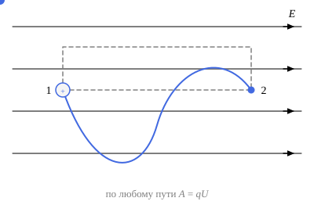

Отпусти заряд в поле — он разгонится. Значит, поле совершает над ним работу. В механике мы уже считали работу силы, которая действует на расстоянии, — силы тяжести (урок 11.5 из механики). Оказывается, электрическое поле устроено так же, и из этого вырастают два главных слова электротехники: потенциал и напряжение.

## Работа не зависит от пути

Сила тяжести совершает одну и ту же работу, спускаешься ли ты по лестнице, по пандусу или на лифте: важны только начальная и конечная высота (урок 11.5 из механики). Для электростатического поля верно то же самое.

Работа поля при перемещении заряда **не зависит от формы пути** — только от начальной и конечной точек. На замкнутом пути она равна нулю. Такие поля называют **потенциальными**. Поле тяжести потенциально, электростатическое — тоже. А сила трения — нет: её работа тем больше, чем длиннее путь.

## Потенциальная энергия и потенциал

Раз работа зависит только от точек, у заряда в поле есть **потенциальная энергия** $W$, как у поднятого тела — $mgh$ (урок 12.1 из механики). И, как там, работа поля равна убыли потенциальной энергии (урок 12.6 из механики):

$$
A_{12} = W_1 - W_2.
$$

Энергия $W$ пропорциональна заряду: вдвое больший заряд в той же точке имеет вдвое большую энергию. Поэтому её делят на заряд и получают характеристику самого поля — **потенциал**:

$$
\varphi = \frac{W}{q}, \qquad W = q\varphi.
$$

Потенциал — энергия заряда ${+1\ \text{Кл}}$ в данной точке. Его единица — **вольт**: ${1\ \text{В} = 1\ \text{Дж/Кл}}$. В механике похоже: $mgh$ — энергия тела, а $gh$ — энергия на один килограмм, она уже не зависит от тела, только от высоты.

Потенциал — число, а не вектор, и он бывает отрицательным. Как высоту, его отсчитывают от выбранного нуля, и как в механике, важна только **разность** (урок 12.1 из механики).

## Напряжение

Разность потенциалов двух точек называют **напряжением**:

$$
U = \varphi_1 - \varphi_2.
$$

Его единица — тоже вольт. «Батарейка $1{,}5\ \text{В}$» значит: между её полюсами напряжение $1{,}5\ \text{В}$.

Работа поля при переходе заряда из точки 1 в точку 2:

$$
A_{12} = W_1 - W_2 = q(\varphi_1 - \varphi_2) = qU.
$$

Отсюда смысл вольта: напряжение $1\ \text{В}$ — когда поле, перенося заряд $1\ \text{Кл}$, совершает работу $1\ \text{Дж}$.

**Пример.** Заряд $3\ \text{мкКл}$ проходит напряжение $30\ \text{В}$:

$$
A = qU = 3 \cdot 10^{-6} \cdot 30 = 9 \cdot 10^{-5}\ \text{Дж} = 90\ \text{мкДж}.
$$

<pp-task id="ks-field-04"></pp-task>

## Знаки

В ${A = q(\varphi_1 - \varphi_2)}$ знаки важны: и у заряда, и у разности потенциалов.

- Положительный заряд сам движется туда, где потенциал **меньше**: тогда ${\varphi_1 - \varphi_2 > 0}$ и работа поля положительна. Как камень сам катится вниз.
- Отрицательный заряд — например, электрон — сам движется к **большему** потенциалу: ${q < 0}$ и ${\varphi_1 - \varphi_2 < 0}$, произведение положительно.
- Если заряд ведут «против» поля, работа поля отрицательна — работу совершает тот, кто ведёт.

**Пример.** Заряд $-2\ \text{мкКл}$ переходит из точки с потенциалом $15\ \text{В}$ в точку с потенциалом $55\ \text{В}$:

$$
A = q(\varphi_1 - \varphi_2) = -2 \cdot 10^{-6} \cdot (15 - 55),
$$

$$
A = 8 \cdot 10^{-5}\ \text{Дж} = 80\ \text{мкДж}.
$$

Работа положительна: отрицательный заряд движется к большему потенциалу сам.

<pp-task id="ks-field-12"></pp-task>

Проверь себя: заряд перенесли из точки A в точку B, а потом вернули в A другой дорогой. Какую работу совершило поле за весь путь?

Ноль. Работа зависит только от начальной и конечной точек, а они совпали: ${A = q(\varphi_A - \varphi_A) = 0}$. Как у силы тяжести на замкнутом пути.

## Частые ловушки

- **Думают, что работа поля зависит от траектории.** В электростатике — нет.
- **Путают порядок в $\varphi_1 - \varphi_2$.** Из начального потенциала вычитают конечный.
- **Теряют знак заряда.** Для электрона $q = -e$, и знак работы меняется.
- **Путают потенциал и напряжение.** Потенциал — у точки, напряжение — между двумя точками.

## Коротко

- Работа поля не зависит от пути; на замкнутом пути она ноль.
- ${W = q\varphi}$; потенциал $\varphi$ — энергия на ${1\ \text{Кл}}$, в вольтах.
- ${U = \varphi_1 - \varphi_2}$; ${A_{12} = q(\varphi_1 - \varphi_2) = qU}$.
- Положительный заряд сам идёт к меньшему потенциалу, отрицательный — к большему.

Дальше — урок 2.6: как связаны напряжение и напряжённость в однородном поле.
