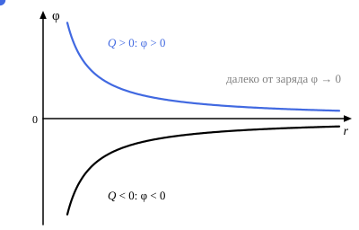

В однородном поле потенциал меняется равномерно: на каждом метре вдоль поля — на $E$ вольт (урок 2.6). А как он устроен вокруг одного заряда, где поле то сильное, то слабое?

## Формула

Потенциал поля точечного заряда $Q$ на расстоянии $r$ от него:

$$
\varphi = k\,\frac{Q}{r}.
$$

Вывод требует высшей математики, поэтому примем формулу как данность. Сравни её с напряжённостью ${E = k|Q|/r^2}$ (урок 2.3) — два отличия:

- **расстояние в первой степени**, а не в квадрате: вдвое дальше — потенциал вдвое меньше, а напряжённость — вчетверо;
- **заряд со знаком**, без модуля: у положительного заряда потенциал положительный, у отрицательного — отрицательный.

Ноль потенциала здесь выбран **бесконечно далеко** от заряда: там поле исчезает, и чем дальше, тем ближе $\varphi$ к нулю.

Это знакомая картина из механики. Положительный заряд — как гора: чем ближе к нему, тем выше «высота» $\varphi$, и положительный пробный заряд с неё скатывается — отталкивается. Отрицательный заряд — как яма: потенциал вблизи него ниже нуля, и положительный заряд в неё падает — притягивается.

**Пример.** Потенциал поля заряда $5\ \text{нКл}$ на расстоянии $9\ \text{см}$:

$$
\varphi = 9 \cdot 10^9 \cdot \frac{5 \cdot 10^{-9}}{0{,}09} = \frac{45}{0{,}09} = 500\ \text{В}.
$$

А заряда $-2\ \text{нКл}$ на расстоянии $4\ \text{см}$:

$$
\varphi = 9 \cdot 10^9 \cdot \frac{-2 \cdot 10^{-9}}{0{,}04} = -450\ \text{В}.
$$

<pp-task id="ks-field-06"></pp-task>

## Эквипотенциали — сферы

Все точки на одном расстоянии от заряда имеют один потенциал. Значит, эквипотенциальные поверхности точечного заряда — **сферы** вокруг него, а линии поля идут по радиусам, перпендикулярно им, как и в однородном поле (урок 2.6). Двигая заряд по такой сфере, поле работы не совершает.

## Несколько зарядов

Потенциал — энергия на единицу заряда, а энергии складываются как числа. Поэтому потенциал нескольких зарядов — **алгебраическая сумма** их потенциалов:

$$
\varphi = \varphi_1 + \varphi_2 + \ldots = k\frac{q_1}{r_1} + k\frac{q_2}{r_2} + \ldots
$$

Никаких векторов, параллелограммов и Пифагора — только знаки. Это намного проще, чем складывать напряжённости (урок 2.4).

Из этого видно: где ${E = 0}$, потенциал не обязательно ноль, и наоборот. Посередине между двумя одинаковыми положительными зарядами поля гасят друг друга, а потенциалы — оба положительные — складываются.

## Модель: потенциал двух зарядов

Та же модель, что в уроке 2.4, но в строке под ней теперь и потенциал в точке $P$.

<pp-field q1="7" q2="-3" x="10" y="3" potential>Модель: поле двух точечных зарядов. Ползунками задаются заряды от −10 до +10 нКл и положение точки P; в точке P показаны поля обоих зарядов, их сумма, напряжённость и потенциал.</pp-field>

Попробуй:

- сделай заряды равными по модулю и разными по знаку и поставь $P$ на одинаковом расстоянии от них — чему равен $\varphi$? А $E$?
- сделай оба заряда положительными и равными и найди точку, где ${E = 0}$, — какой там потенциал?
- отодвигай $P$ от зарядов — к чему стремится $\varphi$?

<pp-task id="ks-field-14"></pp-task>

Проверь себя: расстояние от точечного заряда увеличили в 5 раз. Во сколько раз изменились напряжённость и потенциал?

Напряжённость уменьшилась в ${5^2 = 25}$ раз, потенциал — в $5$ раз: в формуле потенциала расстояние в первой степени.

## Частые ловушки

- **Возводят расстояние в квадрат.** У потенциала $r$ в первой степени; квадрат — у напряжённости.
- **Теряют знак заряда.** У отрицательного заряда потенциал отрицательный.
- **Складывают потенциалы как векторы.** Потенциалы — числа, складываются со знаками.
- **«Где $E = 0$, там и $\varphi = 0$».** Не обязательно: это разные величины.

## Коротко

- ${\varphi = kQ/r}$ — со знаком заряда, ноль далеко от заряда.
- Вдвое дальше — потенциал вдвое меньше (а напряжённость вчетверо).
- Потенциалы нескольких зарядов складываются как числа.

Дальше — урок 2.8: как поле разгоняет заряженные частицы.
