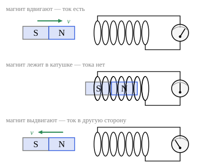

Электростанция, беспроводная зарядка, индукционная плита, металлоискатель — всё это работает благодаря электромагнитной индукции. Тема встречается в задаче 12, в задачах 14–15, в задаче 21 и в задаче 25.

Само явление, магнитный поток и правило Ленца проходят в 9 классе. Закон Фарадея и задачи на ЭДС индукции — в 11. Пригодятся темы «Магнитное поле и сила Ампера», «Сила Лоренца» и «ЭДС и закон Ома для полной цепи».

## Шаг 1. Явление электромагнитной индукции (9 класс)

Вдвинь магнит в катушку, подключённую к гальванометру, — стрелка дёрнется. Останови магнит — стрелка вернётся к нулю. Вынь магнит — стрелка отклонится в другую сторону.

Ток в замкнутом контуре возникает, только пока **меняется магнитное поле**, пронизывающее контур. Это открыл Фарадей. Ток называют **индукционным**. Магнит, просто лежащий в катушке, тока не даёт.

## Шаг 2. Магнитный поток (9 класс)

Представь окно и ветер. Через окно проходит тем больше воздуха, чем сильнее ветер, чем больше окно и чем прямее ветер дует в окно. Так же и с магнитным полем. Величину, которая показывает, «сколько поля» проходит через контур, называют **магнитным потоком** $\Phi$.

Если линии поля перпендикулярны плоскости контура площадью $S$:

$$
\Phi = B S.
$$

Единица — вебер (Вб): $1\ \text{Вб} = 1\ \text{Тл} \cdot \text{м}^2$. Индукционный ток возникает, когда меняется магнитный поток.

<pp-task id="ks-ind-01"></pp-task>

## Шаг 3. Правило Ленца (9 класс)

Индукционный ток направлен так, чтобы своим магнитным полем **противодействовать изменению** магнитного потока, которое его вызвало.

Подносишь магнит к алюминиевому кольцу — поток растёт, ток в кольце создаёт поле навстречу, кольцо отталкивается. Убираешь магнит — поток уменьшается, ток пытается его поддержать, кольцо тянется за магнитом. Поэтому магнит медленно падает по медной трубе: индукционные токи тормозят его.

## Шаг 4. Поток под углом (11 класс)

Если поле направлено под углом, работает только составляющая поля, перпендикулярная контуру:

$$
\Phi = B S \cos\alpha.
$$

- $\alpha$ — угол между $\vec B$ и **нормалью** (перпендикуляром) к плоскости контура.

Если линии поля скользят вдоль плоскости рамки ($\alpha = 90^\circ$), поток равен нулю. Если в условии дан угол между полем и **плоскостью** рамки, угол с нормалью равен $90^\circ$ минус он.

Поток можно менять тремя способами: менять $B$ (двигать магнит, менять ток в соседней катушке), менять площадь, поворачивать рамку.

<pp-task id="ks-ind-02"></pp-task>

## Шаг 5. Закон Фарадея (11 класс)

ЭДС индукции равна скорости изменения магнитного потока:

$$
\mathcal{E}_i = -\frac{\Delta \Phi}{\Delta t}.
$$

Минус отражает правило Ленца. В задачах обычно нужен модуль: $|\mathcal E_i| = |\Delta\Phi|/\Delta t$. Чем быстрее меняется поток, тем больше ЭДС: резко выдерни магнит — стрелка отклонится сильнее.

<pp-task id="ks-ind-03"></pp-task>

## Шаг 6. Катушка из многих витков (11 класс)

В катушке из $N$ витков ЭДС возникает в каждом витке, и они складываются:

$$
|\mathcal{E}_i| = N \frac{|\Delta \Phi|}{\Delta t}.
$$

Здесь $\Phi$ — поток через **один** виток. Если меняется индукция при постоянной площади, $\Delta\Phi = S\,\Delta B$.

<pp-task id="ks-ind-04"></pp-task>

## Шаг 7. Индукционный ток (11 класс)

ЭДС индукции действует как источник в замкнутом контуре. Если сопротивление контура $R$, по закону Ома

$$
I = \frac{|\mathcal E_i|}{R}.
$$

Если контур разомкнут, ЭДС есть, а тока нет — как у батарейки без нагрузки.

<pp-task id="ks-ind-05"></pp-task>

## Шаг 8. ЭДС в движущемся проводнике (11 класс)

Проводник длиной $l$ движется со скоростью $v$ в поле $B$, пересекая линии поля под прямым углом:

$$
\mathcal{E}_i = B v l.
$$

Причина — сила Лоренца, действующая на свободные электроны в движущемся проводнике: она сгоняет их к одному концу. Если скорость направлена под углом $\alpha$ к $\vec B$, то $\mathcal{E}_i = Bvl\sin\alpha$.

<pp-task id="ks-ind-06"></pp-task>

## Частые ловушки

- **Думают, что ток есть, когда магнит просто лежит в катушке.** Нужно изменение потока.
- **Берут угол между $\vec B$ и плоскостью рамки** вместо нормали.
- **Забывают число витков.**
- **Путают «противодействует изменению» и «противодействует полю».** Если поток убывает, индукционное поле направлено **так же**, как внешнее.

## Как это выглядит на ЕГЭ

*Магнитный поток через катушку из $100$ витков равномерно уменьшился с $5\ \text{мВб}$ до $1\ \text{мВб}$ за $0{,}02\ \text{с}$. Найди ЭДС индукции в катушке.*

Изменение потока через один виток: $|\Delta\Phi| = 4 \cdot 10^{-3}\ \text{Вб}$.

$$
|\mathcal{E}_i| = N\frac{|\Delta\Phi|}{\Delta t} = 100 \cdot \frac{4 \cdot 10^{-3}}{0{,}02} = 20\ \text{В}.
$$

## Коротко

- Ток индукции — только при изменении потока.
- $\Phi = BS\cos\alpha$, $\alpha$ — угол между $\vec B$ и нормалью.
- Правило Ленца: индукционный ток противодействует изменению потока.
- $|\mathcal E_i| = N|\Delta\Phi|/\Delta t$; ток $I = |\mathcal E_i|/R$.
- Движущийся проводник: $\mathcal E_i = Bvl$.
