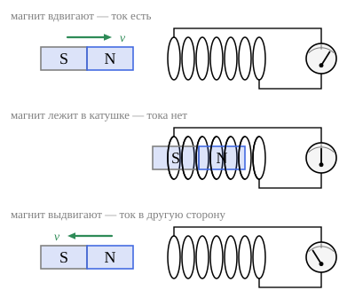

Ток создаёт магнитное поле — это мы знаем из опыта Эрстеда (урок 8.2). Майкл Фарадей поставил обратный вопрос: может ли магнитное поле создать ток? Десять лет опытов — и в 1831 году он нашёл ответ: может, но только меняющееся поле.

## Опыт с магнитом и катушкой

Соединим катушку из проволоки с **гальванометром** — чувствительным прибором, стрелка которого отклоняется даже от очень слабого тока, вправо или влево в зависимости от его направления. Батарейки в цепи нет.

- Вдвигаем в катушку магнит — стрелка отклоняется: по катушке идёт ток.
- Магнит остановился внутри катушки — стрелка возвращается к нулю. Магнит рядом, поле в катушке сильное, а тока нет.
- Выдвигаем магнит — стрелка отклоняется в другую сторону: ток идёт в обратном направлении.

Можно двигать не магнит, а катушку — результат тот же. Важно лишь, чтобы магнит и катушка двигались друг относительно друга.

## Что общего у этих опытов

Ток возникает и без магнита. Наденем на один железный сердечник две катушки: первую подключим к батарейке через ключ, вторую — к гальванометру. В момент, когда ключ замыкают, стрелка дёргается; пока ток в первой катушке постоянный — стоит на нуле; когда ключ размыкают — дёргается в другую сторону.

Во всех опытах ток идёт, только пока **меняется магнитное поле**, пронизывающее катушку: магнит приближается или удаляется, ток в соседней катушке нарастает или исчезает.

Возникновение тока в замкнутом проводнике при изменении магнитного поля, которое его пронизывает, называют **электромагнитной индукцией**, а сам ток — **индукционным**. Не путай с магнитной индукцией $B$ (урок 8.5): это величина, а электромагнитная индукция — явление.

<pp-task id="ks-ind-07"></pp-task>

## Быстрее — сильнее

Если резко выдернуть магнит, стрелка отклоняется сильнее, чем если вытягивать его медленно. Чем быстрее меняется поле, тем больше индукционный ток. Точный закон — в уроке 10.5.

На электростанции так и получают ток: в генераторе мощный электромагнит быстро вращается внутри обмоток — поле в них непрерывно меняется, и в обмотках идёт ток. Вращает генератор турбина: её крутит пар на тепловой и атомной станции или вода на гидроэлектростанции.

Проверь себя: по катушке, замкнутой на гальванометр, пропустили сильный постоянный магнит, и он остановился внутри. Пойдёт ли ток, пока магнит лежит?

Нет. Ток шёл, пока магнит двигался и поле в катушке менялось. Когда магнит остановился, поле в катушке постоянно — тока нет, как бы сильно ни было поле.

## Частые ловушки

- **Думают, что ток даёт само магнитное поле.** Ток даёт только изменение поля. Неподвижный магнит в неподвижной катушке тока не создаёт.
- **Забывают, что цепь должна быть замкнута.** Без замкнутого контура тока нет (что при этом всё же возникает — в уроке 10.6).
- **Путают магнитную индукцию и электромагнитную индукцию.** Первая — величина $B$, вторая — явление.

## Коротко

- Индукционный ток в замкнутом контуре идёт, только пока меняется магнитное поле, пронизывающее контур.
- Магнит вдвигают и выдвигают — ток идёт в разные стороны.
- Чем быстрее меняется поле, тем больше ток. На этом работают генераторы.

Дальше — урок 10.2: как сказать точно, «сколько поля» проходит через контур.
