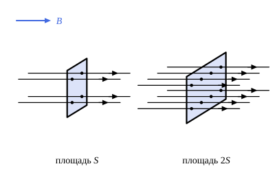

В уроке 10.1 ток появлялся, когда менялось поле, пронизывающее катушку. Но «поле в катушке» — слишком расплывчато. Нужна величина, которая учитывает и силу поля, и размер контура.

## Сколько линий проходит через рамку

Представь окно и ветер. Через окно проходит тем больше воздуха, чем сильнее ветер и чем больше окно. С магнитным полем так же. Нарисуем линии поля так, чтобы их густота показывала индукцию $B$: где поле сильнее, там линии гуще (урок 8.1). Тогда число линий, которые пронизывают рамку, тем больше, чем больше $B$ и чем больше площадь рамки $S$.

Эту величину называют **магнитным потоком** и обозначают греческой буквой $\Phi$ («фи»). Если линии однородного поля перпендикулярны плоскости контура,

$$
\Phi = B S.
$$

- $B$ — магнитная индукция, Тл;
- $S$ — площадь контура, м².

Единица потока — **вебер** (Вб), по имени немецкого физика Вильгельма Вебера: ${1\ \text{Вб} = 1\ \text{Тл} \cdot \text{м}^2.}$ Часто встречаются милливеберы: ${1\ \text{мВб} = 10^{-3}\ \text{Вб}.}$

**Пример.** Рамка размером ${25 \times 12\ \text{см}}$ находится в поле с индукцией ${0{,}25\ \text{Тл},}$ перпендикулярном её плоскости. Площадь ${S = 0{,}25 \cdot 0{,}12 = 0{,}03\ \text{м}^2,}$ поток

$$
\Phi = 0{,}25 \cdot 0{,}03 = 7{,}5 \cdot 10^{-3}\ \text{Вб} = 7{,}5\ \text{мВб}.
$$

<pp-task id="ks-ind-01"></pp-task>

## Как изменить поток

Поток зависит от индукции, от площади и от того, как рамка повёрнута к линиям. Поэтому его меняют тремя способами:

- **меняют индукцию**: двигают магнит, меняют ток в соседней катушке;
- **меняют площадь**: растягивают или сжимают гибкий виток, двигают перемычку по рельсам (урок 10.7);
- **поворачивают рамку**: если линии скользят вдоль плоскости рамки, они её не пронизывают и поток равен нулю (урок 10.4).

Теперь опыт Фарадея можно сказать точно: **индукционный ток в замкнутом контуре идёт, пока меняется магнитный поток через него.**

Если меняются сразу индукция и площадь, изменения перемножают, как в уроке 8.6. Например, если индукцию увеличить в $4$ раза, а площадь уменьшить в $4$ раза, поток не изменится — и тока не будет.

<pp-task id="ks-ind-08"></pp-task>

Проверь себя: в однородном поле рамку двигают, не поворачивая, — линии всё время перпендикулярны её плоскости. Будет ли в рамке ток?

Нет. Поле однородное, площадь и поворот не меняются, значит, поток ${\Phi = BS}$ остаётся прежним. Ток идёт, только когда поток меняется. Вот если рамка въезжает в поле или выезжает из него, поток меняется — и ток идёт.

## Частые ловушки

- **Оставляют площадь в квадратных сантиметрах.** ${1\ \text{см}^2 = 10^{-4}\ \text{м}^2,}$ а не ${10^{-2}.}$
- **Думают, что ток зависит от самого потока.** Большой, но постоянный поток тока не даёт — важно его изменение.
- **Складывают изменения вместо того, чтобы перемножать.** ${\Phi = BS}$ — произведение: изменения в разах перемножают.

## Коротко

- Магнитный поток — сколько линий поля пронизывает контур: ${\Phi = BS}$, если линии перпендикулярны контуру.
- Единица — вебер: ${1\ \text{Вб} = 1\ \text{Тл} \cdot \text{м}^2.}$
- Поток меняют индукцией, площадью и поворотом контура; ток идёт, пока поток меняется.

Дальше — урок 10.3: куда течёт индукционный ток.
