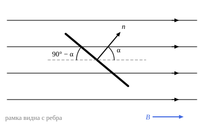
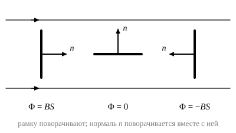

В уроке 10.2 линии поля были перпендикулярны рамке. А если рамку наклонить? Через наклонённое окно ветра проходит меньше, а если поставить его вдоль ветра — нисколько.

## Нормаль и угол

Направление рамки удобно задавать **нормалью** $\vec n$ — перпендикуляром к её плоскости. Поток через рамку в однородном поле

$$
\Phi = B S \cos\alpha,
$$

где $\alpha$ — угол между вектором $\vec B$ и нормалью $\vec n$.

Почему косинус? Разложим $\vec B$ на две части: вдоль нормали ${B\cos\alpha}$ и вдоль плоскости рамки. Часть вдоль плоскости скользит по рамке и её не пронизывает — работает только ${B\cos\alpha}$. Это похоже на силу Ампера, где работала часть проводника поперёк поля (урок 8.6), только там был синус: там угол отсчитывали от линий поля, а здесь — от перпендикуляра.

- ${\alpha = 0}$: линии перпендикулярны рамке, ${\Phi = BS}$ — наибольший поток, как в уроке 10.2.
- ${\alpha = 90^\circ}$: линии идут вдоль плоскости рамки, ${\Phi = 0}$.

**Пример.** Рамка площадью ${0{,}06\ \text{м}^2}$ в поле ${0{,}2\ \text{Тл};}$ нормаль составляет с линиями угол ${60^\circ\text{:}}$

$$
\Phi = 0{,}2 \cdot 0{,}06 \cdot \cos 60^\circ = 0{,}2 \cdot 0{,}06 \cdot 0{,}5 = 6 \cdot 10^{-3}\ \text{Вб} = 6\ \text{мВб}.
$$

Если в условии дан угол между линиями и **плоскостью** рамки, угол с нормалью равен $90^\circ$ минус он. Это частая ловушка ЕГЭ.

<pp-task id="ks-ind-02"></pp-task>

## Поворот рамки

Когда рамку поворачивают, вместе с ней поворачивается нормаль, и поток меняется.

Повернём рамку на $90^\circ$ из положения, где линии ей перпендикулярны: поток уменьшится от $BS$ до нуля, изменение ${|\Delta\Phi| = BS.}$

А если повернуть ещё на $90^\circ$? Нормаль смотрит **против** поля, ${\cos 180^\circ = -1}$, и ${\Phi = -BS.}$ Знак минус значит, что линии пронизывают рамку с другой стороны. Именно поэтому при повороте рамки на $180^\circ$ поток меняется не на ноль, а на ${2BS}$ — хотя «линий через рамку» столько же.

Так работает генератор: рамка равномерно вращается в поле, поток через неё меняется от $BS$ до $-BS$ и обратно, и в рамке непрерывно идёт ток — то в одну, то в другую сторону. Это **переменный ток**; о нём — в теме «Переменный ток и электромагнитные волны».

<pp-task id="ks-ind-11"></pp-task>

Проверь себя: линии поля составляют с плоскостью рамки угол 90°. Чему равен угол α в формуле потока и каким будет поток?

Линии перпендикулярны плоскости, значит, идут вдоль нормали: ${\alpha = 0}$, ${\cos 0 = 1}$ и ${\Phi = BS}$ — наибольший поток.

## Частые ловушки

- **Берут угол между линиями и плоскостью рамки.** В формулу входит угол с нормалью.
- **Путают синус и косинус.** Для потока — косинус угла с нормалью.
- **Забывают знак при повороте на 180°.** Поток меняется с $BS$ на $-BS$, изменение ${2BS}$, а не ноль.

## Коротко

- ${\Phi = BS\cos\alpha}$, $\alpha$ — угол между $\vec B$ и нормалью к рамке.
- Линии вдоль плоскости рамки — поток ноль.
- Поворот на $180^\circ$ из положения ${\Phi = BS}$ меняет поток на ${2BS}$.

Дальше — урок 10.5: от чего зависит ЭДС индукции — закон Фарадея.
