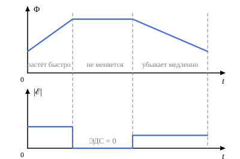

Индукционный ток тем больше, чем быстрее меняется поток (урок 10.1). Но ток зависит ещё и от сопротивления контура. Что же создаёт меняющийся поток — независимо от того, из чего сделан контур?

## ЭДС индукции

Меняющийся поток действует на заряды контура, как источник тока: создаёт в нём **ЭДС индукции** $\mathcal{E}_i$ — работу сторонних сил над каждым кулоном (урок 6.1). Сторонние силы здесь — не химические, как в батарейке, а созданные меняющимся магнитным полем.

**Закон электромагнитной индукции** (закон Фарадея): ЭДС индукции равна скорости изменения магнитного потока через контур, взятой с обратным знаком:

$$
\mathcal{E}_i = -\frac{\Delta \Phi}{\Delta t}.
$$

- $\Delta\Phi$ — изменение потока, Вб;
- $\Delta t$ — время, за которое оно произошло, с.

Минус — это правило Ленца (урок 10.3): ЭДС направлена так, чтобы ток мешал изменению потока. Направление мы находим правилом Ленца, а в расчётах нужен модуль:

$$
|\mathcal{E}_i| = \frac{|\Delta \Phi|}{\Delta t}.
$$

Проверим единицы: ${1\ \text{Вб/с} = 1\ \text{Тл} \cdot \text{м}^2/\text{с} = 1\ \text{В}.}$ Если поток меняется неравномерно, формула даёт среднюю ЭДС за время $\Delta t$.

**Пример.** Магнит выдернули из витка, и поток через виток уменьшился с ${8\ \text{мВб}}$ до нуля за ${0{,}05\ \text{с}.}$

$$
|\mathcal{E}_i| = \frac{8 \cdot 10^{-3}}{0{,}05} = 0{,}16\ \text{В}.
$$

Если выдернуть магнит вдвое быстрее, ЭДС будет вдвое больше. Изменение потока то же — важна быстрота.

<pp-task id="ks-ind-03"></pp-task>

## ЭДС по графику потока

Скорость изменения потока на графике $\Phi(t)$ — это его крутизна, как скорость на графике координаты (урок 1.5 из механики).

- Где график круче, там ЭДС больше.
- Где поток не меняется — горизонтальный участок, — ЭДС равна нулю, сколь бы большим ни был сам поток.
- Где поток растёт и где убывает, ЭДС имеет разные знаки: ток идёт в разные стороны.

На каждом прямом участке ЭДС постоянна: ${|\mathcal{E}_i| = |\Delta\Phi|/\Delta t}$ по концам участка.

<pp-task id="ks-ind-12"></pp-task>

Проверь себя: в момент, когда поток через виток наибольший, может ли ЭДС в нём быть равна нулю?

Может. ЭДС зависит не от самого потока, а от того, как быстро он меняется. В вершине графика, где поток перестаёт расти и начинает убывать, или на горизонтальном участке скорость изменения потока равна нулю.

## Частые ловушки

- **Делят сам поток на время.** В числителе — изменение потока ${|\Phi_2 - \Phi_1|.}$
- **Не переводят милливеберы в веберы.** ${1\ \text{мВб} = 10^{-3}\ \text{Вб}.}$
- **Ищут ЭДС по высоте графика $\Phi(t)$.** ЭДС — крутизна графика, а не его высота.

## Коротко

- Меняющийся поток создаёт в контуре ЭДС индукции: ${\mathcal{E}_i = -\Delta\Phi/\Delta t}$; минус — правило Ленца.
- В расчётах — модуль ${|\Delta\Phi|/\Delta t}$; ${1\ \text{Вб/с} = 1\ \text{В}.}$
- По графику $\Phi(t)$ ЭДС — его крутизна.

Дальше — урок 10.6: катушка из многих витков и индукционный ток.
