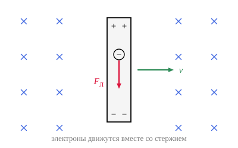

До сих пор поток менялся, потому что менялось поле или поворачивался контур. А если проводник просто движется в постоянном поле? Ответ мы знаем из темы «Сила Лоренца»: на каждый заряд, который движется в магнитном поле, действует сила (урок 9.1).

## Сила Лоренца на электроны проводника

Пусть металлический стержень летит поперёк однородного поля. Свободные электроны летят вместе с ним — и на каждый действует сила Лоренца.

Найдём её направление по правилу левой руки. Поле от нас — ладонь смотрит на нас; четыре пальца — вправо, по скорости положительного заряда. Большой палец показывает вверх: положительный заряд гнало бы вверх, а электроны сила гонит вниз. Электроны собираются у нижнего конца, верхний остаётся с нехваткой электронов: стержень стал источником с полюсами «+» сверху и «−» снизу.

Сила Лоренца здесь — та самая **сторонняя сила** (урок 6.1): она разделяет заряды, как химические силы в батарейке. Разделение идёт, пока электрическое поле разделённых зарядов не уравновесит силу Лоренца.

## Формула ЭДС

На заряд $q$, летящий со скоростью $v$ поперёк поля, действует сила ${F_{\text{Л}} = |q|vB}$ (урок 9.2), направленная вдоль стержня. Пройдя весь стержень длиной $l$, заряд получает от неё работу ${A = |q|vB \cdot l.}$ ЭДС — работа сторонних сил на единицу заряда:

$$
\mathcal{E}_i = \frac{A}{|q|} = B v l.
$$

Здесь стержень перпендикулярен и линиям поля, и своей скорости, а скорость перпендикулярна линиям. Если скорость направлена под углом $\alpha$ к линиям поля, работает только её часть поперёк поля, ${v\sin\alpha}$, как в уроке 9.2:

$$
\mathcal{E}_i = B v l \sin\alpha.
$$

Летит стержень вдоль линий — ЭДС нет: он их не пересекает.

**Пример.** Самолёт с размахом крыльев ${30\ \text{м}}$ летит горизонтально со скоростью ${250\ \text{м/с}.}$ Вертикальная часть поля Земли — около ${5 \cdot 10^{-5}\ \text{Тл}.}$ Между концами крыльев

$$
\mathcal{E}_i = 5 \cdot 10^{-5} \cdot 250 \cdot 30 \approx 0{,}38\ \text{В}.
$$

Измерить её вольтметром на борту нельзя: провода вольтметра летят вместе с крылом, и в них возникает такая же ЭДС.

<pp-task id="ks-ind-06"></pp-task>

<pp-task id="ks-ind-14"></pp-task>

<pp-task id="ks-ind-16"></pp-task>

## Стержень на рельсах

Положим стержень на два рельса, соединённые слева резистором $R$, и потянем его вдоль рельсов. Получился замкнутый контур, и стержень в нём — источник.

Ту же ЭДС даёт и закон Фарадея (урок 10.5). За время $\Delta t$ стержень проходит ${v\,\Delta t}$, и площадь контура растёт на ${\Delta S = l v\,\Delta t.}$ Поток растёт на ${\Delta\Phi = B l v\,\Delta t}$, и

$$
|\mathcal{E}_i| = \frac{\Delta\Phi}{\Delta t} = B v l.
$$

Два взгляда — сила Лоренца на электроны и изменение потока — дают один ответ. Если сопротивлением стержня и рельсов можно пренебречь, ток ${I = Bvl/R.}$

Куда он идёт? Поток растёт, поэтому по правилу Ленца поле тока направлено против внешнего — к нам, и ток идёт против часовой стрелки: вверх по стержню, как и показала сила Лоренца.

На стержень с током действует сила Ампера ${F_{\text{А}} = IBl}$ (урок 8.6). По правилу левой руки она направлена **против скорости** — снова правило Ленца: ток мешает движению, которое его вызвало. Чтобы стержень ехал равномерно, его надо тянуть с такой же силой. Работа этой силы и превращается в тепло в резисторе: мощность ${F_{\text{А}} v}$ (урок 11.7 из механики) равна ${I^2 R}$ (урок 7.4).

**Пример.** Рельсы на расстоянии ${80\ \text{см}}$ в поле ${0{,}25\ \text{Тл},}$ резистор ${1{,}6\ \text{Ом},}$ стержень едет со скоростью ${4\ \text{м/с}	ext{:}}$

$$
\begin{aligned}
\mathcal{E}_i &= 0{,}25 \cdot 4 \cdot 0{,}8 = 0{,}8\ \text{В}, \\
I &= \frac{0{,}8}{1{,}6} = 0{,}5\ \text{А}, \\
F_{\text{А}} &= 0{,}5 \cdot 0{,}25 \cdot 0{,}8 = 0{,}1\ \text{Н}.
\end{aligned}
$$

В модели стержень едет по рельсам. Меняй скорость ползунком, а направление поля и движения — кнопками. Без настройки «уменьшить движение» стержень скользит по рельсам и начинает сначала; в таблице — ЭДС, ток, сила Ампера и направление тока.

<pp-rails>Модель: вид сверху на рельсы, соединённые резистором 0,5 Ом, в магнитном поле 0,5 Тл, перпендикулярном рисунку; по рельсам скользит стержень длиной 0,4 м. Ползунок меняет скорость от 1 до 5 м/с, кнопки — направление поля и движения; стрелки показывают скорость, индукционный ток и силу Ампера, таблица — поток, ЭДС, ток, силу и направление тока.</pp-rails>

Попробуй:

- поменяй направление движения: куда теперь направлена сила Ампера?
- поменяй направление поля: что стало с током?
- увеличь скорость вдвое: во сколько раз выросли ЭДС, ток и сила?

<pp-task id="ks-ind-15"></pp-task>

Проверь себя: стержень на рельсах толкнули и отпустили. Трения нет. Будет ли он ехать с постоянной скоростью?

Нет. По контуру идёт индукционный ток, и сила Ампера тормозит стержень. Он замедляется, а его кинетическая энергия уходит в тепло в резисторе. Вот если цепь разомкнуть — убрать резистор, — тока нет, и стержень едет равномерно.

## Частые ловушки

- **Берут угол не с линиями поля.** В ${\mathcal{E}_i = Bvl\sin\alpha}$ $\alpha$ — угол между скоростью и линиями поля; поперёк поля ${\sin\alpha = 1}$.
- **Путают, какой конец положительный.** Правило левой руки даёт силу на положительный заряд; туда собираются «+», а электроны — к другому концу.
- **Направляют силу Ампера по скорости.** На стержень на рельсах она всегда тормозит — иначе энергия бралась бы из ниоткуда.

## Коротко

- В движущемся проводнике сила Лоренца разделяет заряды: ${\mathcal{E}_i = Bvl\sin\alpha}$.
- Положительный конец — куда правило левой руки направляет силу на положительный заряд.
- Стержень на рельсах: ${I = Bvl/R}$, сила Ампера ${IBl}$ тормозит его — правило Ленца.

Это последний урок темы. Дальше — тема «Самоиндукция и энергия магнитного поля»: что происходит, когда меняется ток в самой катушке.
