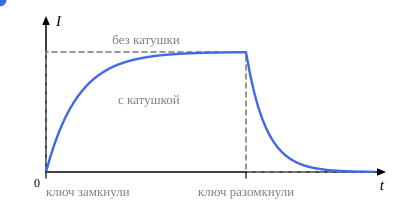

Выдерни вилку работающего пылесоса — между контактами проскочит искра. Откуда взялось напряжение, если цепь разорвана? Это самоиндукция. Тема встречается в задаче 12 и в задачах 14–15.

Само явление показывают в 9 классе. Индуктивность, ЭДС самоиндукции и энергию магнитного поля — в 11. Пригодится тема «Электромагнитная индукция»: самоиндукция — её частный случай.

## Шаг 1. Самоиндукция (9 класс)

Собери цепь из двух одинаковых ламп: одну подключи через резистор, другую — через катушку с железным сердечником. Замкни ключ. Лампа с резистором вспыхнет сразу, а лампа с катушкой разгорится с заметной задержкой.

Причина: ток в катушке создаёт её собственное магнитное поле. Когда ток растёт, растёт и поток через саму катушку, и в ней возникает ЭДС индукции. По правилу Ленца она мешает росту тока. Это явление называют **самоиндукцией**.

## Шаг 2. Индуктивность (11 класс)

Магнитный поток через катушку, созданный её собственным током, пропорционален току:

$$
\Phi = L I.
$$

Коэффициент $L$ — **индуктивность**. Единица — генри (Гн): $1\ \text{Гн} = 1\ \text{Вб/А}$. Индуктивность зависит от формы и размеров катушки, числа витков и сердечника: железный сердечник увеличивает её во много раз.

<pp-task id="ks-self-01"></pp-task>

## Шаг 3. ЭДС самоиндукции (11 класс)

Если ток в катушке меняется, меняется и её собственный магнитный поток $\Phi = LI$. По закону Фарадея:

$$
\mathcal{E}_{si} = -L\,\frac{\Delta I}{\Delta t}.
$$

- $L$ — индуктивность, Гн;
- $\Delta I/\Delta t$ — скорость изменения тока, А/с.

По правилу Ленца ЭДС самоиндукции **противодействует изменению тока**:

- при замыкании цепи ток нарастает не мгновенно, а постепенно — катушка «тормозит» рост;
- при размыкании ток пытается сохраниться, и быстрое изменение тока даёт большую ЭДС — отсюда искра.

<pp-task id="ks-self-02"></pp-task>

## Шаг 4. Ток в катушке не меняется скачком (11 класс)

Катушка ведёт себя как «электрическая инерция»: как масса не даёт мгновенно изменить скорость, так индуктивность не даёт мгновенно изменить ток. В момент замыкания ток через катушку равен нулю, в момент размыкания — прежнему значению.

Чем меньше время изменения тока, тем больше ЭДС: $|\mathcal{E}_{si}| = L|\Delta I|/\Delta t$. Отсюда же можно найти, за какое время ток изменится при данной ЭДС: $\Delta t = L|\Delta I|/|\mathcal{E}_{si}|$.

<pp-task id="ks-self-03"></pp-task>

## Шаг 5. Энергия магнитного поля (11 класс)

Чтобы создать ток в катушке, источник совершает работу против ЭДС самоиндукции. Эта работа запасается в магнитном поле катушки:

$$
W = \frac{L I^2}{2}.
$$

- $L$ — индуктивность, Гн;
- $I$ — сила тока, А;
- $W$ — энергия, Дж.

Сравни с кинетической энергией $mv^2/2$: индуктивность играет роль массы, ток — роль скорости. Это сходство пригодится в теме про колебательный контур. При размыкании цепи именно эта энергия выделяется в искре.

<pp-task id="ks-self-04"></pp-task>

## Шаг 6. Как меняется энергия (11 класс)

Энергия пропорциональна **квадрату** тока: ток вдвое больше — энергия вчетверо. Изменение энергии считают как разность: $\Delta W = \dfrac{L I_2^2}{2} - \dfrac{L I_1^2}{2}$, а не как $L(\Delta I)^2/2$.

<pp-task id="ks-self-05"></pp-task>

## Шаг 7. Где встречается самоиндукция (11 класс)

- В лампах дневного света старого типа катушка (дроссель) при размыкании даёт импульс высокого напряжения, который зажигает лампу.
- В системе зажигания автомобиля ток в катушке резко прерывают, и ЭДС самоиндукции в тысячи вольт даёт искру в свече.
- Рубильники мощных электродвигателей размыкают осторожно: иначе искра или дуга повредит контакты.

Во всех случаях работает одна идея: чем быстрее меняется ток, тем больше ЭДС самоиндукции.

## Частые ловушки

- **Думают, что ЭДС самоиндукции зависит от самого тока.** Она зависит от **скорости изменения** тока. Постоянный ток — никакой самоиндукции.
- **Забывают, что ток в катушке не может измениться скачком.** В момент замыкания ток через катушку равен нулю, в момент размыкания — прежнему значению.
- **В энергии забывают возвести ток в квадрат.** Ток вдвое больше — энергия вчетверо.

## Как это выглядит на ЕГЭ

*Сила тока в катушке индуктивностью $0{,}4\ \text{Гн}$ равномерно увеличилась с $1\ \text{А}$ до $3\ \text{А}$ за $0{,}1\ \text{с}$. Найди ЭДС самоиндукции и изменение энергии магнитного поля.*

ЭДС самоиндукции по модулю:

$$
|\mathcal{E}_{si}| = L\frac{\Delta I}{\Delta t} = 0{,}4 \cdot \frac{2}{0{,}1} = 8\ \text{В}.
$$

Энергия была $\dfrac{0{,}4 \cdot 1}{2} = 0{,}2\ \text{Дж}$, стала $\dfrac{0{,}4 \cdot 9}{2} = 1{,}8\ \text{Дж}$. Изменение $1{,}6\ \text{Дж}$.

Заметь: ток вырос в 3 раза, а энергия — в 9.

## Коротко

- $\Phi = LI$, индуктивность в генри.
- $|\mathcal E_{si}| = L|\Delta I|/\Delta t$; противодействует изменению тока.
- Ток в катушке не меняется скачком.
- $W = LI^2/2$; $\Delta W$ — разность энергий, а не $L(\Delta I)^2/2$.
