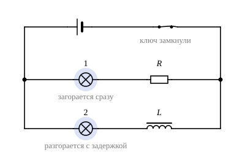
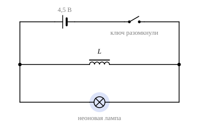
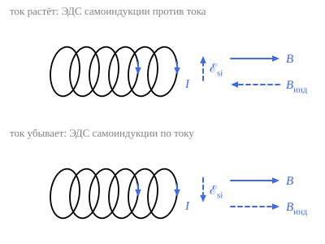

В теме «Электромагнитная индукция» поле менял кто-то снаружи: вдвигал магнит, поворачивал рамку, включал соседнюю катушку (урок 10.1). Но катушка с током и сама создаёт магнитное поле (урок 8.3). Что будет, если меняется ток в самой катушке?

## Опыт с двумя лампами

Соберём цепь из двух одинаковых ламп. Лампа 1 подключена через резистор, лампа 2 — через катушку из многих витков на железном сердечнике. Сердечник во много раз усиливает поле катушки (урок 8.3). Резистор подобран так, чтобы сопротивления обеих ветвей были одинаковы: когда ток установится, лампы горят одинаково ярко.

Замкнём ключ. Лампа 1 вспыхивает сразу. Лампа 2 разгорается постепенно, с заметной задержкой — примерно за секунду. Что-то в ветви с катушкой мешает току сразу стать полным.

## Опыт с размыканием

Теперь включим катушку на сердечнике параллельно неоновой лампе и подключим к батарейке на ${4{,}5\ \text{В}.}$ Неоновой лампе для свечения нужно около $80$ вольт, поэтому, пока ключ замкнут, она не горит: ток идёт через катушку.

Разомкнём ключ — неоновая лампа ярко вспыхивает. Батарейка отключена, а на лампе на мгновение оказалось напряжение в десятки вольт. Откуда? Из той же катушки. Без лампы энергия ушла бы в искру между контактами ключа — та самая искра у вилки пылесоса, в котором тоже есть катушки: обмотки двигателя.

## Почему так

Ток катушки создаёт её **собственное** магнитное поле, и линии этого поля пронизывают её же витки. Пока ток постоянный, поток через катушку не меняется, и ничего особенного не происходит. Но когда ток меняется, меняется и поток через саму катушку — а меняющийся поток, как мы знаем, создаёт ЭДС индукции (урок 10.1).

Это явление называют **самоиндукцией**: ЭДС индукции возникает в проводнике из-за изменения тока в нём самом. Её называют **ЭДС самоиндукции** и обозначают $\mathcal{E}_{si}$.

Куда она направлена, подсказывает правило Ленца (урок 10.3): индукционный ток мешает изменению потока, который его вызвал.

- **Ток растёт** — растёт и поток. ЭДС самоиндукции направлена **против тока** и мешает ему расти. Поэтому лампа 2 разгорается не сразу.
- **Ток убывает** — убывает и поток. ЭДС самоиндукции направлена **по току** и пытается его поддержать. Поэтому при размыкании катушка «толкает» ток дальше — через неоновую лампу или через искру.

Коротко: самоиндукция мешает **любому изменению** тока — и росту, и убыванию.

<pp-task id="ks-self-06"></pp-task>

Проверь себя: по катушке давно идёт постоянный ток. Есть ли в ней ЭДС самоиндукции?

Нет. Поле катушки есть, но оно не меняется, и поток через катушку постоянен. ЭДС самоиндукции появляется, только пока ток меняется.

## Частые ловушки

- **Думают, что катушка просто «плохо пропускает» ток.** Когда ток установился, катушка — обычный провод: лампы в опыте горят одинаково. Мешает она только изменению тока.
- **Считают, что ЭДС самоиндукции всегда против тока.** Против тока — пока ток растёт. Когда ток убывает, она направлена по току.

## Коротко

- Самоиндукция — ЭДС индукции в катушке из-за изменения тока в ней самой.
- По правилу Ленца она мешает изменению тока: растущему — против тока, убывающему — по току.
- При замыкании ток в цепи с катушкой нарастает постепенно; при размыкании катушка поддерживает ток — отсюда искра.

Дальше — урок 11.2: от чего зависит, насколько сильна самоиндукция.
