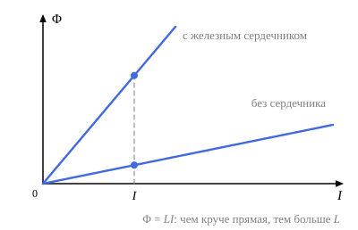

В опыте с двумя лампами (урок 11.1) лампа с катушкой разгоралась с задержкой. Возьми катушку без сердечника — задержка станет почти незаметной. Значит, одни катушки «сопротивляются» изменению тока сильнее, другие слабее. Чем это измерить?

## Поток пропорционален току

Магнитная индукция поля катушки пропорциональна её току: ток вдвое больше — поле вдвое сильнее (урок 8.3). Значит, и магнитный поток через катушку, созданный её же током, растёт пропорционально току (урок 10.2):

$$
\Phi = L I.
$$

- $\Phi$ — собственный магнитный поток катушки, Вб;
- $I$ — сила тока в ней, А;
- $L$ — **индуктивность** катушки.

Для катушки из $N$ витков $\Phi$ здесь — поток через все витки вместе, то есть $N$ раз поток через один виток (урок 10.6).

Единица индуктивности — **генри** (Гн), в честь американского физика Джозефа Генри, открывшего самоиндукцию:

$$
1\ \text{Гн} = 1\ \frac{\text{Вб}}{\text{А}}.
$$

Индуктивность в $1\ \text{Гн}$ у катушки, в которой ток $1\ \text{А}$ создаёт поток ${1\ \text{Вб}.}$ Это много: у катушек в электронике индуктивность — микро- и миллигенри, у катушки на железном сердечнике из школьного кабинета — порядка генри.

На графике $\Phi(I)$ — прямая из начала координат, и чем она круче, тем больше индуктивность.

**Пример.** Ток ${1{,}5\ \text{А}}$ создаёт в катушке поток ${12\ \text{мВб}.}$ Её индуктивность

$$
L = \frac{\Phi}{I} = \frac{12 \cdot 10^{-3}}{1{,}5} = 8 \cdot 10^{-3}\ \text{Гн} = 8\ \text{мГн}.
$$

<pp-task id="ks-self-01"></pp-task>

## От чего зависит индуктивность

Индуктивность — свойство самой катушки, как ёмкость — свойство конденсатора (урок 4.1). Она зависит от того, как катушка устроена:

- **число витков** — чем больше витков, тем больше $L$: каждый виток и усиливает поле, и сам пронизан им;
- **размеры и форма** — у широкой катушки больше площадь витков, а значит, и поток;
- **сердечник** — железный сердечник усиливает поле катушки в сотни и тысячи раз (урок 8.3) и во столько же раз увеличивает индуктивность.

А от тока индуктивность **не зависит**. Ток вырос — во столько же раз вырос поток, а их отношение ${L = \Phi/I}$ осталось прежним. Так и ёмкость ${C = q/U}$ не зависит от заряда конденсатора.

<pp-task id="ks-self-07"></pp-task>

<pp-task id="ks-self-08"></pp-task>

Проверь себя: из катушки вынули железный сердечник, а ток оставили прежним. Что стало с потоком через катушку?

Он сильно уменьшился. Без сердечника поле катушки слабее, её индуктивность меньше, и при том же токе ${\Phi = LI}$ во много раз меньше. Поэтому и в опыте с двумя лампами задержка почти пропадает.

## Частые ловушки

- **Делят ток на индуктивность.** ${\Phi = LI}$ — поток равен произведению, а ${L = \Phi/I}$.
- **Думают, что $L$ зависит от тока.** Это свойство катушки: витки, размеры, сердечник. Ток меняет поток, а не $L$.
- **Не переводят миллигенри.** ${1\ \text{мГн} = 10^{-3}\ \text{Гн}.}$

## Коротко

- Собственный поток катушки пропорционален току: ${\Phi = LI}$.
- $L$ — индуктивность, ${1\ \text{Гн} = 1\ \text{Вб/А}.}$
- $L$ зависит от числа витков, размеров и сердечника, но не от тока.

Дальше — урок 11.3: какую ЭДС создаёт катушка, когда ток в ней меняется.
