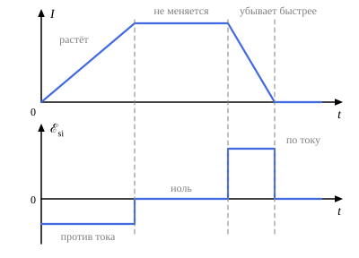

Мы знаем, куда направлена ЭДС самоиндукции (урок 11.1), и знаем, чем катушки отличаются друг от друга, — индуктивностью (урок 11.2). Осталось найти, чему эта ЭДС равна.

## Закон Фарадея для собственного потока

ЭДС индукции равна скорости изменения потока со знаком минус (урок 10.5). Собственный поток катушки ${\Phi = LI}$, а индуктивность не меняется, поэтому ${\Delta\Phi = L\,\Delta I}$ и

$$
\mathcal{E}_{si} = -L\,\frac{\Delta I}{\Delta t}.
$$

- $L$ — индуктивность, Гн;
- ${\Delta I/\Delta t}$ — скорость изменения тока, А/с.

Минус — это правило Ленца: ток растёт (${\Delta I > 0}$) — ЭДС против тока; ток убывает — по току. В расчётах нужен модуль:

$$
|\mathcal{E}_{si}| = L\,\frac{|\Delta I|}{\Delta t}.
$$

Проверим единицы: ${1\ \text{Гн} \cdot \text{А/с} = 1\ \text{Вб/с} = 1\ \text{В}.}$ Отсюда и другое определение генри: индуктивность в $1\ \text{Гн}$ у катушки, в которой ЭДС самоиндукции равна $1\ \text{В}$, когда ток меняется на $1\ \text{А}$ за секунду.

**Пример.** В катушке индуктивностью ${30\ \text{мГн}}$ ток равномерно вырос от нуля до ${8\ \text{А}}$ за ${0{,}02\ \text{с}.}$ Скорость изменения тока ${8/0{,}02 = 400\ \text{А/с},}$ и

$$
|\mathcal{E}_{si}| = 0{,}03 \cdot 400 = 12\ \text{В}.
$$

Если бы ток вырос до того же значения вдвое быстрее, ЭДС была бы вдвое больше. Важна быстрота изменения, а не сам ток.

<pp-task id="ks-self-02"></pp-task>

## ЭДС по графику тока

Скорость изменения тока — это крутизна графика $I(t)$, как крутизна графика потока в уроке 10.5.

- Где график круче, там ЭДС больше.
- Где ток постоянный — горизонтальный участок, — ЭДС самоиндукции равна нулю, каким бы большим ни был сам ток.
- Где ток растёт, ЭДС против тока; где убывает — по току.

На каждом прямом участке ЭДС постоянна: ${|\mathcal{E}_{si}| = L\,|\Delta I|/\Delta t}$ по концам участка.

<pp-task id="ks-self-09"></pp-task>

<pp-task id="ks-self-10"></pp-task>

Проверь себя: в одной катушке ток 1 А, в другой, такой же, — 100 А. Оба тока постоянные. В какой катушке ЭДС самоиндукции больше?

Ни в какой: в обеих она равна нулю. ЭДС самоиндукции зависит от того, как быстро меняется ток, а не от того, какой он.

## Частые ловушки

- **Умножают индуктивность на сам ток.** В формуле — изменение тока ${|\Delta I| = |I_2 - I_1|}$, делённое на время.
- **Ищут ЭДС по высоте графика $I(t)$.** ЭДС — его крутизна, умноженная на $L$.
- **Забывают перевести миллигенри и миллисекунды** в генри и секунды.

## Коротко

- ${\mathcal{E}_{si} = -L\,\Delta I/\Delta t}$; в расчётах ${|\mathcal{E}_{si}| = L\,|\Delta I|/\Delta t}$.
- Минус — правило Ленца: растущему току ЭДС противодействует, убывающий поддерживает.
- По графику $I(t)$ ЭДС пропорциональна его крутизне; при постоянном токе её нет.

Дальше — урок 11.4: что из этого следует для цепи с катушкой в момент замыкания и размыкания.
