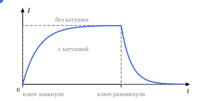

Лампа с катушкой разгорается с задержкой (урок 11.1). Почему ток в ней не может стать полным сразу? Посмотрим на формулу ${|\mathcal{E}_{si}| = L\,|\Delta I|/\Delta t}$ из урока 11.3 внимательнее.

## Электрическая инерция

Пусть ток в катушке изменился на $\Delta I$ мгновенно, за ${\Delta t \to 0}$. Тогда ЭДС самоиндукции была бы бесконечной. Такого не бывает, поэтому:

**ток в катушке не может измениться скачком** — только постепенно, за какое-то время.

Это похоже на инерцию в механике. Масса тела не даёт мгновенно изменить его скорость (урок 5.1 из механики): чем больше масса, тем дольше разгон. Индуктивность не даёт мгновенно изменить ток: чем больше $L$, тем медленнее ток растёт и убывает. Поэтому катушку называют «электрической инерцией».

Обрати внимание: скачком не меняется именно ток **через катушку**. Ток в соседней ветви, где катушки нет, может измениться мгновенно — так вспыхивает лампа 1 в опыте с двумя лампами.

## Замыкание: сразу и спустя долгое время

В задачах о цепи с катушкой обычно спрашивают о двух моментах.

- **Сразу после замыкания** ток через катушку такой же, как был до замыкания, — ноль. Катушка ведёт себя как **разрыв цепи**. Вся ЭДС источника в этот момент уравновешена ЭДС самоиндукции.
- **Спустя долгое время** ток постоянный, ЭДС самоиндукции нет. Катушка ведёт себя как **обычный провод** со своим сопротивлением, обычно очень малым.

**Пример.** Источник с ЭДС ${12\ \text{В}}$ и внутренним сопротивлением ${1\ \text{Ом}}$ замкнули на катушку и резистор ${7\ \text{Ом},}$ соединённые последовательно; сопротивлением катушки можно пренебречь. Сразу после замыкания ключа ток в цепи равен нулю. Спустя долгое время катушка — просто провод, и по закону Ома для полной цепи (урок 6.2)

$$
I = \frac{\mathcal{E}}{R + r} = \frac{12}{7 + 1} = 1{,}5\ \text{А}.
$$

<pp-task id="ks-self-11"></pp-task>

## Размыкание: откуда искра

Перед размыканием через катушку идёт ток. Сразу после размыкания он **прежний** — скачком исчезнуть он не может. Если рядом есть замкнутый путь — например, вторая ветвь с лампой, — ток катушки идёт через него и постепенно затухает. Через лампу 1 он идёт в обратную сторону: она не гаснет сразу, а вспыхивает и гаснет вместе с лампой 2.

А если пути нет, ток должен упасть до нуля почти мгновенно. Тогда ${\Delta t}$ очень мало, и ЭДС самоиндукции огромна — сотни и тысячи вольт. Она пробивает воздух между расходящимися контактами: проскакивает искра, и ток катушки идёт через неё.

Из той же формулы можно найти, за какое время ток изменится при данной ЭДС самоиндукции:

$$
\Delta t = \frac{L\,|\Delta I|}{|\mathcal{E}_{si}|}.
$$

<pp-task id="ks-self-03"></pp-task>

## Модель: две лампы

В модели — опыт с двумя лампами из урока 11.1. Сопротивления ветвей одинаковые, источник без внутреннего сопротивления. Замыкай и размыкай ключ кнопкой, вынимай сердечник. Без настройки «уменьшить движение» время после переключения идёт само; ползунком можно вернуться к любому моменту. На графике — токи через обе лампы, в таблице — их значения и ЭДС самоиндукции.

<pp-lamps>Модель: батарея 6 В и ключ, две параллельные ветви сопротивлением 15 Ом каждая — лампа 1 с резистором и лампа 2 с катушкой индуктивностью 6 Гн (без сердечника 0,3 Гн). Кнопка замыкает и размыкает ключ, ползунок показывает момент после переключения; лампы светятся тем ярче, чем больше ток, график показывает токи через обе лампы, таблица — токи и ЭДС самоиндукции.</pp-lamps>

Попробуй:

- замкни ключ и верни ползунок к нулю: какой ток через лампу 2 и какая ЭДС самоиндукции в первый момент?
- дождись, пока ток установится, и разомкни ключ: куда теперь идёт ток через лампу 1 и чему равна ЭДС самоиндукции?
- вынь сердечник и повтори: что изменилось?

Проверь себя: почему в модели при размыкании ЭДС самоиндукции больше ЭДС батареи?

После размыкания ток катушки идёт через обе ветви, и сопротивление его пути вдвое больше, чем было у ветви с катушкой. Ток в первый момент прежний, значит, и напряжение, которое нужно, чтобы его поддержать, вдвое больше. Его и даёт ЭДС самоиндукции. Чем больше сопротивление пути — а у воздушного промежутка между контактами оно огромно, — тем больше ЭДС: отсюда искра.

## Частые ловушки

- **Считают, что сразу после замыкания ток через катушку полный.** Он нулевой: катушка в этот момент — разрыв.
- **Считают, что после размыкания ток катушки сразу пропадает.** Он прежний и затухает постепенно — через соседнюю ветвь или искру.
- **Путают ток через катушку с током в соседней ветви.** Скачком не меняется только ток через катушку.

## Коротко

- Ток через катушку не меняется скачком: индуктивность — «электрическая инерция».
- Сразу после замыкания катушка — разрыв, спустя долгое время — провод.
- При размыкании ток катушки прежний; быстрый обрыв даёт огромную ЭДС и искру. ${\Delta t = L\,|\Delta I|/|\mathcal{E}_{si}|.}$

Дальше — урок 11.5: откуда берётся энергия искры.
