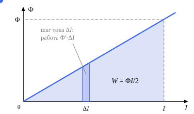

При размыкании катушка зажигает неоновую лампу и даёт искру (урок 11.1), хотя батарея уже отключена. Значит, в катушке с током запасена энергия. Где она хранится и сколько её?

## Откуда энергия

Пока ток в катушке растёт, ЭДС самоиндукции направлена против тока (урок 11.3). Источник «проталкивает» заряды против неё и совершает работу. Эта работа не пропадает: она запасается, как работа на сжатие пружины запасается в её энергии. Когда ток исчезает, ЭДС самоиндукции поддерживает его, и запасённая энергия возвращается: в искре, в лампе, в нагреве проводов.

Где именно она хранится? В магнитном поле катушки. Поэтому говорят: энергия катушки с током — это **энергия магнитного поля**.

## Почему половина

Пусть за малое время ток вырос на ${\Delta I}$, а поток — на ${\Delta\Phi = L\,\Delta I}$. ЭДС самоиндукции по модулю ${\Delta\Phi/\Delta t}$, и через катушку за это время прошёл заряд ${I'\Delta t}$, где $I'$ — ток в этот момент. Работа источника против ЭДС — ЭДС, умноженная на заряд (урок 6.1):

$$
\frac{\Delta\Phi}{\Delta t} \cdot I'\Delta t = I'\,\Delta\Phi = \Phi'\,\Delta I,
$$

где ${\Phi' = LI'}$ — поток в этот момент. Последний шаг — та же подстановка: ${I'\,L\,\Delta I = (LI')\,\Delta I.}$

Работа на один шаг — площадь узкой полоски под графиком $\Phi(I)$. Все полоски вместе — треугольник с катетами $I$ и $\Phi$:

$$
W = \frac{\Phi I}{2}.
$$

Так же мы находили энергию конденсатора — площадь треугольника под графиком $U(q)$ (урок 4.4).

## Три формулы — одна энергия

Подставим ${\Phi = LI}$ или ${I = \Phi/L}$:

$$
W = \frac{\Phi I}{2} = \frac{L I^2}{2} = \frac{\Phi^2}{2L}.
$$

- $L$ — индуктивность, Гн;
- $I$ — сила тока, А;
- $W$ — энергия, Дж.

Чаще всего нужна средняя формула. Сравни её с кинетической энергией ${mv^2/2}$ (урок 12.2 из механики): индуктивность играет роль массы, ток — роль скорости. Это та же «электрическая инерция» из урока 11.4, и это сходство ещё пригодится в теме «Колебательный контур».

**Пример.** По катушке индуктивностью ${0{,}15\ \text{Гн}}$ идёт ток ${6\ \text{А}.}$ Энергия её поля

$$
W = \frac{L I^2}{2} = \frac{0{,}15 \cdot 36}{2} = 2{,}7\ \text{Дж}.
$$

<pp-task id="ks-self-04"></pp-task>

Если известна энергия, а нужен ток, выражаем его: ${I = \sqrt{2W/L}.}$

<pp-task id="ks-self-12"></pp-task>

Проверь себя: две катушки, индуктивность второй вдвое больше. Токи в них одинаковые. У какой катушки энергия поля больше и во сколько раз?

У второй, вдвое: при одинаковом токе ${W = LI^2/2}$ пропорциональна $L$ — как кинетическая энергия тел с одной скоростью пропорциональна массе.

## Частые ловушки

- **Забывают возвести ток в квадрат.** ${W = LI^2/2}$, а не ${LI/2}$.
- **Забывают поделить на 2.** Ток рос от нуля, и поток вместе с ним — отсюда половина, как у конденсатора и пружины.
- **Ищут энергию в проводе катушки.** Она запасена в магнитном поле: нет тока — нет поля — нет энергии.

## Коротко

- Источник совершает работу против ЭДС самоиндукции; она запасается в магнитном поле.
- ${W = \Phi I/2 = LI^2/2 = \Phi^2/(2L)}$ — площадь треугольника под графиком $\Phi(I)$.
- $L$ — как масса, $I$ — как скорость: сравни с ${mv^2/2}$.

Дальше — урок 11.6: как меняется энергия поля и куда она уходит.
