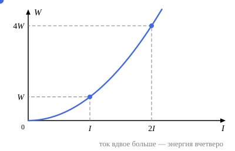

Энергия поля катушки ${W = LI^2/2}$ (урок 11.5). Как она меняется вместе с током — и куда девается, когда ток пропадает?

## Энергия растёт как квадрат тока

Ток входит в формулу в квадрате, поэтому энергия растёт быстрее тока:

Ток вдвое больше — энергия вчетверо больше. Ток вдвое меньше — энергия вчетверо меньше. Так же кинетическая энергия растёт как квадрат скорости.

Отсюда главное правило: **изменение энергии — это разность энергий**, а не энергия изменения тока:

$$
\Delta W = \frac{L I_2^2}{2} - \frac{L I_1^2}{2} \ne \frac{L (\Delta I)^2}{2}.
$$

**Пример.** Ток в катушке индуктивностью ${0{,}8\ \text{Гн}}$ увеличили с ${2\ \text{А}}$ до ${7\ \text{А}.}$

$$
\begin{aligned}
W_1 &= \frac{0{,}8 \cdot 2^2}{2} = 1{,}6\ \text{Дж}, \\
W_2 &= \frac{0{,}8 \cdot 7^2}{2} = 19{,}6\ \text{Дж}, \\
\Delta W &= 19{,}6 - 1{,}6 = 18\ \text{Дж}.
\end{aligned}
$$

А ошибочная формула дала бы ${0{,}8 \cdot 5^2/2 = 10\ \text{Дж}}$ — почти вдвое меньше верного.

<pp-task id="ks-self-05"></pp-task>

<pp-task id="ks-self-13"></pp-task>

## Ток исчез — энергия выделилась

Отключим катушку с током от источника, замкнув её на резистор. Ток катушки скачком не исчезнет (урок 11.4): он идёт через резистор и постепенно затухает. Пока он идёт, резистор нагревается (урок 7.4). Когда ток упадёт до нуля, поля не останется, и вся его энергия перейдёт в теплоту:

$$
Q = \frac{L I^2}{2},
$$

где $I$ — ток в момент отключения. Сопротивление резистора влияет только на то, как быстро затухнет ток, но не на теплоту: она всегда равна запасённой энергии. Если резисторов несколько, эта теплота делится между ними.

<pp-task id="ks-self-14"></pp-task>

## Где встречается самоиндукция

Во всех примерах работает одна идея: чем быстрее обрывается ток, тем больше ЭДС самоиндукции, а запасённая энергия уходит в искру.

- **Зажигание автомобиля.** Ток в катушке зажигания резко прерывают, и ЭДС самоиндукции — десятки тысяч вольт во вторичной обмотке — даёт искру в свече, которая поджигает топливо.
- **Лампы дневного света старого типа.** Катушка-дроссель при размыкании стартёра даёт импульс высокого напряжения, который зажигает лампу.
- **Рубильники мощных двигателей** размыкают осторожно и снабжают дугогасящими устройствами: иначе дуга, в которую уходит энергия обмоток, разрушит контакты.
- **Реле и электромагниты** в электронике защищают диодом, включённым параллельно катушке: при отключении ток катушки затухает через диод, а не пробивает транзистор.

Проверь себя: ток в катушке увеличили втрое. Во сколько раз выросла энергия её поля?

В девять раз. Индуктивность не изменилась, а энергия пропорциональна квадрату тока: ${3^2 = 9}$.

## Частые ловушки

- **Считают $\Delta W$ как ${L(\Delta I)^2/2}$.** Найди энергию до и после и вычти.
- **Делают энергию пропорциональной току.** Она пропорциональна квадрату тока.
- **Думают, что теплота зависит от сопротивления резистора.** Всё равно выделится вся энергия поля ${LI^2/2}$ — меняется только время.

## Коротко

- ${W \propto I^2}$: ток вдвое больше — энергия вчетверо.
- ${\Delta W = LI_2^2/2 - LI_1^2/2}$, а не ${L(\Delta I)^2/2}$.
- Когда ток в катушке исчезает, энергия ${LI^2/2}$ уходит в теплоту или искру.

Это последний урок темы. Дальше — тема «Колебательный контур»: катушка и конденсатор вместе, и энергия переходит из магнитного поля в электрическое и обратно.
