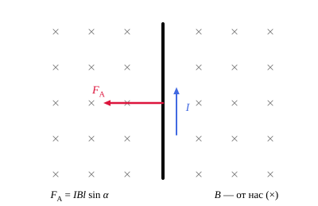

Магнит на холодильнике, компас, электродвигатель в пылесосе — всё это магнитные явления. Тема встречается в задаче 12 и в задачах 14–15.

Магниты и опыт Эрстеда проходят в 8 классе, правила буравчика и левой руки и индукцию — в 9, силу Ампера с углом и задачи на равновесие — в 11. Пригодятся темы «Закон Ома» (сила тока), «Законы Ньютона» и «Работа и мощность».

## Шаг 1. Магниты и опыт Эрстеда (8 класс)

У магнита два полюса — северный и южный. Одноимённые полюса отталкиваются, разноимённые притягиваются. Стрелка компаса — маленький магнит, и Земля тоже магнит: поэтому стрелка показывает на север.

Поднеси компас к проводу, по которому идёт ток, — стрелка отклонится. Значит, ток создаёт вокруг себя **магнитное поле**. Это открыл Эрстед. Источники магнитного поля — движущиеся заряды: токи и постоянные магниты (в них токи внутри атомов).

Магнитное поле действует на магниты, на движущиеся заряды и на проводники с током.

## Шаг 2. Линии поля и правило буравчика (9 класс)

Поле изображают **линиями магнитной индукции**. Направление поля — туда, куда указывает северный конец магнитной стрелки. Линии всегда **замкнуты**: у магнитного поля нет «зарядов», на которых линии начинались бы. Вне магнита линии идут от северного полюса к южному.

Как направлены линии вокруг прямого провода с током? Возьми буравчик (или правую руку): если поступательное движение буравчика совпадает с направлением тока, то вращение его ручки показывает направление линий магнитной индукции. Линии — концентрические окружности вокруг провода.

Для катушки (соленоида) с током: обхвати катушку правой рукой так, чтобы четыре пальца шли по току в витках, — отогнутый большой палец укажет направление поля внутри катушки, то есть на её северный полюс.

## Шаг 3. Магнитная индукция (9 класс)

Силовая характеристика магнитного поля — **вектор магнитной индукции** $\vec B$. Его модуль измеряют по силе, с которой поле действует на проводник с током, расположенный **перпендикулярно** линиям поля:

$$
B = \frac{F}{I l}.
$$

Единица — тесла (Тл): $1\ \text{Тл}$ — поле, которое действует на проводник длиной $1\ \text{м}$ с током $1\ \text{А}$ с силой $1\ \text{Н}$. Поле Земли — около $5 \cdot 10^{-5}\ \text{Тл}$, магнита на холодильнике — сотые доли тесла.

<pp-task id="ks-amp-01"></pp-task>

## Шаг 4. Сила Ампера и правило левой руки (9 класс)

Из шага 3: на проводник длиной $l$ с током $I$, перпендикулярный полю, действует сила

$$
F_{\text{А}} = I B l.
$$

**Правило левой руки**: расположи левую руку так, чтобы линии $\vec B$ входили в ладонь, а четыре пальца шли по току. Отогнутый на $90^\circ$ большой палец покажет направление силы Ампера.

На силе Ампера работают электродвигатели и динамики: рамка с током в поле магнита поворачивается.

<pp-task id="ks-amp-02"></pp-task>

## Шаг 5. Проводник под углом к полю (11 класс)

Если проводник расположен под углом к линиям поля, работает только перпендикулярная полю составляющая:

$$
F_{\text{А}} = I B l \sin\alpha.
$$

- $\alpha$ — угол между направлением тока и вектором $\vec B$.

Если провод параллелен линиям поля, сила равна нулю. Если перпендикулярен — максимальна.

<pp-task id="ks-amp-03"></pp-task>

## Шаг 6. Как меняется сила Ампера (11 класс)

Сила пропорциональна каждому множителю: $I$, $B$, $l$ и $\sin\alpha$. В задачах 15 «как изменится сила» достаточно перемножить изменения: ток вдвое больше — сила вдвое больше; угол с $90^\circ$ стал $30^\circ$ — сила уменьшилась вдвое ($\sin 30^\circ = 0{,}5$).

<pp-task id="ks-amp-04"></pp-task>

## Шаг 7. Проводник в равновесии (11 класс)

Сила Ампера — такая же сила, как остальные, и входит во второй закон Ньютона. Типичная задача: горизонтальный проводник в вертикальном или горизонтальном поле. Нарисуй все силы — тяжести, натяжения нитей, реакции опоры, трения — и добавь силу Ампера.

Если проводник «висит» в поле без опоры, сила Ампера направлена вверх и уравновешивает силу тяжести:

$$
I B l = m g.
$$

<pp-task id="ks-amp-05"></pp-task>

## Шаг 8. Работа силы Ампера (11 класс)

Проводник с током движется в поле — сила Ампера совершает работу, как любая сила (тема «Работа и мощность»):

$$
A = F_{\text{А}}\, s \cos\beta,
$$

где $s$ — перемещение проводника, $\beta$ — угол между силой и перемещением. Так электродвигатель превращает энергию тока в механическую.

<pp-task id="ks-amp-06"></pp-task>

## Шаг 9. Взаимодействие токов (11 класс)

Два параллельных провода с токами **одного** направления притягиваются, **противоположных** — отталкиваются. Это легко проверить правилами буравчика и левой руки: каждый провод находится в поле другого. Обрати внимание: здесь «одноимённые притягиваются» — наоборот по сравнению с зарядами.

## Частые ловушки

- **Используют правую руку для силы.** Для силы Ампера — левая, для направления поля тока — буравчик (правая).
- **Забывают $\sin\alpha$.** Угол — между током и $\vec B$, а не между проводом и чем-то ещё.
- **Думают, что линии магнитной индукции начинаются и заканчиваются.** Они замкнуты.
- **Считают, что магнитное поле действует на неподвижный заряд.** Нет, только на движущийся.

## Как это выглядит на ЕГЭ

*Прямой проводник длиной $0{,}5\ \text{м}$ с током $4\ \text{А}$ находится в однородном магнитном поле с индукцией $0{,}2\ \text{Тл}$. Угол между проводником и линиями индукции $30^\circ$. Найди силу Ампера.*

$$
F = I B l \sin\alpha = 4 \cdot 0{,}2 \cdot 0{,}5 \cdot 0{,}5 = 0{,}2\ \text{Н}.
$$

Если повернуть проводник перпендикулярно полю, сила вырастет вдвое — до $0{,}4\ \text{Н}$.

## Коротко

- Магнитное поле создают токи; оно действует на движущиеся заряды и токи.
- Линии $\vec B$ замкнуты; направление поля тока — правило буравчика.
- $B = F/(Il)$; $F_{\text{А}} = IBl\sin\alpha$; направление — правило левой руки.
- Сила Ампера входит в законы Ньютона и совершает работу.
- Параллельные токи одного направления притягиваются.
