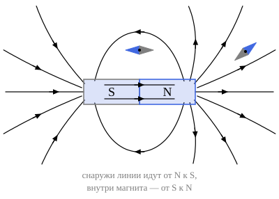

В конце урока 7.8 мы обещали: ток не только греет проводник, но и создаёт вокруг него магнитное поле. Чтобы это поле увидеть, нужен прибор, который его чувствует, — компас. А стрелка компаса — это маленький магнит. Поэтому начнём с магнитов.

## Два полюса

Магнит притягивает железные и стальные предметы — скрепки, гвозди, дверцу холодильника. Сильнее всего притягивают его концы: их называют **полюсами**. Подвесь полосовой магнит на нитке — он повернётся одним концом на север. Этот конец — **северный полюс** N, другой — **южный** S.

Поднеси два магнита друг к другу:

- одноимённые полюса (N к N или S к S) отталкиваются;
- разноимённые (N к S) притягиваются.

Похоже на заряды (урок 1.1), но есть важное отличие: полюса нельзя разделить. Разрежь магнит пополам — получишь не отдельный «северный» кусок и отдельный «южный», а два целых магнита, у каждого свои N и S. Режь дальше — то же самое, сколько бы раз ни резал.

<pp-task id="ks-amp-07"></pp-task>

## Магнитное поле

Заряд действует на другие заряды через электрическое поле (урок 2.1). Магнит тоже действует не напрямую, а через поле вокруг себя — **магнитное поле**. Его не видно, но его чувствует любая магнитная стрелка: в поле она поворачивается и встаёт вдоль него.

Поэтому **направление магнитного поля** в точке определяют так: туда, куда указывает северный конец магнитной стрелки, поставленной в эту точку.

## Линии магнитного поля

Насыпь железные опилки на лист картона над магнитом и постучи по картону. Опилки — маленькие стрелки — выстроятся цепочками. По этим цепочкам рисуют **линии магнитного поля**: в каждой точке линия идёт так, как встала бы стрелка, а стрелка на линии показывает, куда указывает её северный конец.

Вне магнита линии выходят из северного полюса и входят в южный. Но внутри магнита они не обрываются, а идут дальше — от S к N. Линии магнитного поля **замкнуты**: у них нет ни начала, ни конца.

Сравни с электрическим полем (урок 2.4): там линии начинаются на положительных зарядах и кончаются на отрицательных. У магнитного поля таких «зарядов» нет — потому и полюса нельзя отделить друг от друга.

Где линии гуще, там поле сильнее: у полюсов магнита оно сильнее, чем вдали от него.

## Земля — тоже магнит

Стрелка компаса показывает на север, потому что Земля — большой магнит со своим магнитным полем. Северный конец стрелки притягивается к южному полюсу магнита. Значит, около северного географического полюса Земли находится её **южный** магнитный полюс, а около южного географического — северный магнитный.

Проверь себя: к одному из концов полосового магнита северный конец стрелки компаса притянулся. Какой это полюс магнита?

Южный. Притягиваются разноимённые полюса, а у стрелки к магниту повернулся северный конец.

## Частые ловушки

- **Думают, что линии поля начинаются на N и кончаются на S.** Внутри магнита они идут дальше, от S к N: линии замкнуты.
- **Путают полюса Земли.** Около северного географического полюса — южный магнитный: к нему и тянется северный конец стрелки.
- **Думают, что магнит притягивает любой металл.** Медь, алюминий, золото к магниту почти не притягиваются; притягиваются железо, сталь, никель.

## Коротко

- У магнита два полюса: одноимённые отталкиваются, разноимённые притягиваются.
- Направление поля — куда указывает северный конец магнитной стрелки.
- Линии поля замкнуты: снаружи от N к S, внутри от S к N; отдельных полюсов не бывает.

Дальше — урок 8.2: как магнитное поле создаёт ток.
