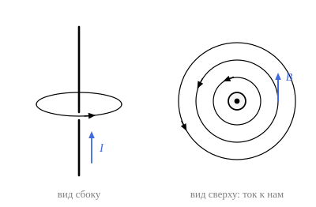

В 1820 году датский физик Ханс Кристиан Эрстед показывал студентам опыты с током. Рядом с проводом лежал компас. Когда Эрстед замкнул цепь, стрелка компаса повернулась и встала поперёк провода. Цепь разомкнули — стрелка вернулась. Ток пустили в обратную сторону — стрелка повернулась в другую сторону.

## Ток создаёт магнитное поле

Стрелку компаса поворачивает магнитное поле (урок 8.1). Значит, ток создаёт вокруг себя **магнитное поле** — такое же, как поле магнита: оно действует на стрелки, на магниты и, как мы увидим в уроке 8.4, на другие токи.

Отсюда понятно и устройство самого магнита. Внутри атомов движутся электроны — это крошечные токи. В магните они выстроены согласованно, и их поля складываются. Поэтому разрезать магнит на отдельные полюса нельзя: каждый кусок — снова набор таких токов.

## Линии поля прямого тока

Пропусти сильный ток через вертикальный провод, проходящий сквозь лист картона, и насыпь на картон опилки. Они выстроятся **окружностями** вокруг провода. Линии поля прямого тока — замкнутые окружности с центром на проводе, в плоскостях, перпендикулярных проводу. Чем дальше от провода, тем реже линии: поле слабее.

Направление поля в точке — по касательной к линии. Его показывает вектор **магнитной индукции** $\vec B$; о его величине — в уроке 8.5.

## Ток «к нам» и «от нас»

Часто провод перпендикулярен рисунку. Тогда направление тока показывают значком:

- кружок с точкой — ток идёт **к нам** (видим остриё летящей стрелы);
- кружок с крестиком — ток идёт **от нас** (видим оперение стрелы).

Направление тока, как всегда, — от «+» к «−» источника (урок 5.1); электроны движутся навстречу.

## Правило буравчика

Как узнать, в какую сторону идут линии вокруг провода? **Правило буравчика**: если буравчик (или винт) ввинчивать по направлению тока, то его ручка вращается по направлению линий поля.

То же самое правой рукой: обхвати провод так, чтобы отогнутый большой палец показывал по току, — согнутые пальцы покажут направление линий.

Для тока к нам (справа на рисунке) буравчик выкручивается к нам — ручка вращается против часовой стрелки, так и идут линии. Для тока от нас — по часовой стрелке.

<pp-task id="ks-amp-08"></pp-task>

Проверь себя: компас лежит под горизонтальным проводом, ток в проводе идёт на север. Куда повернётся северный конец стрелки?

На запад. Обхвати провод правой рукой, большой палец на север: под проводом согнутые пальцы направлены на запад. Так и повернулась стрелка в опыте Эрстеда — поперёк провода.

## Частые ловушки

- **Рисуют линии поля тока лучами от провода, как у заряда.** Линии поля прямого тока — окружности вокруг провода.
- **Берут направление движения электронов.** Правило буравчика — по направлению тока, от «+» к «−»; электроны движутся навстречу.
- **Путают значки.** Точка в кружке — ток к нам, крестик — от нас.

## Коротко

- Ток создаёт магнитное поле (опыт Эрстеда).
- Линии поля прямого тока — окружности вокруг провода; вдали от провода поле слабее.
- Направление линий — по правилу буравчика: буравчик ввинчивается по току, ручка вращается по линиям.

Дальше — урок 8.3: поле катушки с током и электромагнит.
