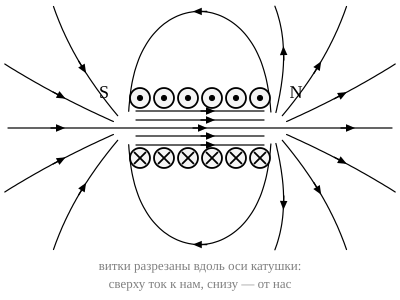
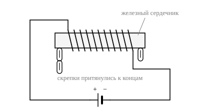

Поле одного прямого провода слабое: стрелка компаса заметно поворачивается, только если поднести её близко. А теперь свернём провод в катушку — много витков подряд. Поля витков сложатся, и у катушки появятся полюса, как у магнита.

## Поле катушки

Посмотри на один виток. Возле каждого кусочка провода линии поля идут по окружностям (урок 8.2). Внутри витка поля всех кусочков направлены в одну сторону и складываются. Снаружи они частично гасят друг друга.

Когда витков много и они идут вплотную, внутри катушки поле сильное, а линии почти параллельны. Снаружи поле катушки такое же, как у полосового магнита (урок 8.1): линии выходят из одного конца, огибают катушку и входят в другой. Конец, из которого линии выходят, — северный полюс N, другой — южный S.

Чтобы нарисовать это на плоскости, катушку мысленно разрезают вдоль оси. Каждый виток пересекает рисунок дважды: сверху и снизу. В одном месте ток идёт к нам, в другом — от нас.

## Правило правой руки

Северный полюс катушки находят **правилом правой руки**: обхвати катушку правой рукой так, чтобы четыре пальца шли по току в витках, — отогнутый большой палец покажет направление поля внутри катушки, то есть на её северный полюс.

Это то же правило буравчика, только наоборот: вращай ручку буравчика по току в витках — он будет ввинчиваться по направлению поля внутри.

Проверим по рисунку другим способом. Верхний ряд: ток к нам, линии вокруг каждого провода идут против часовой стрелки (урок 8.2) — под проводами, внутри катушки, это вправо. Нижний ряд: ток от нас, линии по часовой стрелке — над проводами тоже вправо. Внутри поле направлено вправо, значит, северный полюс справа.

<pp-task id="ks-amp-09"></pp-task>

## Электромагнит

Вставь в катушку железный стержень — **сердечник**. Поле катушки намагничивает железо, и поле становится во много раз сильнее. Катушка с железным сердечником — **электромагнит**.

Электромагнит удобен тем, что им управляет ток:

- выключили ток — электромагнит почти перестаёт притягивать;
- больше ток или больше витков — притягивает сильнее;
- поменяли направление тока — полюса поменялись местами.

Электромагниты поднимают металлолом на свалках, держат двери с электронным замком, работают в звонках и реле. Большой ток в цепи можно включать маленьким током в обмотке реле: электромагнит притягивает железную пластинку и замыкает контакты.

Проверь себя: у электромагнита нужно поменять полюса местами. Что для этого сделать?

Поменять направление тока в обмотке — например, поменять местами провода у полюсов батарейки. Тогда, по правилу правой руки, поле внутри катушки повернётся в обратную сторону.

## Частые ловушки

- **Берут для катушки левую руку.** Направление поля — по правой руке (или по буравчику), левая рука нужна для силы (урок 8.4).
- **Считают северным полюсом конец, в который линии входят.** Северный полюс — тот, из которого линии выходят наружу.
- **Не учитывают, где ток «к нам», а где «от нас».** У разреза катушки верхний и нижний ряды всегда с противоположными значками.

## Коротко

- Поле катушки с током снаружи как у полосового магнита, внутри — сильное и почти однородное.
- Северный полюс — по правилу правой руки: пальцы по току в витках, большой палец на N.
- Электромагнит — катушка с железным сердечником; им управляют током.

Дальше — урок 8.4: как магнитное поле действует на ток.
