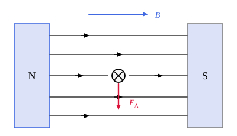
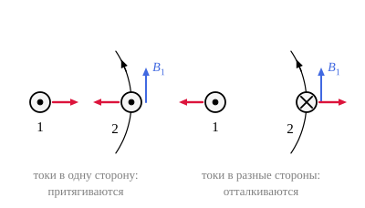

Ток действует на магнитную стрелку (урок 8.2). По третьему закону Ньютона (урок 5.5 из механики) и стрелка, и любой магнит должны действовать на ток. Проверим.

## Опыт с проводником между полюсами

Подвесим на гибких проводах лёгкий металлический стержень между полюсами подковообразного магнита. Замкнём цепь — стержень резко отклонится в сторону. Поменяем направление тока — отклонится в другую сторону. Перевернём магнит — тоже в другую.

Сила, с которой магнитное поле действует на проводник с током, называется **силой Ампера** — по имени французского физика Андре-Мари Ампера, который изучил её в 1820 году, вскоре после опыта Эрстеда. Обозначим её $F_{\text{А}}$.

## Куда направлена сила

Сила Ампера перпендикулярна и линиям поля, и проводнику. Её направление находят **правилом левой руки**: расположи левую руку так, чтобы линии поля входили в ладонь, а четыре пальца шли по току. Отогнутый на $90^\circ$ большой палец покажет направление силы Ампера.

Проверим по рисунку. Линии идут от N к S — слева направо, значит, ладонь смотрит влево, навстречу полю. Четыре пальца — от нас, по току. Большой палец левой руки показывает вниз.

Если поменять направление тока или поменять местами полюса, сила изменит направление на противоположное. Если поменять и то и другое — направление силы останется прежним.

<pp-task id="ks-amp-10"></pp-task>

## Почему поле действует на ток

Ток в металле — это движение свободных электронов (урок 5.1). Магнитное поле действует на каждый движущийся электрон, а электроны передают эту силу проводнику. На неподвижный заряд магнитное поле не действует. Сила на одну движущуюся частицу — тема «Сила Лоренца».

## Два тока

Каждый провод с током создаёт магнитное поле (урок 8.2) и находится в поле соседнего провода. Значит, два провода с токами действуют друг на друга:

- токи одного направления **притягиваются**;
- токи противоположных направлений **отталкиваются**.

Проверь по рисунку обоими правилами. Ток первого провода к нам — его линии идут против часовой стрелки, и справа от него, во втором проводе, поле направлено вверх. Для второго тока к нам левая рука даёт силу влево — к первому проводу. По третьему закону Ньютона первый провод притягивается ко второму с такой же силой.

Заметь: у зарядов одноимённые отталкиваются (урок 1.1), а у токов «одноимённые», одного направления, притягиваются.

## Где работает сила Ампера

В уроке 7.4 мы говорили: в электродвигателе работа тока уходит в движение. Двигает его сила Ампера: рамка с током в поле магнита поворачивается — подробно в уроке 8.8. В динамике катушка, приклеенная к диффузору, сидит в поле магнита: ток в катушке меняется, сила Ампера толкает её туда-сюда, и диффузор качает воздух — получается звук.

Проверь себя: одновременно поменяли направление тока в проводнике и поменяли местами полюса магнита. Как изменилась сила Ампера?

Не изменилась. Каждая перемена по отдельности развернула бы силу в обратную сторону, а две перемены вместе возвращают её назад.

## Частые ловушки

- **Берут правую руку.** Для силы Ампера — левая рука; правая (или буравчик) — для направления поля тока.
- **Ставят ладонь так, чтобы линии из неё выходили.** Линии входят в ладонь: ладонь смотрит навстречу полю, на северный полюс.
- **Направляют силу вдоль линий поля.** Сила Ампера перпендикулярна и полю, и току.

## Коротко

- Магнитное поле действует на проводник с током — это сила Ампера.
- Направление — правило левой руки: линии в ладонь, четыре пальца по току, большой палец — сила.
- Токи одного направления притягиваются, противоположных — отталкиваются.

Дальше — урок 8.5: от чего зависит величина силы и как измерить силу поля.
