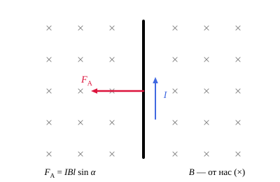

Правило левой руки говорит, куда направлена сила Ампера. А от чего зависит её величина? И как сказать, что одно магнитное поле сильнее другого?

## Опыт: сила, ток и длина

Поставим прямой проводник поперёк линий однородного поля — например, между полюсами большого магнита, где линии параллельны и одинаково густые. Будем измерять силу Ампера:

- ток вдвое больше — сила вдвое больше;
- в поле вдвое более длинный кусок проводника — сила тоже вдвое больше.

Значит, сила пропорциональна и току $I$, и длине $l$ той части проводника, которая находится в поле. А отношение ${F/(Il)}$ в этом поле одно и то же, какой бы проводник и ток мы ни взяли. В другом, более сильном поле оно больше. Это отношение и характеризует само поле.

## Индукция поля

**Модуль магнитной индукции** — отношение силы, с которой поле действует на проводник с током, расположенный **перпендикулярно** линиям поля, к току и длине проводника:

$$
B = \frac{F}{I l}.
$$

- $F$ — сила Ампера, Н;
- $I$ — сила тока, А;
- $l$ — длина проводника в поле, м;
- $B$ — индукция поля, Тл.

Единица — **тесла** (Тл), в честь изобретателя Николы Теслы: ${1\ \text{Тл} = 1\ \text{Н}/(\text{А} \cdot \text{м}).}$ В поле с индукцией ${1\ \text{Тл}}$ на проводник длиной ${1\ \text{м}}$ с током ${1\ \text{А}}$ действует сила ${1\ \text{Н}}$.

Так же мы ввели напряжённость электрического поля: ${E = F/q}$ — сила на единичный заряд (урок 2.2). И так же индукция — свойство поля: от проводника, который мы внесли, она не зависит.

Индукция — вектор $\vec B$. Он направлен по касательной к линии поля — туда, куда указывает северный конец магнитной стрелки (урок 8.1).

Сколько это — тесла? Поле Земли около ${5 \cdot 10^{-5}\ \text{Тл}}$, магнита на холодильнике — сотые доли тесла, сильного электромагнита — порядка тесла, магнита в томографе — несколько тесла.

**Пример.** На проводник длиной ${15\ \text{см}}$ с током ${2\ \text{А},}$ перпендикулярный линиям поля, действует сила ${0{,}27\ \text{Н}.}$ Длина в метрах ${0{,}15\ \text{м},}$ индукция

$$
B = \frac{0{,}27}{2 \cdot 0{,}15} = 0{,}9\ \text{Тл}.
$$

<pp-task id="ks-amp-01"></pp-task>

## Сила Ампера

Из определения индукции сразу получаем силу Ампера на проводник, перпендикулярный полю:

$$
F_{\text{А}} = I B l.
$$

На рисунках поле, перпендикулярное плоскости рисунка, изображают так же, как ток: крестики — поле направлено от нас, точки — к нам.

Направление — по правилу левой руки: линии поля идут от нас, значит, ладонь смотрит на нас; четыре пальца вверх, по току; большой палец показывает влево.

<pp-task id="ks-amp-02"></pp-task>

<pp-task id="ks-amp-11"></pp-task>

Проверь себя: ток в проводнике, перпендикулярном полю, увеличили в 2 раза. Как изменились сила Ампера и индукция поля?

Сила выросла в $2$ раза, а индукция не изменилась: её создаёт магнит, а не проводник, который мы внесли в поле. Отношение ${F/(Il)}$ осталось прежним.

## Частые ловушки

- **Думают, что индукция зависит от тока в проводнике.** Индукция — свойство поля; от тока в проводнике зависит сила.
- **Не переводят в СИ.** Длину — в метры, силу — в ньютоны, а ответ, если просят, — в миллитеслы: ${1\ \text{Тл} = 1000\ \text{мТл}.}$
- **Путают значки поля.** Крестики — поле от нас, точки — к нам.

## Коротко

- Модуль магнитной индукции ${B = F/(Il)}$ для проводника поперёк поля, в теслах.
- Индукция — свойство поля; вектор $\vec B$ направлен по линиям поля.
- Сила Ампера на проводник поперёк поля ${F_{\text{А}} = IBl.}$

Дальше — урок 8.6: что будет, если проводник расположен под углом к полю.
