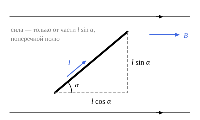

В уроке 8.5 проводник стоял поперёк линий поля. Повернём его. Если повернуть до конца — так, что ток идёт вдоль линий, — сила Ампера пропадает совсем: ток не «пересекает» линии поля. А если повернуть только частично?

## Часть поперёк поля

Разложим проводник на две части, как раскладывают вектор: часть вдоль линий поля и часть поперёк. Если угол между проводником и линиями поля $\alpha$, то вдоль поля идёт ${l\cos\alpha}$, а поперёк — ${l\sin\alpha}$.

Часть вдоль поля сил не даёт, а на часть поперёк поля действует сила ${IB \cdot l\sin\alpha}$ (урок 8.5). Получаем силу Ампера в общем виде:

$$
F_{\text{А}} = I B l \sin\alpha.
$$

- $\alpha$ — угол между направлением тока и вектором $\vec B$.

Поэтому:

- проводник поперёк поля, ${\alpha = 90^\circ}$: ${\sin\alpha = 1}$, сила наибольшая, ${F = IBl}$;
- проводник вдоль поля, ${\alpha = 0}$ или ${180^\circ}$: ${\sin\alpha = 0}$, силы нет;
- углы $\alpha$ и ${180^\circ - \alpha}$ дают одну и ту же силу: синусы у них равны.

Направление силы — по-прежнему правило левой руки, только в ладонь входит та часть линий поля, которая перпендикулярна проводнику. Сила всегда перпендикулярна и проводнику, и вектору $\vec B$.

**Пример.** Проводник длиной ${0{,}6\ \text{м}}$ с током ${8\ \text{А}}$ в поле с индукцией ${0{,}15\ \text{Тл}.}$ Поперёк поля на него действует ${8 \cdot 0{,}15 \cdot 0{,}6 = 0{,}72\ \text{Н}.}$ Если угол между током и полем ${60^\circ,}$ то ${\sin 60^\circ \approx 0{,}866}$ и сила

$$
F = 0{,}72 \cdot \sin 60^\circ \approx 0{,}72 \cdot 0{,}866 \approx 0{,}62\ \text{Н}.
$$

<pp-task id="ks-amp-03"></pp-task>

## Модель: проводник поворачивается в поле

В модели — однородное поле между полюсами, вид сверху, и проводник с током. Поворачивай проводник ползунком и меняй направление тока. Сила Ампера перпендикулярна рисунку: кружок с точкой — она направлена к нам, с крестиком — от нас. В таблице — угол между током и полем, его синус и сила.

<pp-ampere>Модель: вид сверху на однородное магнитное поле между полюсами N и S и прямой проводник длиной 0,6 м с током 2,5 А в поле 0,6 Тл. Ползунок поворачивает проводник от 0 до 180°, кнопки меняют направление тока; таблица показывает угол между током и полем, его синус, силу Ампера IBl sin α и её направление — к нам или от нас.</pp-ampere>

Попробуй:

- поверни проводник вдоль линий поля: что стало с силой?
- найди два разных положения проводника с одинаковой силой;
- поменяй направление тока: что изменилось в таблице, а что осталось прежним?

<pp-task id="ks-amp-12"></pp-task>

## Как меняется сила

Сила ${F = IBl\sin\alpha}$ пропорциональна каждому множителю. Если меняют сразу несколько, изменения перемножают. Например, ток уменьшили в $5$ раз, а индукцию увеличили в ${2{,}5}$ раза — сила уменьшилась в ${5/2{,}5 = 2}$ раза. Угол учитывают отношением синусов: новый синус делят на старый.

<pp-task id="ks-amp-04"></pp-task>

Проверь себя: угол между током и полем был 60°, проводник повернули — угол стал 120°. Как изменилась сила Ампера?

Никак: ${\sin 120^\circ = \sin 60^\circ}$, поэтому модуль силы прежний. Направление тоже прежнее — проверь в модели: поставь ${60^\circ}$, а потом ${120^\circ}$.

## Частые ловушки

- **Берут косинус.** В силе Ампера — синус угла между током и $\vec B$: вдоль поля силы нет.
- **Берут не тот угол.** Угол — между проводником (током) и линиями поля, а не между проводником и перпендикуляром к ним.
- **Складывают изменения вместо умножения.** Ток в $2$ раза больше и индукция в $5$ раз больше — сила больше в $10$ раз, а не в $7$.

## Коротко

- Сила Ампера ${F_{\text{А}} = IBl\sin\alpha}$, $\alpha$ — угол между током и $\vec B$.
- Работает только часть проводника поперёк поля, ${l\sin\alpha}$.
- Вдоль поля силы нет, поперёк — наибольшая, ${IBl}$.

Дальше — урок 8.7: проводник с током в равновесии.
