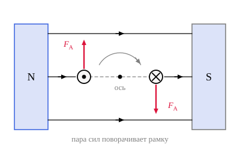

В уроке 7.4 мы сказали, что в электродвигателе работа тока уходит в движение, и оставили открытым вопрос: как именно ток крутит вал? Теперь ответ готов: вал крутит сила Ампера. Осталось понять, как сила, которая толкает проводник в одну сторону, заставляет рамку вращаться.

## Работа силы Ампера

Если проводник с током движется в магнитном поле, сила Ампера совершает работу — как любая сила (урок 11.4 из механики):

$$
A = F_{\text{А}}\, s \cos\beta.
$$

- $F_{\text{А}} = IBl\sin\alpha$ — сила Ампера (урок 8.6), Н;
- $s$ — перемещение проводника, м;
- $\beta$ — угол между силой и перемещением;
- $A$ — работа, Дж.

Не путай два угла: $\alpha$ — между током и полем, он входит в силу; $\beta$ — между силой и перемещением, он входит в работу.

**Пример.** Проводник длиной ${0{,}5\ \text{м}}$ с током ${1{,}5\ \text{А}}$ стоит поперёк поля с индукцией ${0{,}6\ \text{Тл}.}$ Сила Ампера ${1{,}5 \cdot 0{,}6 \cdot 0{,}5 = 0{,}45\ \text{Н}.}$ Проводник сдвинулся на ${10\ \text{см}}$ в направлении силы, ${\cos 0 = 1}$:

$$
A = 0{,}45 \cdot 0{,}1 = 0{,}045\ \text{Дж} = 45\ \text{мДж}.
$$

<pp-task id="ks-amp-06"></pp-task>

<pp-task id="ks-amp-15"></pp-task>

## Рамка с током в поле

Возьмём прямоугольную рамку из провода и поставим её между полюсами магнита так, чтобы она могла поворачиваться вокруг оси. Посмотрим на рамку вдоль оси: две её длинные стороны видны с торца. В одной ток идёт к нам, в другой — от нас, ведь это один и тот же ток, обходящий рамку.

По правилу левой руки силы на эти стороны противоположны: на левую вверх, на правую вниз. Обе силы равны по модулю и стремятся повернуть рамку в одну сторону — по часовой стрелке. Их моменты (урок 8.2 из механики) складываются, и рамка поворачивается.

А на короткие стороны рамки, которые идут поперёк оси, силы действуют вдоль оси и рамку не поворачивают.

## Почему двигатель крутится дальше

Рамка повернётся на четверть оборота и встанет поперёк поля. В этом положении силы на стороны тянут их в разные стороны вдоль одной прямой через ось: плечо равно нулю, поворачивающего момента нет. Рамка проскочит это положение по инерции — и силы начнут поворачивать её обратно.

Чтобы рамка крутилась дальше, ток в ней каждые пол-оборота меняют на противоположный. Это делает **коллектор**: кольцо, разрезанное на две половинки, к которым прижаты контакты — щётки. Вместе с рамкой поворачивается кольцо, и каждые пол-оборота щётки переходят на другие половинки. Так устроен электродвигатель постоянного тока. В настоящем двигателе рамок много и они повёрнуты друг относительно друга — поэтому вал крутится ровно.

Откуда берётся энергия? Её отдаёт источник: работа тока ${UIt}$ (урок 7.1) идёт в механическую работу силы Ампера и немного в тепло ${I^2Rt}$ в обмотке (урок 7.4).

Проверь себя: почему рамка не поворачивается дальше сама, когда встаёт поперёк линий поля?

В этом положении силы Ампера на две стороны рамки лежат на одной прямой, проходящей через ось, и тянут их в разные стороны. Плечо каждой силы равно нулю, поворачивающего момента нет. Дальше рамку проносит инерция, а коллектор меняет ток, чтобы силы снова поворачивали её в ту же сторону.

## Частые ловушки

- **Путают углы.** В силе — угол между током и полем, в работе — между силой и перемещением.
- **Считают, что на обе стороны рамки сила действует в одну сторону.** Ток в сторонах противоположный, поэтому силы противоположны — и поворачивают рамку.
- **Забывают перевести перемещение в метры.** Тогда и работа выходит не в джоулях.

## Коротко

- Работа силы Ампера ${A = F_{\text{А}}\, s\cos\beta}$, как у любой силы.
- На стороны рамки с током действуют противоположные силы — рамка поворачивается.
- Коллектор каждые пол-оборота меняет ток в рамке — так работает электродвигатель.

Это последний урок темы. Дальше — тема «Сила Лоренца»: с какой силой магнитное поле действует на одну движущуюся заряженную частицу и почему такая частица в поле движется по окружности.
