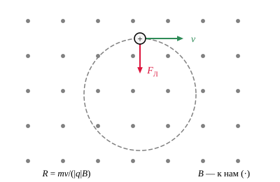

Северное сияние появляется у полюсов, потому что магнитное поле Земли «заворачивает» заряженные частицы солнечного ветра. Сила, которая это делает, — сила Лоренца. Она встречается в задаче 12, в задачах 14–15 и в задаче 25.

Что магнитное поле отклоняет летящую заряженную частицу, говорят в 9 классе. Формулу силы и движение частиц по окружности разбирают в 11. Пригодятся темы «Сила Ампера», «Движение по окружности» и «Законы Ньютона».

## Шаг 1. Поле действует на летящий заряд (9 класс)

Сила Ампера действует на провод с током. А ток — это движущиеся заряды. Значит, магнитное поле действует на каждую движущуюся заряженную частицу. Так в старых кинескопах магнитное поле отклоняло электронный луч.

**Направление** — по правилу левой руки: линии $\vec B$ входят в ладонь, четыре пальца — по скорости **положительной** частицы; большой палец показывает силу. Для отрицательной частицы (электрона) сила направлена в противоположную сторону.

На покоящийся заряд магнитное поле не действует.

## Шаг 2. Формула силы Лоренца (11 класс)

$$
F_{\text{Л}} = |q|\, v B \sin\alpha.
$$

- $q$ — заряд частицы, Кл;
- $v$ — её скорость, м/с;
- $B$ — индукция поля, Тл;
- $\alpha$ — угол между $\vec v$ и $\vec B$.

Если частица летит вдоль линий поля, сила равна нулю.

<pp-task id="ks-lor-01"></pp-task>

## Шаг 3. Сила Лоренца работы не совершает (11 класс)

Сила Лоренца всегда перпендикулярна скорости. Значит, она меняет только направление скорости, но не её модуль. Работа силы Лоренца равна нулю, кинетическая энергия частицы в магнитном поле **не меняется** — сколько бы частица ни летала в поле.

<pp-task id="ks-lor-02"></pp-task>

## Шаг 4. Движение по окружности (11 класс)

Частица влетела в однородное поле перпендикулярно линиям индукции. Сила Лоренца перпендикулярна скорости и постоянна по модулю — частица движется по окружности. Сила Лоренца играет роль центростремительной, и по второму закону Ньютона:

$$
\frac{m v^2}{R} = |q| v B
\quad\Rightarrow\quad
R = \frac{m v}{|q| B}.
$$

<pp-task id="ks-lor-03"></pp-task>

## Шаг 5. От чего зависит радиус (11 класс)

$R = mv/(|q|B)$: быстрая и тяжёлая частица описывает большую окружность; сильное поле закручивает сильнее; при большем заряде радиус меньше. В задачах «как изменится радиус» перемножь изменения: скорость вдвое больше и поле вдвое больше — радиус тот же.

<pp-task id="ks-lor-04"></pp-task>

## Шаг 6. Период обращения (11 класс)

$$
T = \frac{2\pi R}{v} = \frac{2\pi m}{|q| B}.
$$

Удивительный факт: период **не зависит от скорости**. Быстрая частица идёт по большему кругу, но и движется быстрее — время оборота то же. На этом основан циклотрон.

<pp-task id="ks-lor-05"></pp-task>

## Шаг 7. Разгон в электрическом поле, потом магнитное (11 класс)

Типичная задача 25: частицу сначала разгоняют разностью потенциалов $U$, потом она влетает в магнитное поле. Два этапа:

1. Разгон (тема «Напряжённость и потенциал»): $\dfrac{m v^2}{2} = |q| U$, откуда $v = \sqrt{\dfrac{2|q|U}{m}}$.
2. Окружность: $R = \dfrac{m v}{|q| B}$.

<pp-task id="ks-lor-06"></pp-task>

## Шаг 8. Движение по винтовой линии (11 класс)

Если скорость направлена под углом к полю, разложи её на две составляющие. Вдоль поля сила не действует — эта составляющая скорости не меняется. Поперёк поля частица крутится по окружности. Вместе получается **винтовая линия**, навитая на линии поля. Так частицы солнечного ветра «скользят» вдоль линий поля Земли к полюсам — и там возникает полярное сияние.

## Частые ловушки

- **Думают, что магнитное поле разгоняет частицу.** Модуль скорости не меняется, работа силы Лоренца — ноль.
- **Забывают сменить направление для электрона.** Правило левой руки — для положительного заряда.
- **Считают, что период зависит от скорости.** Нет: $T = 2\pi m/(|q|B)$.
- **Путают угол.** Нужен угол между скоростью и $\vec B$.

## Как это выглядит на ЕГЭ

*Протон влетает в однородное магнитное поле с индукцией $0{,}1\ \text{Тл}$ перпендикулярно линиям индукции со скоростью $10^6\ \text{м/с}$. Найди радиус окружности. Масса протона $1{,}67 \cdot 10^{-27}\ \text{кг}$, заряд $1{,}6 \cdot 10^{-19}\ \text{Кл}$.*

$$
R = \frac{m v}{q B} = \frac{1{,}67 \cdot 10^{-27} \cdot 10^6}{1{,}6 \cdot 10^{-19} \cdot 0{,}1} \approx 0{,}10\ \text{м}.
$$

Около $10\ \text{см}$. Если увеличить скорость вдвое, радиус вырастет вдвое, а период не изменится.

## Коротко

- $F_{\text{Л}} = |q|vB\sin\alpha$; направление — левая рука (для $q > 0$).
- Сила перпендикулярна скорости: работы нет, $|v|$ не меняется.
- В однородном поле при $\vec v \perp \vec B$: $R = mv/(|q|B)$.
- $T = 2\pi m/(|q|B)$ — не зависит от скорости.
- Под углом к полю — винтовая линия.
