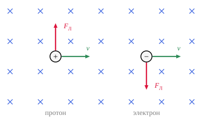

В уроке 8.4 мы выяснили: магнитное поле действует на проводник с током, потому что действует на каждый движущийся в нём электрон. А если заряженная частица летит сама по себе, без всякого провода? Поле действует и на неё.

## Опыт с электронным лучом

В электронно-лучевой трубке — так были устроены экраны старых телевизоров и осциллографов — узкий пучок электронов летит к экрану и рисует на нём светящееся пятно. Поднесём к трубке магнит — пятно сдвинется: магнитное поле отклоняет летящие электроны. Повернём магнит другим полюсом — пятно сдвинется в другую сторону. Уберём магнит — пятно вернётся на место.

А на неподвижный заряд магнитное поле не действует. Заряженная бусинка на нити рядом с магнитом не отклоняется — если, конечно, она не железная.

Сила, с которой магнитное поле действует на движущуюся заряженную частицу, называется **силой Лоренца** — по имени нидерландского физика Хендрика Лоренца. Обозначим её $F_{\text{Л}}$. Сила Ампера (урок 8.4) складывается из сил Лоренца на все движущиеся электроны проводника.

## Куда направлена сила

Направление силы Лоренца находят тем же **правилом левой руки**, что и силу Ампера: линии поля входят в ладонь, четыре пальца — по скорости **положительной** частицы. Отогнутый на $90^\circ$ большой палец покажет силу.

Для силы Ампера четыре пальца шли по току. А ток направлен туда, куда двигались бы положительные заряды (урок 5.1), — поэтому теперь пальцы идут по скорости положительной частицы.

На **отрицательную** частицу — например, на электрон — сила направлена в **противоположную** сторону. Можно сказать и так: для электрона четыре пальца направляют против его скорости — как ток в проводе направлен против движения электронов.

Проверим по рисунку. Поле направлено от нас, линии входят в ладонь — значит, ладонь смотрит на нас. Четыре пальца — вправо, по скорости протона. Большой палец показывает вверх. На электрон, летящий так же, сила направлена вниз.

Сила Лоренца всегда перпендикулярна и скорости частицы, и линиям поля. Если частица летит вдоль линий поля, силы нет — как нет силы Ампера на провод, ток в котором идёт вдоль поля (урок 8.6).

<pp-task id="ks-lor-07"></pp-task>

<pp-task id="ks-lor-08"></pp-task>

## Знак заряда по следу

Правило работает и в обратную сторону. Физики фотографируют следы частиц в магнитном поле — в камерах, где пролетевшая частица оставляет цепочку капелек или пузырьков. В одном и том же поле положительные и отрицательные частицы загибаются в разные стороны, поэтому по изгибу следа узнают знак заряда частицы.

<pp-task id="ks-lor-09"></pp-task>

Проверь себя: заряженная пылинка неподвижно лежит между полюсами сильного магнита. Действует ли на неё магнитное поле?

Нет. Магнитное поле действует только на движущиеся заряды. На неподвижную пылинку действуют сила тяжести и сила реакции опоры, а силы Лоренца нет.

## Частые ловушки

- **Забывают сменить направление для отрицательной частицы.** Правило левой руки дано для положительной частицы.
- **Берут правую руку.** Правая рука и буравчик — для поля тока; для силы, с которой поле действует на ток или на летящий заряд, — левая.
- **Направляют силу вдоль скорости или вдоль поля.** Сила Лоренца перпендикулярна и скорости, и линиям поля.

## Коротко

- Магнитное поле действует на движущуюся заряженную частицу — это сила Лоренца; на покоящийся заряд оно не действует.
- Направление — правило левой руки: линии в ладонь, четыре пальца по скорости положительной частицы, большой палец — сила.
- На отрицательную частицу сила направлена в обратную сторону.

Дальше — урок 9.2: от чего зависит величина силы Лоренца.
