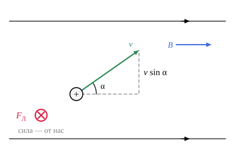

Правило левой руки говорит, куда направлена сила Лоренца (урок 9.1). А какова её величина? Получим её из силы Ампера — ведь сила Ампера складывается из сил Лоренца на все движущиеся заряды проводника.

## От силы Ампера к силе на один заряд

Возьмём кусок проводника длиной $l$ поперёк однородного поля с индукцией $B$. Ток в нём $I$, и на него действует сила Ампера ${F_{\text{А}} = IBl}$ (урок 8.5).

Пусть в этом куске $N$ свободных зарядов, каждый равен $q$, и все они движутся вдоль проводника со скоростью $v$. Весь кусок они проходят за время ${t = l/v}$ — и за это время через конец куска проходит заряд ${Nq}$. Значит, сила тока (урок 5.1)

$$
I = \frac{Nq}{t} = \frac{Nqv}{l}.
$$

Подставим в силу Ампера:

$$
F_{\text{А}} = IBl = \frac{Nqv}{l} \cdot Bl = N \cdot qvB.
$$

Сила Ампера — это $N$ одинаковых сил, по одной на каждый заряд. На одну частицу, летящую поперёк поля, действует сила

$$
F_{\text{Л}} = |q|\, v B.
$$

Заряд берут по модулю: от знака заряда зависит только направление силы (урок 9.1), а не её величина.

## Скорость под углом к полю

Если частица летит под углом к линиям поля, силу создаёт только часть скорости поперёк поля, ${v\sin\alpha}$, — так же, как у проводника под углом работает только его часть ${l\sin\alpha}$ (урок 8.6):

$$
F_{\text{Л}} = |q|\, v B \sin\alpha.
$$

- $q$ — заряд частицы, Кл;
- $v$ — её скорость, м/с;
- $B$ — индукция поля, Тл;
- $\alpha$ — угол между скоростью $\vec v$ и вектором $\vec B$;
- $F_{\text{Л}}$ — сила Лоренца, Н.

Поэтому:

- частица летит поперёк поля, ${\alpha = 90^\circ}$: сила наибольшая, ${F_{\text{Л}} = |q|vB}$;
- вдоль линий поля, ${\alpha = 0}$ или ${180^\circ}$: силы нет, частица летит прямо;
- сила перпендикулярна и $\vec v$, и $\vec B$. На рисунке оба вектора лежат в плоскости листа, поэтому сила направлена перпендикулярно листу. Линии поля идут вправо и входят в ладонь — ладонь смотрит влево; четыре пальца — по части скорости поперёк поля, вверх; большой палец показывает от нас.

**Пример.** Протон летит со скоростью ${4 \cdot 10^5\ \text{м/с}}$ поперёк поля с индукцией ${0{,}3\ \text{Тл}.}$ Его заряд ${1{,}6 \cdot 10^{-19}\ \text{Кл}}$:

$$
F_{\text{Л}} = 1{,}6 \cdot 10^{-19} \cdot 4 \cdot 10^5 \cdot 0{,}3 \approx 1{,}9 \cdot 10^{-14}\ \text{Н}.
$$

Сила крошечная — но и протон лёгкий. Сила тяжести на него ${mg \approx 1{,}6 \cdot 10^{-26}\ \text{Н}}$ — в триллион раз меньше. Поэтому в задачах о частицах в магнитном поле силу тяжести не учитывают, как и в электрическом поле (урок 2.8).

<pp-task id="ks-lor-01"></pp-task>

<pp-task id="ks-lor-10"></pp-task>

Проверь себя: протон и электрон летят с одинаковыми скоростями поперёк одного и того же поля. На кого действует большая сила Лоренца?

Силы равны по модулю: заряды у протона и электрона по модулю одинаковые, а масса в силу Лоренца не входит. Направлены силы в противоположные стороны.

## Частые ловушки

- **Берут не тот угол.** Нужен угол между скоростью и вектором $\vec B$, а не между скоростью и границей поля или другой линией на рисунке.
- **Подставляют заряд со знаком.** В модуль силы входит ${|q|}$; знак заряда решает только, куда направлена сила.
- **Путаются в степенях.** Заряд частиц ${\sim 10^{-19}\ \text{Кл}}$, скорости ${\sim 10^5{-}10^7\ \text{м/с}}$: перемножай мантиссы и степени отдельно.

## Коротко

- Сила Ампера — сумма сил Лоренца на заряды проводника.
- ${F_{\text{Л}} = |q|vB\sin\alpha}$, $\alpha$ — угол между $\vec v$ и $\vec B$.
- Поперёк поля сила наибольшая, вдоль поля её нет.

Дальше — урок 9.3: совершает ли сила Лоренца работу.
