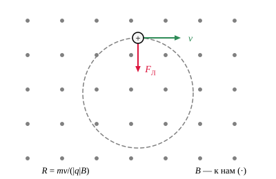

Скорость частицы в магнитном поле постоянна по модулю (урок 9.3), а сила Лоренца всё время поворачивает её. По какой линии движется частица?

## Почему окружность

Пусть частица влетела в однородное поле перпендикулярно линиям индукции. Скорость так и остаётся перпендикулярной полю, а её модуль не меняется. Значит, и сила Лоренца ${|q|vB}$ постоянна по модулю и всё время перпендикулярна скорости. Именно такая сила нужна для равномерного движения по окружности: она сообщает частице центростремительное ускорение ${v^2/R}$, направленное к центру (урок 4.3 из механики).

На частицу действует только сила Лоренца. По второму закону Ньютона (урок 5.4 из механики):

$$
\frac{m v^2}{R} = |q|\, v B.
$$

Сократим на $v$ и выразим радиус окружности:

$$
R = \frac{m v}{|q| B}.
$$

Проверим направление по рисунку. Поле к нам — линии входят в ладонь, ладонь смотрит от нас. Четыре пальца — вправо, по скорости. Большой палец показывает вниз — к центру окружности.

**Пример.** В электронно-лучевой трубке электрон летит со скоростью ${1{,}6 \cdot 10^7\ \text{м/с}}$ поперёк поля с индукцией ${1\ \text{мТл} = 10^{-3}\ \text{Тл}.}$ Масса электрона ${9{,}1 \cdot 10^{-31}\ \text{кг}}$:

$$
R = \frac{9{,}1 \cdot 10^{-31} \cdot 1{,}6 \cdot 10^7}{1{,}6 \cdot 10^{-19} \cdot 10^{-3}} = 0{,}091\ \text{м} \approx 9\ \text{см}.
$$

<pp-task id="ks-lor-03"></pp-task>

## В какую сторону вращается частица

Сила на положительную и на отрицательную частицу направлена в противоположные стороны (урок 9.1). Поэтому в одном и том же поле они вращаются в противоположные стороны.

На рисунке поле направлено от нас. Положительная частица поворачивает вверх и идёт против часовой стрелки, отрицательная — вниз, по часовой. Пройдя половину окружности, каждая вылетает из поля в обратную сторону: скорость развернулась, а по модулю осталась прежней.

## От чего зависит радиус

${R = mv/(|q|B)}$:

- чем быстрее частица, тем больше радиус: быструю частицу труднее повернуть;
- чем тяжелее частица, тем больше радиус;
- чем больше заряд или сильнее поле, тем больше сила и тем меньше радиус.

Если меняют сразу несколько величин, изменения перемножают — как для силы Ампера (урок 8.6). Например, если и скорость, и индукцию увеличить в $5$ раз, радиус не изменится.

Чтобы сравнить две частицы с одинаковыми скоростями в одном поле, смотрят на отношение массы к заряду ${m/|q|}$: радиус пропорционален ему. У дейтрона — ядра тяжёлого водорода — масса вдвое больше, чем у протона, а заряд тот же. Поэтому его окружность вдвое больше.

<pp-task id="ks-lor-04"></pp-task>

<pp-task id="ks-lor-12"></pp-task>

Проверь себя: протон и электрон влетели в одно поле с одинаковыми скоростями поперёк линий. У кого радиус больше и куда они поворачивают?

Заряды у них по модулю равны, а масса протона примерно в $1836$ раз больше. Поэтому и радиус окружности протона во столько же раз больше. Поворачивают они в разные стороны: заряды противоположные.

## Частые ловушки

- **Считают центростремительную силу ещё одной силой.** На частицу действует только сила Лоренца — она и сообщает центростремительное ускорение.
- **Не переводят в СИ.** Миллитеслы — в теслы, а ответ — в те единицы, в которых просят.
- **Путают, что в числителе, а что в знаменателе.** Масса и скорость увеличивают радиус, заряд и индукция — уменьшают.

## Коротко

- Частица, влетевшая перпендикулярно однородному полю, движется по окружности.
- ${mv^2/R = |q|vB}$, откуда ${R = mv/(|q|B).}$
- Положительные и отрицательные частицы в одном поле вращаются в разные стороны.

Дальше — урок 9.5: сколько времени занимает один оборот.
