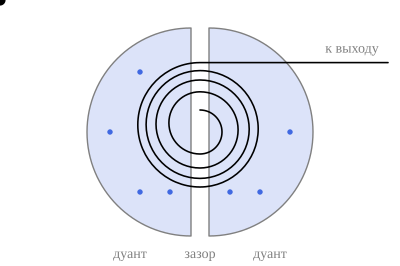

Быстрая частица описывает большую окружность (урок 9.4). Значит ли это, что на один оборот у неё уходит больше времени?

## Период не зависит от скорости

Период — время одного оборота (урок 4.1 из механики). За период частица проходит длину окружности ${2\pi R}$ со скоростью $v$ (урок 4.2 из механики). Подставим радиус ${R = mv/(|q|B)}$:

$$
T = \frac{2\pi R}{v} = \frac{2\pi}{v} \cdot \frac{mv}{|q|B} = \frac{2\pi m}{|q| B}.
$$

Скорость сократилась! Период обращения зависит только от массы и заряда частицы и от индукции поля — и не зависит ни от скорости, ни от радиуса. Быстрая частица идёт по большей окружности, но во столько же раз быстрее — и тратит на оборот то же время.

Частота обращения — число оборотов в секунду — тоже от скорости не зависит:

$$
\nu = \frac{1}{T} = \frac{|q| B}{2\pi m}.
$$

**Пример.** Протон в поле с индукцией ${1\ \text{Тл}}$:

$$
T = \frac{2\pi \cdot 1{,}67 \cdot 10^{-27}}{1{,}6 \cdot 10^{-19} \cdot 1} \approx 6{,}6 \cdot 10^{-8}\ \text{с} = 66\ \text{нс}.
$$

Это около ${15}$ миллионов оборотов в секунду — с какой бы скоростью протон ни летел.

<pp-task id="ks-lor-05"></pp-task>

<pp-task id="ks-lor-13"></pp-task>

## Модель: частица в магнитном поле

В модели — частица с массой протона в однородном поле, перпендикулярном рисунку. Все окружности начинаются в одной точке, где частица летит вправо. Меняй скорость ползунком, а знак заряда и направление поля — кнопками. Без настройки «уменьшить движение» частица бежит по окружности; в таблице — радиус, период и направление обращения.

<pp-lorentz>Модель: частица с массой протона и зарядом +e или −e в однородном магнитном поле 0,1 Тл, перпендикулярном рисунку. Ползунок меняет скорость от 2 до 10 · 10⁵ м/с, кнопки — знак заряда и направление поля; частица движется по окружности, таблица показывает радиус, период и направление обращения.</pp-lorentz>

Попробуй:

- увеличь скорость: что стало с радиусом, а что — с периодом?
- поменяй знак заряда, потом направление поля: в какую сторону теперь вращается частица?
- поменяй сразу и знак, и поле.

## Циклотрон

На независимости периода от скорости основан **циклотрон** — ускоритель, который в 1930-х годах придумал американский физик Эрнест Лоуренс.

Два полых металлических полудиска — **дуанта** — стоят в однородном магнитном поле, между ними узкий зазор. Внутри дуанта электрического поля нет, и частица летит по полуокружности. В зазоре её разгоняет напряжение между дуантами (урок 2.8). Через пол-оборота частица снова в зазоре — а напряжение к этому моменту поменяло знак и снова её разгоняет. С каждым проходом через зазор скорость растёт, радиус тоже, и частица раскручивается по спирали, пока у края её не выведут наружу.

Главное: время каждого полуоборота одно и то же, как бы ни выросла скорость. Поэтому напряжение можно менять с одной и той же частотой — частотой обращения частицы. Сейчас циклотроны, например, получают радиоактивные вещества для медицины.

Это верно, пока скорость много меньше скорости света. Почему у очень быстрых частиц период начинает расти — в теме «Основы специальной теории относительности».

Проверь себя: протон и однозарядный ион гелия (масса вчетверо больше, заряд тот же) движутся в одном поле. У кого больше период и во сколько раз?

У иона гелия, в $4$ раза: период ${T = 2\pi m/(|q|B)}$ пропорционален массе, заряды одинаковые, а скорости значения не имеют.

## Частые ловушки

- **Считают, что период растёт вместе с радиусом.** Радиус растёт со скоростью, но и путь проходится быстрее — период прежний.
- **Забывают ${2\pi}$.** Выражение ${m/(|q|B)}$ — это ещё не период: время оборота в ${2\pi}$ раз больше.
- **Путают период и частоту.** Период — время оборота, частота — число оборотов в секунду: ${\nu = 1/T}$.

## Коротко

- ${T = 2\pi R/v = 2\pi m/(|q|B)}$ — не зависит от скорости и радиуса.
- Частота обращения ${\nu = |q|B/(2\pi m)}$.
- Циклотрон разгоняет частицы напряжением, меняющим знак с частотой их обращения.

Дальше — урок 9.6: частицу разгоняют, а потом она влетает в магнитное поле.
