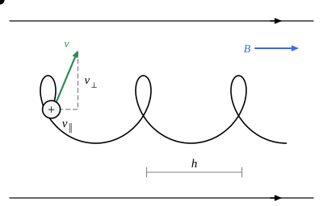

До сих пор частица влетала в поле перпендикулярно линиям и шла по окружности (урок 9.4). А если она влетает под углом?

## Две части скорости

Разложим скорость на две части: вдоль линий поля и поперёк. Если угол между скоростью и линиями поля $\alpha$, то

$$
v_\parallel = v\cos\alpha, \qquad v_\perp = v\sin\alpha.
$$

- Вдоль поля сила Лоренца не действует (урок 9.2), поэтому ${v_\parallel}$ не меняется: вдоль линий частица летит равномерно.
- Поперёк поля всё как в уроке 9.4: частица крутится по окружности радиусом ${R = mv_\perp/(|q|B)}$ с прежним периодом ${T = 2\pi m/(|q|B)}$.

Вместе получается **винтовая линия**, навитая на линии поля, — как пружина. За один оборот частица смещается вдоль поля на **шаг винта**:

$$
h = v_\parallel T.
$$

Если частица летит вдоль линий поля, ${\sin\alpha = 0}$: окружности нет, частица летит прямо. Если поперёк, ${\cos\alpha = 0}$: шаг равен нулю, получается окружность урока 9.4.

<pp-task id="ks-lor-15"></pp-task>

## Полярное сияние

Земля — большой магнит (урок 8.1). От Солнца непрерывно летит поток заряженных частиц, в основном протонов и электронов, — солнечный ветер. Магнитное поле Земли не пускает их к поверхности: частицы закручиваются вокруг линий поля и скользят вдоль них по винтовым линиям. А линии поля сходятся к магнитным полюсам.

Там частицы врываются в атмосферу на высоте около ${100\ \text{км}}$ и сталкиваются с атомами кислорода и азота, а те светятся. Это и есть **полярное сияние** — поэтому его видно у полюсов, а не на экваторе. Часть частиц остаётся в ловушке поля и годами кружит вокруг Земли — это радиационные пояса.

Магнитное поле Земли — её щит: без него солнечный ветер постепенно сдувал бы атмосферу.

Проверь себя: частица влетела в однородное магнитное поле вдоль линий индукции. По какой линии она будет двигаться?

По прямой. Угол между скоростью и полем равен нулю, ${\sin 0 = 0}$, сила Лоренца на частицу не действует.

## Частые ловушки

- **Путают части скорости.** Вдоль поля — ${v\cos\alpha}$, поперёк — ${v\sin\alpha}$, где $\alpha$ — угол между скоростью и линиями поля, а не между скоростью и перпендикуляром к ним.
- **Считают радиус по всей скорости.** В радиус винтовой линии входит только часть скорости поперёк поля.
- **Думают, что от угла зависит период.** Период обращения тот же, ${T = 2\pi m/(|q|B)}$.

## Коротко

- Под углом к полю: ${v_\parallel = v\cos\alpha}$ не меняется, ${v_\perp = v\sin\alpha}$ крутит частицу по окружности.
- Траектория — винтовая линия; её шаг ${h = v_\parallel T}$.
- Солнечный ветер скользит вдоль линий поля Земли к полюсам — там горит полярное сияние.

Это последний урок темы. Дальше — тема «Электромагнитная индукция»: как изменение магнитного поля порождает ток. Сила Лоренца понадобится и там: если проводник движется в магнитном поле, она гонит его свободные электроны вдоль проводника — и в нём возникает ЭДС.
