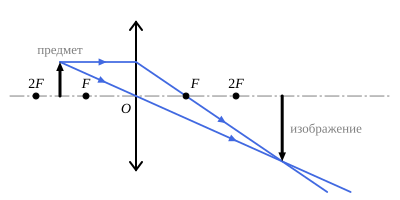

Очки, фотоаппарат, проектор, лупа — везде линзы. Даже глаз — это линза, которая строит изображение на сетчатке. Тема нужна в задачах 13, 14, 15 и 23.

Линзы, оптическую силу и построение изображений проходят в 8 классе. Формулу тонкой линзы и увеличение — в 11. Пригодится тема «Отражение и преломление света»: линза работает за счёт преломления.

## Шаг 1. Собирающие и рассеивающие линзы (8 класс)

**Собирающая** линза толще в середине, чем у краёв (в воздухе). Параллельные лучи после неё сходятся в одной точке — **фокусе**. Лупа и линза фотоаппарата — собирающие.

**Рассеивающая** линза тоньше в середине. Параллельные лучи после неё расходятся так, будто вышли из одной точки — мнимого фокуса. Очки для близоруких — рассеивающие.

## Шаг 2. Оптическая сила (8 класс)

**Фокусное расстояние** $F$ — расстояние от линзы до фокуса. **Оптическая сила**:

$$
D = \frac{1}{F}.
$$

Единица — диоптрия (дптр), $1\ \text{дптр} = 1\ \text{м}^{-1}$. Фокусное расстояние — **в метрах**. Чем короче фокус, тем сильнее линза преломляет.

<pp-task id="ks-lens-01"></pp-task>

## Шаг 3. Знак оптической силы (8 класс)

У собирающей линзы $D > 0$, у рассеивающей $D < 0$. Очки «$+2$» — собирающие с $F = 0{,}5\ \text{м}$ (для дальнозорких). Очки «$-4$» — рассеивающие с $|F| = 0{,}25\ \text{м}$ (для близоруких).

<pp-task id="ks-lens-02"></pp-task>

## Шаг 4. Как построить изображение (8 класс)

Достаточно двух лучей из точки предмета:

1. луч через **оптический центр** линзы не преломляется;
2. луч, параллельный главной оптической оси, после собирающей линзы проходит через фокус;
3. луч через передний фокус после линзы идёт параллельно оси.

Где лучи пересеклись — там изображение. Если пересекаются только продолжения лучей — изображение **мнимое**.

## Шаг 5. Где изображение у собирающей линзы (8 класс)

Двигай свечу к линзе издалека — и смотри:

- $d > 2F$ — изображение действительное, перевёрнутое, **уменьшенное** (фотоаппарат, глаз);
- $d = 2F$ — действительное, перевёрнутое, **равное**, тоже на расстоянии $2F$ за линзой;
- $F < d < 2F$ — действительное, перевёрнутое, **увеличенное** (проектор);
- $d = F$ — изображения нет (лучи идут параллельно);
- $d < F$ — **мнимое**, прямое, увеличенное (лупа).

У рассеивающей линзы изображение всегда мнимое, прямое, уменьшенное.

<pp-task id="ks-lens-03"></pp-task>

## Шаг 6. Формула тонкой линзы (11 класс)

$$
\frac{1}{d} + \frac{1}{f} = \frac{1}{F}.
$$

- $d$ — расстояние от предмета до линзы;
- $f$ — расстояние от линзы до изображения;
- $F$ — фокусное расстояние.

Если все расстояния в сантиметрах, можно считать в сантиметрах — формула однородная. Проверь себя по списку из шага 5: например, при $d = 2F$ формула даёт $f = 2F$.

<pp-task id="ks-lens-04"></pp-task>

## Шаг 7. Увеличение (11 класс)

**Увеличение** — во сколько раз изображение больше предмета:

$$
\Gamma = \frac{H}{h} = \frac{|f|}{d}.
$$

Изображение дальше от линзы, чем предмет, — оно увеличено.

<pp-task id="ks-lens-05"></pp-task>

## Шаг 8. Мнимые изображения и знаки (11 класс)

Знаки в формуле линзы: для мнимого изображения $f < 0$; для рассеивающей линзы $F < 0$. Если по формуле вышло $f < 0$, изображение мнимое — по ту же сторону линзы, что и предмет. Так работает лупа: предмет ближе фокуса, $1/f = 1/F - 1/d < 0$.

<pp-task id="ks-lens-06"></pp-task>

## Частые ловушки

- **Путают знаки в формуле линзы.** Мнимое изображение — $f < 0$, рассеивающая линза — $F < 0$.
- **Не переводят сантиметры в метры при расчёте диоптрий.** $F = 20\ \text{см}$ — это $D = 5\ \text{дптр}$.
- **Думают, что изображение предмета на расстоянии $2F$ увеличено.** Оно равно предмету.
- **Считают, что рассеивающая линза может дать действительное изображение** реального предмета. Не может.

## Как это выглядит на ЕГЭ

*Предмет находится на расстоянии $30\ \text{см}$ от собирающей линзы с фокусным расстоянием $20\ \text{см}$. На каком расстоянии от линзы получится изображение и каково увеличение?*

Предмет между $F$ и $2F$ — ждём действительное увеличенное изображение.

$$
\frac{1}{f} = \frac{1}{F} - \frac{1}{d} = \frac{1}{20} - \frac{1}{30} = \frac{1}{60},
$$

$f = 60\ \text{см}$. Увеличение $\Gamma = 60/30 = 2$.

## Коротко

- Собирающая: $F > 0$; рассеивающая: $F < 0$; $D = 1/F$ в диоптриях, $F$ в метрах.
- $1/d + 1/f = 1/F$; $\Gamma = |f|/d$.
- $d > 2F$ — уменьшенное; $F < d < 2F$ — увеличенное; $d < F$ — мнимое (лупа).
- Рассеивающая линза даёт мнимое уменьшенное изображение.
