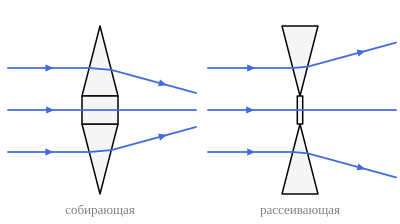
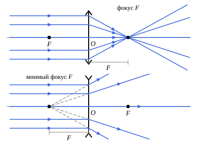

В солнечный день лупа собирает свет в маленькое яркое пятнышко — и бумага под ним начинает дымиться. А капля воды на странице увеличивает буквы под собой. И стёклышко лупы, и капля — линзы. Как кусок прозрачного вещества собирает лучи в одну точку?

## Что такое линза

**Линза** — прозрачное тело (обычно стекло или пластик), ограниченное двумя сферическими поверхностями; одна из них может быть плоской. Линзы бывают двух видов.

- **Собирающие** — толще в середине, чем у краёв: двояковыпуклая, плосковыпуклая, вогнуто-выпуклая.
- **Рассеивающие** — тоньше в середине: двояковогнутая, плосковогнутая, выпукло-вогнутая.

На схемах линзу рисуют отрезком: со стрелками наружу — собирающую, со стрелками внутрь — рассеивающую. Мы будем говорить о **тонких** линзах: их толщина намного меньше размеров, и всё преломление можно считать происходящим в одной плоскости — там, где нарисован отрезок.

## Почему линза собирает лучи

Пропусти луч через стеклянную призму. Он преломляется дважды: на входе в стекло прижимается к перпендикуляру, на выходе отклоняется от него (урок 14.4). В обоих случаях луч поворачивает в одну сторону — **к основанию призмы**, к её толстому краю.

Собирающую линзу можно представить как две призмы, сложенные основаниями, с пластинкой между ними. Верхний луч поворачивает вниз, нижний — вверх, а средний проходит прямо. Лучи сходятся. У рассеивающей линзы призмы сложены вершинами, основания смотрят наружу — и лучи расходятся.

Настоящая линза — это как бы много таких призм: чем дальше от середины, тем круче наклон поверхностей и тем сильнее поворачивает луч. Поэтому все параллельные лучи сходятся в одну точку.

## Ось, центр и фокус

Прямую через центры обеих поверхностей линзы называют **главной оптической осью**. Точку, где ось пересекает тонкую линзу, — **оптическим центром** $O$. Луч через оптический центр **не преломляется**: в середине линза — как тонкая плоская пластинка, и луч проходит её не сворачивая.

Пусти на собирающую линзу пучок лучей, параллельных главной оптической оси. После линзы они сойдутся в одной точке на оси. Это **фокус** $F$. Расстояние от оптического центра до фокуса — **фокусное расстояние**; его обозначают той же буквой $F$. Фокусов два, по обе стороны линзы, на одинаковом расстоянии от неё: пусти свет с другой стороны — он соберётся в другом фокусе.

У рассеивающей линзы параллельные лучи после неё расходятся. Продолжи их назад — продолжения сойдутся в точке перед линзой, будто лучи вышли оттуда. Это **мнимый фокус**: сами лучи в нём не встречаются, встречаются их продолжения, как у изображения в плоском зеркале (урок 14.3).

**Пример.** Как найти фокусное расстояние лупы? Направь её на Солнце. Солнце так далеко, что его лучи почти параллельны (урок 14.1). Двигай лист бумаги за лупой, пока светлое пятно не станет самым маленьким. Пятно — в фокусе, и расстояние от лупы до листа — фокусное расстояние.

<pp-task id="ks-lens-07"></pp-task>

Проверь себя: двояковыпуклый пузырёк воздуха в воде — собирающая линза или рассеивающая?

Рассеивающая. Правило «толще в середине — собирающая» верно для линзы из более плотного вещества, чем вокруг. В пузыре луч переходит из воды в воздух и отклоняется от перпендикуляра, а не прижимается к нему (урок 14.4), — призмы «работают наоборот», и лучи расходятся.

## Частые ловушки

- **Судят по виду поверхности, а не по толщине.** Вогнуто-выпуклая линза, толстая в середине, — собирающая.
- **Думают, что в фокусе рассеивающей линзы лучи встречаются.** Её фокус мнимый: сходятся продолжения лучей.
- **Путают фокус и фокусное расстояние.** Фокус — точка, фокусное расстояние — расстояние от линзы до неё.
- **Забывают, что после фокуса лучи идут дальше.** В фокусе они пересекаются и снова расходятся.

## Коротко

- Собирающая линза толще в середине, рассеивающая — тоньше (стекло в воздухе).
- Линза поворачивает лучи, как призма, к своему толстому краю.
- Луч через оптический центр не преломляется.
- Параллельные оси лучи после собирающей линзы сходятся в фокусе, после рассеивающей — расходятся из мнимого фокуса.
