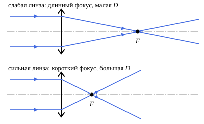

В рецепте на очки не пишут фокусное расстояние. Там стоят числа вроде «$+3$» или «$-1{,}5$». Что они означают и почему одни со знаком плюс, а другие с минусом?

## Сильная и слабая линза

Пропусти один и тот же параллельный пучок через две собирающие линзы. Одна поворачивает лучи слабо — они сходятся далеко за ней. Другая — сильно, и лучи сходятся близко. Чем сильнее линза преломляет лучи, тем **короче** её фокусное расстояние.

## Оптическая сила

Поэтому «силу» линзы удобно измерять величиной, обратной фокусному расстоянию. **Оптическая сила** линзы

$$
D = \frac{1}{F}.
$$

Единица оптической силы — **диоптрия** (дптр). Это оптическая сила линзы с фокусным расстоянием ${1\ \text{м}:}$ ${1\ \text{дптр} = 1\ \text{м}^{-1}.}$ Поэтому фокусное расстояние в формулу подставляют **в метрах**.

**Пример.** Фокусное расстояние линзы ${80\ \text{см}.}$ Переведём в метры: ${F = 0{,}8\ \text{м}.}$

$$
D = \frac{1}{0{,}8\ \text{м}} = 1{,}25\ \text{дптр}.
$$

Чем короче фокус, тем больше оптическая сила: у линзы с вдвое более коротким фокусом она вдвое больше.

<pp-task id="ks-lens-01"></pp-task>

## Знак оптической силы

Собирающая линза сводит лучи, рассеивающая — разводит. Чтобы одно число говорило и о силе линзы, и о её виде, договорились:

- у собирающей линзы фокус действительный, ${F > 0}$ и ${D > 0;}$
- у рассеивающей фокус мнимый, фокусное расстояние считают **отрицательным**: ${F < 0}$ и ${D < 0.}$

Именно это написано в рецепте на очки. Дальнозоркому человеку нужны собирающие линзы, «плюс». Близорукому — рассеивающие, «минус».

**Пример.** Очки «$+3$» — собирающие, ${F = \frac{1}{3}\ \text{м} \approx 33\ \text{см}.}$ Очки «$-8$» — рассеивающие, ${F = -\frac{1}{8}\ \text{м} = -12{,}5\ \text{см}:}$ их мнимый фокус в ${12{,}5\ \text{см}}$ перед линзой.

<pp-task id="ks-lens-02"></pp-task>

## Две линзы вплотную

Сложи две тонкие линзы вплотную — получится одна линза. Её оптическая сила равна **сумме** оптических сил с учётом знаков:

$$
D = D_1 + D_2.
$$

Складывают именно оптические силы, а не фокусные расстояния. Это ещё одна причина, почему оптики считают в диоптриях.

**Пример.** Линзы ${+7\ \text{дптр}}$ и ${-1\ \text{дптр}}$ вместе дают ${+7 - 1 = +6\ \text{дптр}:}$ система собирающая, ${F = \frac{1}{6}\ \text{м} \approx 17\ \text{см}.}$

<pp-task id="ks-lens-08"></pp-task>

Проверь себя: можно ли из двух собирающих линз сложить рассеивающую? А из собирающей и рассеивающей — собирающую?

Из двух собирающих — нельзя: сумма двух положительных оптических сил положительна. Из собирающей и рассеивающей — можно, если собирающая сильнее: например, ${+3}$ и ${-2}$ дают ${+1}$ дптр. Если сильнее рассеивающая, система будет рассеивающей.

## Частые ловушки

- **Подставляют фокусное расстояние в сантиметрах.** ${F = 80\ \text{см}}$ — это ${0{,}8\ \text{м}}$ и ${D = 1{,}25\ \text{дптр},}$ а не ${0{,}0125.}$
- **Путают $D$ и $F$.** Они обратны друг другу: сильная линза — большая $D$, короткий $F$.
- **Теряют минус.** У рассеивающей линзы и $D,$ и $F$ отрицательные.
- **Складывают фокусные расстояния.** Складываются оптические силы.

## Коротко

- ${D = 1/F,}$ $F$ — в метрах, $D$ — в диоптриях.
- Чем короче фокус, тем сильнее линза.
- Собирающая: ${D > 0;}$ рассеивающая: ${D < 0,}$ ${F < 0.}$
- Линзы вплотную: ${D = D_1 + D_2.}$
