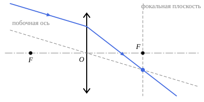

Поставь свечу перед собирающей линзой, а за линзой — лист бумаги. Подвигай лист — и на нём появится маленькое перевёрнутое пламя, резкое, как на фотографии. Где именно нужно держать лист и почему изображение перевёрнуто? Это можно найти карандашом и линейкой.

## Три удобных луча

От каждой точки свечи лучи идут во все стороны, и многие из них попадают на линзу. Все эти лучи после линзы сходятся в одной точке — это **изображение** точки. Значит, чтобы найти изображение, достаточно двух лучей: где они пересеклись, туда придут и все остальные.

Берут лучи, ход которых известен заранее:

1. луч, **параллельный главной оптической оси**, после собирающей линзы проходит **через фокус** — так определён фокус (урок 15.1);
2. луч **через оптический центр** идёт **не преломляясь**;
3. луч **через передний фокус** после линзы идёт **параллельно оси**. Это первый луч, пущенный в обратную сторону: ход луча обратим (урок 14.4).

## Изображение предмета

Предмет на рисунках — стрелка, стоящая на главной оптической оси. Её нижняя точка лежит на оси, и её изображение тоже на оси. Поэтому достаточно найти изображение **верхушки** и опустить из неё перпендикуляр на ось — это и будет изображение стрелки.

Если после линзы пересекаются **сами лучи**, изображение **действительное**: там реально собирается свет, и лист бумаги, поставленный туда, покажет картинку. Если лучи после линзы расходятся и пересекаются только их **продолжения**, изображение **мнимое** — как в плоском зеркале (урок 14.3): глаз его видит, а экран нет.

<pp-task id="ks-lens-09"></pp-task>

## Любой луч

На ЕГЭ бывает нужно провести не удобный, а произвольный луч. Помогает такое свойство: **параллельные друг другу лучи** после собирающей линзы сходятся в одной точке **фокальной плоскости** — плоскости через фокус, перпендикулярной оси. Для пучка вдоль оси это сам фокус, для наклонного пучка — другая точка той же плоскости.

Чтобы найти, куда пойдёт луч:

1. через оптический центр проведи **побочную ось** — прямую, параллельную лучу; она пройдёт линзу не преломляясь;
2. отметь, где побочная ось пересекает фокальную плоскость;
3. проведи преломлённый луч из точки падения на линзу в эту точку.

У рассеивающей линзы так же, только в точке фокальной плоскости перед линзой сходятся продолжения лучей.

Проверь себя: половину собирающей линзы закрыли картоном. Что станет с изображением свечи на экране?

Изображение останется целым и на том же месте, только станет тусклее. В каждую точку изображения приходят лучи от одной точки свечи через всю линзу. Закрыв половину, мы убрали половину лучей, но оставшиеся сходятся в тех же точках.

## Частые ловушки

- **Проводят луч, параллельный оси, через передний фокус.** После линзы он проходит через задний фокус, по другую сторону.
- **Думают, что нужны все три луча.** Хватит двух, третий — для проверки.
- **Ломают луч через оптический центр.** Он идёт прямо.
- **Считают изображение действительным, когда пересекаются продолжения.** Это мнимое изображение.

## Коротко

- Изображение точки — там, где после линзы пересекаются лучи от неё (или их продолжения).
- Удобные лучи: параллельный оси — через фокус; через центр — прямо; через фокус — параллельно оси.
- Пересеклись лучи — изображение действительное, только продолжения — мнимое.
- Произвольный луч идёт в точку фокальной плоскости на побочной оси, параллельной ему.
