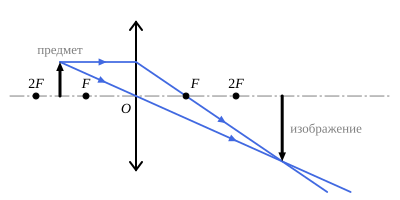
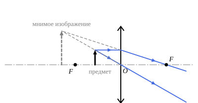

Фотоаппарат делает из большого дома маленькую картинку. Проектор, наоборот, из маленького слайда — огромную картинку на стене. А лупа показывает увеличенную букву, которую не поймать ни на какой экран. Во всех трёх приборах стоит собирающая линза. Разница только в том, где находится предмет.

## Предмет далеко

Начнём с предмета, стоящего дальше двойного фокусного расстояния: ${d > 2F.}$ Здесь $d$ — расстояние от предмета до линзы. Построение тремя лучами было в уроке 15.3: изображение получается за линзой между $F$ и $2F$ — **действительное, перевёрнутое, уменьшенное**. Так работают фотоаппарат и глаз: большой мир помещается на маленькую матрицу или сетчатку.

Чем дальше предмет, тем ближе изображение к фокусу. Изображение Солнца — в самом фокусе: так мы и находили фокусное расстояние лупы (урок 15.1).

## Предмет на двойном фокусе

При ${d = 2F}$ лучи сходятся тоже на расстоянии $2F$ за линзой. Изображение **действительное, перевёрнутое, того же размера**, что и предмет. Построение симметрично: луч через центр делит картинку на два одинаковых треугольника.

<pp-task id="ks-lens-03"></pp-task>

## Предмет между фокусом и двойным фокусом

При ${F < d < 2F}$ изображение уходит за $2F$ и становится **больше** предмета: действительное, перевёрнутое, увеличенное. Так работает проектор: слайд стоит чуть дальше фокуса объектива, а экран — далеко. Слайд вставляют вверх ногами, чтобы картинка на экране была правильной.

## Предмет в фокусе

При ${d = F}$ все лучи от точки предмета после линзы идут **параллельно** друг другу и нигде не пересекаются. Изображения нет. Так устроены прожектор и фонарик: лампа стоит в фокусе, и свет уходит параллельным пучком далеко вперёд.

## Предмет ближе фокуса

При ${d < F}$ линза не успевает свести лучи: после неё они расходятся, хотя и меньше, чем до неё. Продолжения лучей сходятся **перед** линзой, дальше от неё, чем предмет. Изображение **мнимое, прямое, увеличенное**. Его видит глаз, смотрящий через линзу. Это лупа.

## Сводка

| Где предмет | Изображение | Прибор |
|---|---|---|
| ${d > 2F}$ | действительное, перевёрнутое, уменьшенное, между $F$ и $2F$ | фотоаппарат, глаз |
| ${d = 2F}$ | действительное, перевёрнутое, равное, на $2F$ | — |
| ${F < d < 2F}$ | действительное, перевёрнутое, увеличенное, дальше $2F$ | проектор |
| ${d = F}$ | нет, лучи параллельны | прожектор |
| ${d < F}$ | мнимое, прямое, увеличенное, перед линзой | лупа |

Граница между уменьшенным и увеличенным — $2F$, между действительным и мнимым — $F$.

У **рассеивающей** линзы всё проще: где бы ни стоял предмет, изображение мнимое, прямое и уменьшенное. Подробно о нём — в уроке 15.7.

## Модель: линза и предмет

Перетаскивай предмет вдоль оси или двигай ползунок $d$. Проследи, как изображение проходит через все строки сводки: начни издалека и подходи к линзе. Подбери фокусное расстояние и поставь предмет на двойной фокус. Потом выбери рассеивающую линзу и убедись, что её изображение всегда мнимое и уменьшенное. Таблица считает расстояния по формуле линзы, о ней — в уроке 15.5.

<pp-lens>Модель тонкой линзы: собирающая или рассеивающая линза, предмет можно двигать вдоль оси, три луча и изображение, таблица расстояний, оптической силы, увеличения и вида изображения.</pp-lens>

<pp-task id="ks-lens-10"></pp-task>

Проверь себя: предмет медленно приближают к собирающей линзе от двойного фокуса к фокусу. Что происходит с изображением?

Оно остаётся действительным и перевёрнутым, но уходит от линзы всё дальше и растёт. Когда предмет почти в фокусе, изображение огромное и очень далеко, а в самом фокусе лучи становятся параллельными и изображение пропадает.

## Частые ловушки

- **Думают, что на двойном фокусе изображение увеличено.** Оно того же размера.
- **Ищут действительное изображение у лупы.** Предмет ближе фокуса — изображение мнимое.
- **Считают, что изображение собирающей линзы всегда перевёрнуто.** Мнимое изображение прямое.
- **Ждут изображения, когда предмет в фокусе.** Лучи параллельны, изображения нет.

## Коротко

- ${d > 2F}$ — уменьшенное, ${F < d < 2F}$ — увеличенное, оба действительные и перевёрнутые.
- ${d = 2F}$ — того же размера, на $2F$ за линзой.
- ${d = F}$ — изображения нет; ${d < F}$ — мнимое, прямое, увеличенное.
- Рассеивающая линза: всегда мнимое, прямое, уменьшенное.
