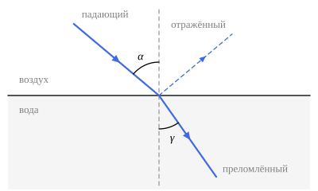

Ложка в стакане чая кажется сломанной, а дно реки — ближе, чем на самом деле. Это преломление. Почему по оптоволокну свет идёт на тысячи километров? Это полное внутреннее отражение. Тема нужна в задачах 13, 14, 15 и 23.

Тени, отражение, зеркало и само явление преломления проходят в 8 классе. Показатель преломления — в 9, закон преломления и полное отражение — в 11. Нужна только геометрия и «Основы кинематики»: скорость света — обычная скорость.

## Шаг 1. Свет идёт по прямой (8 класс)

В однородной среде свет идёт по прямой. Поэтому есть тени: если предмет загораживает источник, за ним образуется тёмная область. Если источник большой, у тени есть ещё и полутень.

Прямолинейность позволяет мерить высоты по теням. Солнце далеко, его лучи параллельны, и у всех предметов в одно время отношение высоты к длине тени одинаково: получаются подобные треугольники.

<pp-task id="ks-refr-01"></pp-task>

## Шаг 2. Закон отражения (8 класс)

Брось мяч в стену под углом — он отскочит под тем же углом. Свет ведёт себя так же:

- падающий луч, отражённый луч и перпендикуляр к поверхности в точке падения лежат в одной плоскости;
- угол отражения равен углу падения: $\beta = \alpha$.

**Углы отсчитывают от перпендикуляра** к поверхности, а не от самой поверхности. Если дан угол между лучом и зеркалом, угол падения равен $90^\circ$ минус он.

<pp-task id="ks-refr-02"></pp-task>

## Шаг 3. Плоское зеркало (8 класс)

В плоском зеркале изображение **мнимое**, прямое, того же размера, расположено симметрично предмету относительно зеркала: на таком же расстоянии за зеркалом, на каком предмет перед ним.

Отойдёшь от зеркала на $1\ \text{м}$ — изображение отойдёт тоже на $1\ \text{м}$, и расстояние между тобой и изображением вырастет на $2\ \text{м}$.

<pp-task id="ks-refr-03"></pp-task>

## Шаг 4. Преломление (8 класс)

Свет переходит из воздуха в воду и меняет направление на границе. Это **преломление**. Угол преломления $\gamma$ тоже отсчитывают от перпендикуляра.

Переходя в оптически **более плотную** среду (из воздуха в воду или стекло), луч прижимается к перпендикуляру: $\gamma < \alpha$. В менее плотную — отклоняется от него. Луч, падающий перпендикулярно границе, не преломляется.

## Шаг 5. Показатель преломления (9 класс)

Почему свет преломляется? В воде и стекле он идёт медленнее, чем в вакууме. Во сколько раз медленнее, показывает **абсолютный показатель преломления** среды:

$$
n = \frac{c}{v},
$$

где $c = 3 \cdot 10^8\ \text{м/с}$ — скорость света в вакууме, $v$ — в среде. У воды $n \approx 1{,}33$, у стекла около $1{,}5$, у воздуха практически $1$. Чем больше $n$, тем среда оптически плотнее.

<pp-task id="ks-refr-04"></pp-task>

## Шаг 6. Закон преломления (11 класс)

**Закон преломления** (Снеллиуса):

$$
n_1 \sin\alpha = n_2 \sin\gamma.
$$

- $\alpha$ — угол падения, $\gamma$ — угол преломления (оба от перпендикуляра);
- $n_1$, $n_2$ — показатели преломления первой и второй сред.

Из воздуха ($n_1 = 1$) в среду: $\sin\gamma = \sin\alpha / n$.

<pp-task id="ks-refr-05"></pp-task>

## Шаг 7. Длина волны в среде (11 класс)

Частота света при переходе не меняется (тема «Электромагнитные волны»), а скорость уменьшается в $n$ раз. Значит, и длина волны уменьшается в $n$ раз:

$$
\lambda = \frac{\lambda_0}{n},
$$

где $\lambda_0$ — длина волны в вакууме. Цвет света определяется частотой, поэтому красный свет в воде остаётся красным.

<pp-task id="ks-refr-06"></pp-task>

## Шаг 8. Полное внутреннее отражение (11 класс)

Свет идёт из воды в воздух. С ростом угла падения угол преломления растёт быстрее. При некотором **предельном угле** $\alpha_0$ угол преломления становится $90^\circ$:

$$
\sin\alpha_0 = \frac{n_2}{n_1} = \frac{1}{n} \quad (\text{если вторая среда — воздух}).
$$

При углах больше предельного свет вообще не выходит во вторую среду, а полностью отражается. Это и есть **полное внутреннее отражение**. Оно возможно только при переходе из **более** плотной среды в **менее** плотную. На нём работает оптоволокно.

<pp-task id="ks-refr-07"></pp-task>

## Частые ловушки

- **Отсчитывают углы от поверхности.** Только от перпендикуляра.
- **Путают, куда отклоняется луч.** В более плотной среде угол меньше.
- **Ищут полное отражение при переходе из воздуха в стекло.** Так не бывает.
- **Думают, что частота света меняется в воде.** Меняются скорость и длина волны.

## Как это выглядит на ЕГЭ

*Луч падает из воздуха на поверхность стекла с показателем преломления $1{,}5$ под углом $30^\circ$. Найди синус угла преломления.*

По закону преломления: $1 \cdot \sin 30^\circ = 1{,}5 \sin\gamma$,

$$
\sin\gamma = \frac{0{,}5}{1{,}5} \approx 0{,}33.
$$

Угол преломления около $19^\circ$ — меньше угла падения, как и должно быть при переходе в более плотную среду.

## Коротко

- Свет в однородной среде идёт по прямой.
- Отражение: $\beta = \alpha$, углы от перпендикуляра.
- Плоское зеркало: изображение мнимое, симметричное.
- $n = c/v$; $n_1\sin\alpha = n_2\sin\gamma$; $\lambda = \lambda_0/n$.
- Полное отражение: из более плотной в менее плотную, $\sin\alpha_0 = n_2/n_1$.
