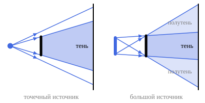
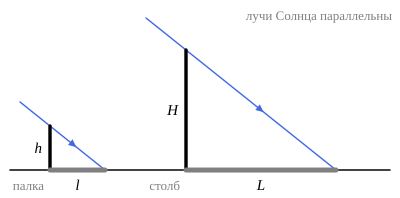

Луч прожектора в тумане, солнечные полосы между деревьями, луч лазерной указки в пыльной комнате — все они прямые. Свет не огибает углы: из-за угла комнаты ты не видишь, кто стоит в коридоре, хотя слышишь его. Почему так и что из этого следует?

## Луч

Свет — электромагнитная волна (урок 13.3). Видимый свет — узкий участок шкалы волн (урок 13.4), длина его волны меньше микрометра. Предметы вокруг нас в миллионы раз больше, и для них свет ведёт себя очень просто:

**В однородной среде свет распространяется прямолинейно.**

Однородная — значит, везде одинаковая: воздух в комнате, вода в стакане, стекло. На границе сред и в неоднородной среде (горячий воздух над асфальтом) свет может изменить направление — об этом уроки 14.2–14.7.

Узкий пучок света рисуют **лучом** — линией со стрелкой, которая показывает, куда идёт свет. Раздел физики, где свет описывают лучами, называют **геометрической оптикой**.

Скорость света огромна, но конечна: ${c = 3 \cdot 10^8\ \text{м/с}}$ в вакууме и почти столько же в воздухе. Свет идёт по прямой с постоянной скоростью, как тело при равномерном движении: ${s = ct}$ (урок 1.2 из механики). От Солнца до Земли около ${1{,}5 \cdot 10^{11}\ \text{м},}$ и свет проходит этот путь за

$$
t = \frac{s}{c} = \frac{1{,}5 \cdot 10^{11}}{3 \cdot 10^8} = 500\ \text{с},
$$

то есть примерно за 8 минут. Мы видим Солнце таким, каким оно было 8 минут назад.

## Тень и полутень

Поставь между лампой и стеной непрозрачный предмет. Лучи, которые проходят мимо его краёв, ограничивают область, куда свет не попадает. Это **тень**.

Если источник маленький (точечный), граница тени резкая. Если источник большой (матовый плафон, Солнце), картина другая. В середине — область, куда не попадает свет ни от одной точки источника: это тень. Вокруг неё — область, куда свет приходит только от части источника: это **полутень**, она светлее тени, но темнее освещённой стены.

Солнечное затмение — та же картина в космосе. Луна заслоняет Солнце. Там, где на Землю падает тень Луны, затмение полное; в полутени Солнце закрыто лишь частично.

Проверь себя: почему у тени от настольной лампы с большим матовым плафоном размытые края, а от маленького светодиода — резкие?

У большого источника край тени — полутень: туда свет приходит только от части плафона. Чем меньше источник, тем у́же полутень. Светодиод почти точечный, полутени почти нет.

## Высота по тени

Солнце очень далеко, поэтому его лучи, которые падают на палку и на соседний дом, практически параллельны. Значит, в одно и то же время они падают на землю под одним углом.

Предмет, его тень и луч, задевший верхушку, образуют прямоугольный треугольник. У палки и у столба эти треугольники подобны: у них одинаковые углы. Поэтому

$$
\frac{H}{L} = \frac{h}{l}.
$$

**Пример.** Днём палка высотой ${1\ \text{м}}$ отбрасывает тень ${0{,}5\ \text{м},}$ а дом — тень ${9\ \text{м}.}$ Тень у всех предметов вдвое короче их высоты, значит, высота дома

$$
H = L \cdot \frac{h}{l} = 9 \cdot \frac{1}{0{,}5} = 18\ \text{м}.
$$

Так ещё в древности мерили высоту пирамид.

<pp-task id="ks-refr-01"></pp-task>

С фонарём всё иначе: он близко, и его лучи расходятся из одной точки. Но подобные треугольники работают и здесь: треугольник «фонарь — основание столба — конец тени» подобен треугольнику «голова человека — его ноги — конец тени».

<pp-task id="ks-refr-08"></pp-task>

## Частые ловушки

- **Переворачивают пропорцию.** Высота относится к своей тени: ${H/L = h/l,}$ а не ${H/l.}$
- **Путают тень и полутень.** В тень не попадает свет ни от одной точки источника, в полутень — от части источника.
- **Считают лучи фонаря параллельными.** Параллельны лучи далёкого Солнца; от фонаря лучи расходятся.

## Коротко

- В однородной среде свет идёт по прямой. Узкий пучок света рисуют лучом.
- Скорость света ${c = 3 \cdot 10^8\ \text{м/с}.}$
- Тень — куда свет не попадает совсем, полутень — куда попадает от части источника.
- Лучи Солнца параллельны: ${H/L = h/l.}$
