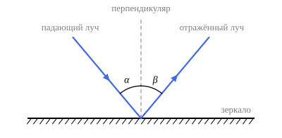
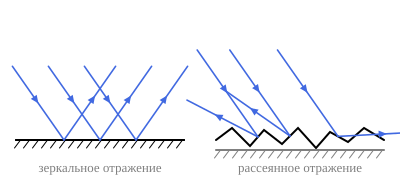

Солнечный зайчик от зеркальца прыгает по стене, когда ты поворачиваешь руку. Луна светит ночью, хотя сама не светится. Ты видишь эту страницу, хотя она не светится тоже. Во всех случаях свет отражается. По какому правилу?

## Как отражается луч

Брось мяч в гладкую стену под углом — он отскочит под тем же углом в другую сторону. Свет при отражении ведёт себя так же. Звук, кстати, тоже отражается — это эхо (урок 14.5 из механики).

Чтобы описать отражение точно, в точке, куда падает луч, проводят **перпендикуляр** к поверхности (его ещё называют нормалью). Углы отсчитывают от него:

- **угол падения** $\alpha$ — между падающим лучом и перпендикуляром;
- **угол отражения** $\beta$ — между отражённым лучом и перпендикуляром.

**Закон отражения:**

1. Падающий луч, отражённый луч и перпендикуляр к поверхности в точке падения лежат в одной плоскости.
2. Угол отражения равен углу падения:

$$
\beta = \alpha.
$$

Луч, падающий перпендикулярно зеркалу (${\alpha = 0}$), возвращается назад по той же линии.

## Углы — от перпендикуляра

Самая частая ошибка в задачах — взять угол между лучом и **поверхностью**. Если дан такой угол, угол падения его дополняет до прямого: ${\alpha = 90^\circ - \varphi.}$

**Пример.** Луч падает на зеркало так, что с поверхностью зеркала он образует угол ${50^\circ.}$ Угол падения

$$
\alpha = 90^\circ - 50^\circ = 40^\circ,
$$

угол отражения тоже ${40^\circ.}$ Угол между падающим и отражённым лучами — это ${\alpha + \beta = 2\alpha = 80^\circ.}$

<pp-task id="ks-refr-02"></pp-task>

Если увеличить угол падения, на столько же вырастет и угол отражения, а угол между лучами — на вдвое большую величину.

<pp-task id="ks-refr-09"></pp-task>

## Обратимость лучей

Пусти луч навстречу отражённому — он отразится и пойдёт точно навстречу падающему. Это **обратимость** световых лучей: свет может пройти любой путь в обратную сторону. Поэтому, если ты видишь в зеркале глаза друга, он видит в нём твои.

## Зеркальное и рассеянное отражение

Гладкая поверхность (зеркало, спокойная вода, полированный металл) отражает параллельный пучок тоже параллельным пучком. Это **зеркальное** отражение: в такой поверхности видны изображения.

Шероховатая поверхность (бумага, ткань, стена) состоит из множества крошечных площадок, повёрнутых как попало. Каждый луч отражается от своей площадки по закону отражения, но площадки смотрят в разные стороны, и лучи разлетаются во все стороны. Это **рассеянное** (диффузное) отражение.

Благодаря рассеянному отражению мы видим несветящиеся предметы с любой стороны: от каждой точки страницы отражённый свет идёт во все стороны и часть его попадает в глаз. А зеркало само по себе почти не видно — видно то, что в нём отражается.

Проверь себя: луч падает на зеркало перпендикулярно. Чему равны угол падения и угол отражения?

Нулю: луч идёт вдоль перпендикуляра, угол между ними ноль. Отражённый луч уходит назад по той же линии.

## Частые ловушки

- **Отсчитывают угол от поверхности.** Угол падения и угол отражения — от перпендикуляра.
- **Путают угол отражения с углом между лучами.** Угол между падающим и отражённым лучами ${2\alpha.}$
- **Думают, что шероховатая поверхность нарушает закон отражения.** Закон выполняется на каждой маленькой площадке, просто площадки повёрнуты по-разному.

## Коротко

- Углы отсчитывают от перпендикуляра к поверхности.
- Закон отражения: лучи и перпендикуляр в одной плоскости, ${\beta = \alpha.}$
- Световые лучи обратимы.
- Гладкая поверхность — зеркальное отражение, шероховатая — рассеянное.
