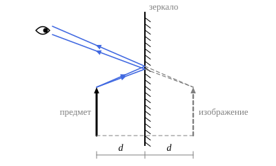

Посмотри в зеркало: человек «за стеклом» повторяет каждое твоё движение. Но за зеркалом — стена, никакого света оттуда не идёт. Откуда же берётся изображение и где именно оно находится?

## Как глаз видит изображение

Глаз не знает, где лучи побывали раньше. Он считает, что свет пришёл по прямой оттуда, откуда лучи входят в глаз (урок 14.1).

Возьмём точку предмета — верхушку стрелки перед зеркалом. От неё лучи идут во все стороны. Проследим два из них: каждый отражается по закону отражения (урок 14.2) и попадает в глаз. После отражения лучи расходятся. Продолжим их назад, за зеркало, — продолжения сойдутся в одной точке. Из неё, как кажется глазу, и вышли лучи. Это **изображение** верхушки.

Из закона отражения следует простая геометрия: точка и её изображение **симметричны** относительно плоскости зеркала. Они лежат на одном перпендикуляре к зеркалу, на одинаковых расстояниях от него.

## Свойства изображения

Изображение в плоском зеркале:

- **мнимое** — в нём сходятся не сами лучи, а их продолжения; за зеркалом никакого света нет, и экран там ничего не покажет;
- **прямое** — не перевёрнутое;
- **того же размера**, что и предмет;
- **симметрично** предмету: на таком же расстоянии за зеркалом, на каком предмет перед ним.

Из-за симметрии правое и левое у изображения меняются местами: поднимешь правую руку — «двойник» поднимет руку, которая у него левая. Поэтому в некоторых странах надпись на капоте машины скорой помощи пишут зеркально: водитель впереди прочитает её в зеркале заднего вида правильно.

**Пример.** Ты стоишь в ${2{,}5\ \text{м}}$ от зеркала. Изображение — в ${2{,}5\ \text{м}}$ за зеркалом. Между тобой и изображением

$$
2{,}5 + 2{,}5 = 5\ \text{м}.
$$

Расстояние до изображения — это **удвоенное** расстояние до зеркала.

<pp-task id="ks-refr-03"></pp-task>

## Изображение в движении

Отойдёшь от зеркала на ${1\ \text{м}}$ — изображение тоже отойдёт на ${1\ \text{м}}$ в свою сторону, и расстояние между вами вырастет на ${2\ \text{м}.}$

Со скоростями так же. Если ты идёшь к зеркалу со скоростью ${v,}$ изображение идёт к зеркалу навстречу тебе с той же скоростью ${v.}$ Скорость сближения — сумма скоростей (урок 1.6 из механики):

$$
v_{\text{сбл}} = v + v = 2v.
$$

**Пример.** Идёшь к зеркалу со скоростью ${0{,}5\ \text{м/с}.}$ К зеркалу ты приближаешься со скоростью ${0{,}5\ \text{м/с},}$ а к своему изображению — со скоростью ${1\ \text{м/с}.}$

<pp-task id="ks-refr-10"></pp-task>

Проверь себя: какой высоты нужно вертикальное зеркало, чтобы увидеть себя в полный рост?

В половину твоего роста. Луч от макушки в глаз отражается от точки зеркала посередине между макушкой и глазами, а луч от ступней — посередине между глазами и ступнями. Между этими точками ровно половина роста. И это не зависит от того, как далеко ты стоишь от зеркала.

## Частые ловушки

- **Находят расстояние до зеркала вместо расстояния до изображения.** До изображения вдвое дальше.
- **Считают, что изображение приближается со скоростью v.** К зеркалу — со скоростью ${v,}$ к тебе — со скоростью ${2v.}$
- **Думают, что изображение можно поймать на экран.** Оно мнимое: за зеркалом света нет.

## Коротко

- Изображение в плоском зеркале мнимое, прямое, того же размера.
- Предмет и изображение симметричны относительно зеркала.
- Расстояние от предмета до изображения вдвое больше, чем до зеркала.
- Идёшь к зеркалу со скоростью $v$ — к изображению приближаешься со скоростью ${2v.}$
