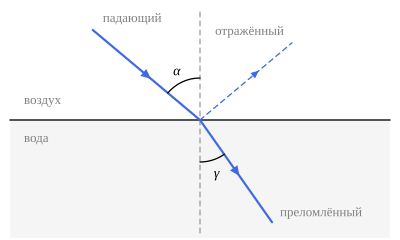
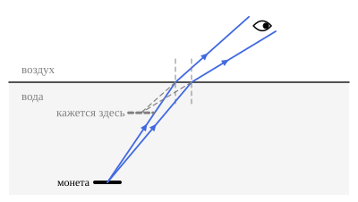

Опусти ложку в стакан с водой и посмотри сбоку: ручка будто сломана на поверхности воды. Положи монету на дно чашки и отойди так, чтобы край чашки её закрыл. Попроси кого-нибудь налить воды — монета «всплывёт» и снова станет видна. Свет на границе воды и воздуха меняет направление.

## Что происходит на границе

Направь луч из воздуха на воду наискосок. На границе он разделится:

- небольшая часть света **отразится** по закону отражения (урок 14.2) — поэтому в воде видно отражение берега;
- бо́льшая часть **пройдёт** в воду, но пойдёт уже в другом направлении.

Изменение направления света на границе двух сред называют **преломлением**. Угол между преломлённым лучом и перпендикуляром к границе — **угол преломления** ${\gamma.}$ Его, как и угол падения ${\alpha,}$ отсчитывают от перпендикуляра.

## Куда отклоняется луч

Опыт показывает простое правило. Среду, в которой свет идёт медленнее, называют **оптически более плотной** (о скорости — в уроке 14.5).

- Переходя в оптически **более плотную** среду (из воздуха в воду, из воздуха или воды в стекло), луч **прижимается к перпендикуляру**: ${\gamma < \alpha.}$
- Переходя в **менее плотную** (из воды в воздух), луч **отклоняется от перпендикуляра**: ${\gamma > \alpha.}$
- Луч, падающий **перпендикулярно** границе (${\alpha = 0}$), проходит не преломляясь.

Оптическая плотность — не то же самое, что плотность вещества: масло легче воды, но оптически плотнее её.

Как и при отражении, лучи обратимы. Если пустить луч из воды по пути преломлённого, он выйдет в воздух по пути падающего.

## Почему свет поворачивает

Представь, что колонна солдат идёт по асфальту и наискосок выходит на вспаханное поле, где идти медленнее. Тот край колонны, что ступил на поле первым, замедляется, а другой край ещё идёт быстро. Колонна поворачивает — ближе к перпендикуляру к краю поля. Так же и свет: в воде он идёт медленнее, чем в воздухе, и край волны, попавший в воду первым, отстаёт. Подробно это разберём в уроке 14.6.

Проверь себя: луч выходит из воды в воздух. Угол преломления больше или меньше угла падения?

Больше. Воздух оптически менее плотный, чем вода, и луч отклоняется от перпендикуляра.

<pp-task id="ks-refr-11"></pp-task>

## Почему вода кажется мельче

Лучи от монеты на дне выходят из воды и отклоняются от перпендикуляра. Глаз продолжает их назад по прямой — и продолжения сходятся выше настоящей монеты. Там глаз её и видит.

Поэтому дно водоёма кажется ближе, чем на самом деле: прозрачная речка, которая выглядит «по колено», может оказаться глубиной по пояс. А ложка в стакане кажется сломанной: её погружённая часть видна выше, чем она есть.

## Частые ловушки

- **Отсчитывают угол преломления от границы.** Только от перпендикуляра.
- **Путают, куда отклоняется луч.** В оптически более плотной среде угол меньше.
- **Думают, что перпендикулярный луч тоже преломляется.** При ${\alpha = 0}$ луч проходит прямо.
- **Забывают про отражение.** На границе всегда есть и отражённый луч, хоть и слабый.

## Коротко

- На границе двух сред свет частично отражается, а в основном преломляется.
- Угол преломления $\gamma$ отсчитывают от перпендикуляра.
- В оптически более плотную среду: ${\gamma < \alpha;}$ в менее плотную: ${\gamma > \alpha.}$
- Перпендикулярный луч не преломляется. Лучи обратимы.
