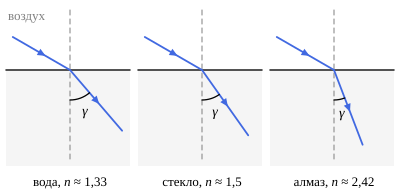

Луч из воздуха падает под одним и тем же углом на воду, на стекло и на алмаз. В воде он поворачивает немного, в стекле сильнее, в алмазе — сильнее всего. Чем эти среды отличаются для света? Скоростью.

## Скорость света в веществе

В вакууме свет бежит со скоростью ${c = 3 \cdot 10^8\ \text{м/с}}$ (урок 13.3). В веществе его поле раскачивает заряды атомов, они излучают в ответ, и в итоге свет идёт медленнее (подробнее — урок 13.7). Насколько медленнее, зависит от вещества.

**Абсолютный показатель преломления** среды показывает, во сколько раз скорость света в ней $v$ меньше, чем в вакууме:

$$
n = \frac{c}{v}.
$$

Это отношение двух скоростей, у него нет единиц. В веществе ${v < c,}$ поэтому ${n > 1.}$

| Среда | $n$ |
|---|---|
| вакуум | $1$ |
| воздух | ${1{,}0003 \approx 1}$ |
| лёд | ${1{,}31}$ |
| вода | ${1{,}33}$ |
| стекло (обычное) | около ${1{,}5}$ |
| алмаз | ${2{,}42}$ |

В задачах показатель преломления воздуха считают равным ${1.}$

**Оптически более плотная** среда — та, у которой $n$ больше: свет в ней медленнее. Теперь правило урока 14.4 можно сказать точнее: чем больше $n$ второй среды, тем сильнее луч из воздуха прижимается к перпендикуляру.

## Скорость из показателя преломления

Из ${n = c/v}$ скорость света в среде

$$
v = \frac{c}{n}.
$$

**Пример.** В алмазе (${n = 2{,}42}$) свет бежит со скоростью

$$
v = \frac{3 \cdot 10^8}{2{,}42} \approx 1{,}24 \cdot 10^8\ \text{м/с}
$$

— почти в два с половиной раза медленнее, чем в вакууме.

<pp-task id="ks-refr-04"></pp-task>

Проверь себя: может ли показатель преломления какого-нибудь вещества быть меньше единицы?

Нет: для видимого света в любом веществе свет медленнее, чем в вакууме, поэтому n больше единицы. У вакуума n равен единице ровно.

## Относительный показатель преломления

Луч не обязательно приходит из воздуха: он может идти из воды в стекло. Тогда важно, во сколько раз изменилась скорость при переходе из первой среды во вторую. Это **относительный показатель преломления** второй среды относительно первой:

$$
n_{21} = \frac{v_1}{v_2} = \frac{c/n_1}{c/n_2} = \frac{n_2}{n_1}.
$$

Если ${n_{21} > 1,}$ вторая среда оптически плотнее первой.

**Пример.** Из воды (${n_1 = 1{,}33}$) в стекло (${n_2 = 1{,}5}$):

$$
n_{21} = \frac{1{,}5}{1{,}33} \approx 1{,}13.
$$

Стекло плотнее воды, но разница меньше, чем у стекла с воздухом, поэтому луч из воды в стекло поворачивает слабее, чем из воздуха в стекло.

<pp-task id="ks-refr-12"></pp-task>

## Частые ловушки

- **Умножают c на n.** В среде свет медленнее: ${v = c/n,}$ а не ${cn.}$
- **Путают оптическую плотность с обычной.** Важна скорость света, а не масса единицы объёма.
- **Переворачивают относительный показатель.** ${n_{21} = n_2/n_1 = v_1/v_2}$ — скорость в первой среде в числителе.

## Коротко

- ${n = c/v}$: во сколько раз свет в среде медленнее, чем в вакууме; ${n \geq 1.}$
- Вода ${1{,}33,}$ стекло около ${1{,}5,}$ алмаз ${2{,}42,}$ воздух ${\approx 1.}$
- Больше $n$ — оптически плотнее.
- ${n_{21} = n_2/n_1 = v_1/v_2.}$
