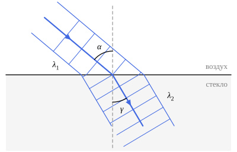

В уроке 14.4 мы узнали, куда поворачивает луч, а в уроке 14.5 — почему: свет меняет скорость. Теперь найдём, на сколько он поворачивает. Для этого посмотрим на свет как на волну.

## Фронты волны на границе

Свет — волна (урок 13.3). Нарисуем гребни волны в один момент: это линии, перпендикулярные лучам, на расстоянии длины волны друг от друга. Их называют **фронтами** волны.

Пучок света падает на стекло наискосок. Край фронта, который коснулся стекла первым, дальше идёт медленнее, а другой край ещё бежит по воздуху. Фронт поворачивается, а вместе с ним и лучи — как колонна солдат из урока 14.4.

Частота при переходе не меняется: её задаёт источник, и сколько гребней пришло к границе за секунду, столько и ушло дальше (урок 13.7, а для звука — урок 14.6 из механики). Скорость в стекле меньше, поэтому меньше и длина волны: ${\lambda = v/\nu.}$

## Откуда берётся закон

Фронт на границе не рвётся: каждый гребень, дойдя до стекла, продолжается в стекле из той же точки. Пусть соседние гребни пересекают границу на расстоянии $a$ друг от друга. Отрезок $a$ на границе — гипотенуза двух прямоугольных треугольников: в воздухе катет между соседними фронтами равен $\lambda_1$ и лежит против угла ${\alpha,}$ в стекле катет $\lambda_2$ лежит против угла ${\gamma.}$ Поэтому

$$
\begin{aligned}
\lambda_1 &= a \sin\alpha, \\
\lambda_2 &= a \sin\gamma.
\end{aligned}
$$

Поделим одно на другое — $a$ сократится. При одной частоте длины волн относятся как скорости, а скорости — обратно показателям преломления (урок 14.5):

$$
\frac{\sin\alpha}{\sin\gamma} = \frac{\lambda_1}{\lambda_2} = \frac{v_1}{v_2} = \frac{n_2}{n_1}.
$$

## Закон преломления

**Закон преломления** (закон Снеллиуса):

1. Падающий луч, преломлённый луч и перпендикуляр к границе в точке падения лежат в одной плоскости.
2. Для углов падения $\alpha$ и преломления $\gamma$:

$$
n_1 \sin\alpha = n_2 \sin\gamma.
$$

Здесь $n_1$ — показатель преломления среды, откуда идёт свет, $n_2$ — среды, куда он идёт. Оба угла — от перпендикуляра.

Закон сразу даёт правило урока 14.4: если ${n_2 > n_1,}$ то ${\sin\gamma < \sin\alpha}$ и ${\gamma < \alpha.}$ А если ${\alpha = 0,}$ то и ${\gamma = 0\text{:}}$ перпендикулярный луч не преломляется.

Чаще всего свет идёт из воздуха (${n_1 = 1}$) в среду с показателем $n$:

$$
\sin\gamma = \frac{\sin\alpha}{n}.
$$

**Пример.** Луч падает из воздуха на воду (${n \approx 1{,}33 \approx 4/3}$), синус угла падения ${0{,}8}$ (угол около $53^\circ$). Синус угла преломления

$$
\sin\gamma = \frac{0{,}8}{4/3} = 0{,}6,
$$

угол преломления около $37^\circ$ — меньше угла падения, как и должно быть при переходе в оптически более плотную среду.

<pp-task id="ks-refr-05"></pp-task>

Закон работает и в обратную сторону: зная оба угла, находят показатель преломления: ${n = \sin\alpha / \sin\gamma.}$ Так его и измеряют.

<pp-task id="ks-refr-13"></pp-task>

Проверь себя: угол падения увеличили вдвое. Увеличится ли вдвое угол преломления?

Нет. Закон связывает синусы углов, а не сами углы, а синус не пропорционален углу. Пропорциональность углов — лишь приближение для маленьких углов.

## Длина волны в среде

Из того же рисунка: частота та же, скорость в $n$ раз меньше, чем в вакууме, — значит, и длина волны в $n$ раз меньше (урок 13.7, там это было ${\lambda/\lambda_0 = v/c}$):

$$
\lambda = \frac{\lambda_0}{n},
$$

где $\lambda_0$ — длина волны в вакууме. Цвет определяет частота, поэтому в воде красный свет остаётся красным, хотя его длина волны стала короче.

<pp-task id="ks-refr-06"></pp-task>

## Частые ловушки

- **Пишут углы вместо синусов.** ${n_1 \sin\alpha = n_2 \sin\gamma,}$ а не ${n_1\alpha = n_2\gamma.}$
- **Путают, где ${n_1,}$ а где ${n_2.}$** $n_1$ — там, откуда идёт свет, рядом с углом падения.
- **Отсчитывают углы от границы.** Только от перпендикуляра.
- **Думают, что в среде меняется частота.** Меняются скорость и длина волны.

## Коротко

- Закон преломления: ${n_1 \sin\alpha = n_2 \sin\gamma.}$
- Из воздуха: ${\sin\gamma = \sin\alpha / n.}$
- Закон следует из непрерывности фронтов: ${\sin\alpha / \sin\gamma = \lambda_1/\lambda_2 = v_1/v_2.}$
- Частота при переходе не меняется, длина волны ${\lambda = \lambda_0/n.}$
