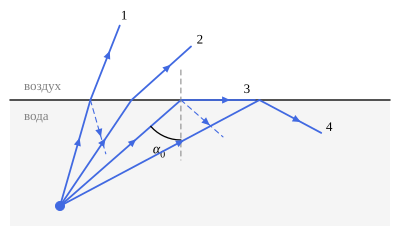
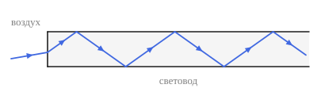

Нырни в бассейн и посмотри вверх наискосок: поверхность воды сверкает, как зеркало, и сквозь неё ничего не видно. А по стеклянному волокну тоньше волоса свет проходит десятки километров и не выходит наружу. Это одно и то же явление.

## Когда луч не может выйти

Пусть свет идёт из воды в воздух. Воздух оптически менее плотный, поэтому луч отклоняется от перпендикуляра: угол преломления больше угла падения (урок 14.4). Будем увеличивать угол падения:

- луч 1 выходит в воздух, отклонившись от перпендикуляра; чуть-чуть света отражается обратно в воду;
- луч 2 падает под бо́льшим углом — угол преломления растёт быстрее и уже близок к $90^\circ$;
- луч 3 падает под таким углом, что угол преломления равен $90^\circ$: преломлённый луч скользит вдоль поверхности;
- луч 4 падает под ещё бо́льшим углом — и в воздух не выходит вовсе. Весь свет отражается обратно в воду.

Это **полное внутреннее отражение**: свет падает на границу с менее плотной средой и целиком отражается назад. «Внутреннее» — потому что свет остаётся внутри плотной среды. Отражение при этом лучше, чем у самого хорошего зеркала: теряется не ${5\text{–}10}$ процентов света, а практически ничего.

## Предельный угол

Угол падения, при котором угол преломления равен ${90^\circ,}$ называют **предельным углом** полного отражения ${\alpha_0.}$ Из закона преломления (урок 14.6) с ${\gamma = 90^\circ}$ и ${\sin 90^\circ = 1}$:

$$
n_1 \sin\alpha_0 = n_2,
\qquad
\sin\alpha_0 = \frac{n_2}{n_1}.
$$

Если вторая среда — воздух (${n_2 = 1}$), а у первой показатель преломления $n$:

$$
\sin\alpha_0 = \frac{1}{n}.
$$

При ${\alpha < \alpha_0}$ свет частично выходит, при ${\alpha \geq \alpha_0}$ — полностью отражается.

Полное отражение возможно **только** при переходе из более плотной среды в менее плотную. Если ${n_2 > n_1,}$ то ${n_2/n_1 > 1,}$ а синус больше единицы не бывает: из воздуха в воду луч входит под любым углом.

**Пример.** У алмаза ${n = 2{,}42.}$ На границе алмаза с воздухом

$$
\sin\alpha_0 = \frac{1}{2{,}42} \approx 0{,}41,
\qquad
\alpha_0 \approx 24^\circ.
$$

Предельный угол маленький, и почти весь свет, попавший в огранённый алмаз, много раз полностью отражается от его граней и выходит только через верхние — поэтому бриллиант так сверкает.

<pp-task id="ks-refr-07"></pp-task>

Вторая среда не обязательно воздух: полное отражение бывает и на границе стекла с водой, если свет идёт из стекла. Тогда в формулу идут оба показателя.

<pp-task id="ks-refr-14"></pp-task>

## Модель: луч на границе

Выбери, откуда и куда идёт свет, и меняй угол падения. Пунктир на стороне падающего луча — предельный угол, если он есть. Проследи, что происходит с преломлённым и отражённым лучами, когда угол падения его переходит. Попробуй «алмаз → воздух» и наоборот, «воздух → алмаз».

<pp-refract>Модель луча на границе двух сред: выбор сред, угол падения, отражённый и преломлённый лучи, предельный угол.</pp-refract>

<pp-task id="ks-refr-15"></pp-task>

## Световоды

**Световод** (оптоволокно) — тонкая стеклянная нить с оболочкой, у которой показатель преломления чуть меньше. Свет входит в торец нити и падает на её стенку под углом больше предельного. Он полностью отражается, падает на противоположную стенку под тем же углом, снова отражается — и так бежит по нити, даже если она изогнута.

По оптоволокну идут интернет и телефонная связь: свет почти не теряется на десятках километров. Врачи по световоду освещают и рассматривают желудок изнутри (эндоскоп).

Проверь себя: может ли произойти полное внутреннее отражение, когда свет идёт из воздуха в стекло?

Нет. Стекло оптически плотнее воздуха, луч в нём прижимается к перпендикуляру и входит под любым углом падения. Полное отражение бывает только при переходе в менее плотную среду.

## Частые ловушки

- **Ищут полное отражение при переходе в более плотную среду.** Только из более плотной в менее плотную.
- **Переворачивают отношение.** ${\sin\alpha_0 = n_2/n_1}$ — меньший показатель в числителе, иначе синус выйдет больше единицы.
- **Вычитают угол из ${90^\circ}$ или берут косинус.** Предельный угол — угол падения, от перпендикуляра, и в формуле синус.
- **Думают, что предельный угол всегда ${90^\circ.}$** $90^\circ$ — это угол преломления при предельном угле падения.

## Коротко

- Из более плотной среды в менее плотную при ${\alpha \geq \alpha_0}$ свет полностью отражается.
- ${\sin\alpha_0 = n_2/n_1;}$ на границе с воздухом ${\sin\alpha_0 = 1/n.}$
- Из менее плотной среды в более плотную полного отражения нет.
- На полном отражении работают световоды.

Это последний урок темы. Дальше — тема «Линзы»: как стеклянная линза, преломляя лучи, собирает их в точку и даёт изображение — в фотоаппарате, в очках и в глазу.
