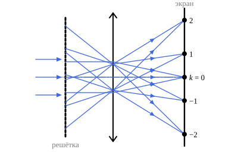

Радужные разводы на мыльном пузыре, радуга после дождя, переливы на диске — всё это проявления волновой природы света. Тема встречается в задаче 13 и в задаче 14.

Дисперсию — разложение белого света в спектр — показывают в 9 классе. Интерференцию, дифракцию и дифракционную решётку — в 11. Пригодятся темы «Преломление света», «Электромагнитные волны» и «Механические волны» (разность фаз).

## Шаг 1. Дисперсия (9 класс)

Пропусти белый свет через стеклянную призму — получится радуга. Белый свет состоит из волн разного цвета, а показатель преломления стекла зависит от частоты: у фиолетового он больше, у красного меньше. Поэтому фиолетовый преломляется сильнее и отклоняется больше.

**Дисперсия** — зависимость показателя преломления от частоты (длины волны) света. Радуга на небе — дисперсия в каплях дождя.

Порядок цветов в спектре: красный, оранжевый, жёлтый, зелёный, голубой, синий, фиолетовый. Длина волны уменьшается от красного (около $760\ \text{нм}$) к фиолетовому (около $380\ \text{нм}$), а частота растёт.

## Шаг 2. Интерференция (11 класс)

Две волны встречаются. Если гребень одной совпадает с гребнем другой — они усиливают друг друга. Если гребень попадает на впадину — гасят. Это **интерференция**.

Для устойчивой картины волны должны быть **когерентными**: одинаковой частоты и с постоянной разностью фаз. Обычно их получают, разделив свет одного источника на два пучка.

Волны гасят друг друга, если одна отстала от другой на полволны: наименьшая разность хода для гашения — $\lambda/2$.

<pp-task id="ks-wopt-01"></pp-task>

## Шаг 3. Условия максимума и минимума (11 класс)

Условия при разности хода $\Delta$ (разности путей, пройденных волнами до точки):

- **максимум** (усиление): $\Delta = k\lambda$, где $k = 0, 1, 2, \dots$ — чётное число полуволн;
- **минимум** (ослабление): $\Delta = (2k + 1)\dfrac{\lambda}{2}$ — нечётное число полуволн.

Удобный приём: посчитай, сколько **полуволн** укладывается в $\Delta$. Чётное число — светло, нечётное — темно.

Мыльная плёнка окрашена потому, что свет отражается от её передней и задней поверхностей, и эти волны интерферируют. Для разных цветов усиление получается при разной толщине.

<pp-task id="ks-wopt-02"></pp-task>

## Шаг 4. Дифракция (11 класс)

Волны огибают препятствия. Звук слышно из-за угла, потому что длина звуковой волны — метры. Свет тоже огибает препятствия, но заметно это только для препятствий и щелей размером, сравнимым с длиной волны.

**Дифракция** — огибание волнами препятствий, отклонение от прямолинейного распространения.

## Шаг 5. Дифракционная решётка (11 класс)

Решётка — много параллельных узких щелей на одинаковом расстоянии $d$ (период решётки). Свет за решёткой даёт яркие максимумы под углами, при которых

$$
d \sin\varphi = k\lambda.
$$

- $d$ — период решётки, м;
- $\varphi$ — угол, под которым виден максимум;
- $k$ — порядок максимума ($0, 1, 2, \dots$);
- $\lambda$ — длина волны.

<pp-task id="ks-wopt-03"></pp-task>

## Шаг 6. Период решётки по числу штрихов (11 класс)

На решётках пишут не период, а число штрихов на миллиметр $N$. Тогда период

$$
d = \frac{1}{N}\ \text{мм}.
$$

Например, «$500$ штрихов на мм» — $d = 1/500\ \text{мм} = 2 \cdot 10^{-6}\ \text{м}$. По известным $d$, $k$ и углу можно найти длину волны — так измеряют длины волн в спектроскопах.

<pp-task id="ks-wopt-04"></pp-task>

## Шаг 7. Сколько максимумов видно (11 класс)

Синус не бывает больше $1$, поэтому $k\lambda \le d$. Наибольший возможный порядок — целая часть от $d/\lambda$. Если $d/\lambda$ получилось целым, максимум этого порядка шёл бы под углом $90^\circ$ — по экрану, и его не видно; тогда $k_{\max}$ на единицу меньше.

Всего максимумов: центральный и по $k_{\max}$ с каждой стороны, то есть $2k_{\max} + 1$.

<pp-task id="ks-wopt-05"></pp-task>

## Шаг 8. Решётка и призма (11 класс)

И решётка, и призма раскладывают белый свет в спектр, но по-разному. Призма сильнее отклоняет **фиолетовый** (у него больше показатель преломления). Решётка сильнее отклоняет **красный**: в $d\sin\varphi = k\lambda$ у красного больше $\lambda$, значит, больше и угол.

## Частые ловушки

- **Путают, что сильнее отклоняет призма и решётка.** Призма — фиолетовый, решётка — красный.
- **Забывают перевести период решётки.** «$N$ штрихов на мм» → $d = 1/N$ мм.
- **Принимают дробное значение $d/\lambda$ за порядок.** Порядок — только целое число, и $\sin\varphi$ не может быть больше $1$.
- **Думают, что интерференцию дадут любые два источника.** Нужны когерентные.

## Как это выглядит на ЕГЭ

*На дифракционную решётку с периодом $2\ \text{мкм}$ падает перпендикулярно свет с длиной волны $500\ \text{нм}$. Под каким углом виден максимум первого порядка? Сколько всего максимумов можно наблюдать?*

$$
\sin\varphi = \frac{k\lambda}{d} = \frac{1 \cdot 500 \cdot 10^{-9}}{2 \cdot 10^{-6}} = 0{,}25.
$$

Угол около $14{,}5^\circ$.

Наибольший порядок: $d/\lambda = 4$, но при $k = 4$ получается $\sin\varphi = 1$ — угол $90^\circ$, такой максимум не наблюдается. Значит, $k_{\max} = 3$. Максимумы: центральный и по три с каждой стороны — всего $7$.

## Коротко

- Дисперсия: $n$ зависит от частоты; призма сильнее отклоняет фиолетовый.
- Интерференция когерентных волн: максимум $\Delta = k\lambda$, минимум $\Delta = (2k+1)\lambda/2$.
- Дифракция — огибание препятствий, заметна при размерах порядка $\lambda$.
- Решётка: $d\sin\varphi = k\lambda$, $d = 1/N$; число максимумов $2k_{\max} + 1$; сильнее отклоняет красный.
