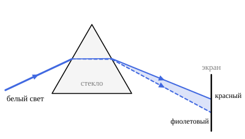
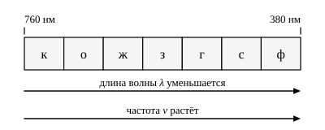

В солнечный день на стене за стеклянной призмой, гранёным стаканом или аквариумом появляется радужная полоска. В самом стекле никаких красок нет, и солнечный свет белый. Откуда цвета?

## Опыт Ньютона

Так в 1666 году поставил опыт Ньютон. Узкий пучок солнечного света из щели в ставне он пропустил через стеклянную призму. На стене вместо белого пятна вышла вытянутая цветная полоса — **спектр**. Цвета шли всегда в одном порядке: красный, оранжевый, жёлтый, зелёный, голубой, синий, фиолетовый.

Ньютон проверил, что призма не «красит» свет. Он вырезал из спектра один цвет и пустил его во вторую призму: цвет больше не раскладывался, только отклонялся. А когда собрал все цвета спектра линзой в одну точку, получил снова белое пятно. Вывод: **белый свет — смесь** волн всех цветов, а призма их только разделяет.

## Почему цвета расходятся

На каждой грани призмы свет преломляется (урок 14.6), и угол поворота зависит от показателя преломления стекла ${n.}$ Если бы $n$ был одинаков для всех цветов, все лучи повернули бы одинаково и белый свет остался бы белым. Значит, $n$ у стекла для разных цветов разный.

**Дисперсия** — зависимость показателя преломления вещества от частоты (цвета) света.

У стекла, воды и большинства прозрачных веществ показатель преломления растёт от красного к фиолетовому. Для одного сорта стекла, например:

| Цвет | $n$ |
|---|---|
| красный | ${1{,}61}$ |
| зелёный | ${1{,}63}$ |
| фиолетовый | ${1{,}67}$ |

Разница небольшая, но заметная. Чем больше ${n,}$ тем сильнее луч поворачивает на границе (урок 14.5). Поэтому **фиолетовый свет призма отклоняет сильнее всего, красный — слабее всего**. На рисунке фиолетовый луч ниже: его призма повернула сильнее.

Раз ${n = c/v,}$ дисперсия значит ещё и то, что в стекле свет разных цветов бежит с разной скоростью: красный быстрее, фиолетовый медленнее. В вакууме все цвета бегут с одной скоростью $c$ (урок 13.3), и дисперсии там нет.

<pp-task id="ks-wopt-06"></pp-task>

## Цвет и длина волны

Видимый свет — узкая полоса электромагнитных волн (урок 13.4). Каждому цвету соответствует своя частота, а значит, и своя длина волны в вакууме.

- Красный свет — самые длинные видимые волны, около ${760\ \text{нм},}$ и самая низкая частота.
- Фиолетовый — самые короткие, около ${380\ \text{нм},}$ и самая высокая частота.

В стекле длина волны меньше, чем в вакууме, а частота та же, и цвет остаётся прежним: цвет задаёт частота (урок 13.7). Поэтому, когда говорят «длина волны красного света», имеют в виду длину волны в вакууме.

Итог дисперсии в стекле: чем выше частота (короче волна), тем больше $n$ и тем сильнее преломление.

Проверь себя: какой свет быстрее проходит стеклянную призму — красный или фиолетовый?

Красный. У него показатель преломления меньше, а скорость в стекле v = c/n больше.

## Радуга

Радуга — та же дисперсия, только в каплях дождя. Солнечный луч входит в каплю, преломляется, отражается от её задней стенки и выходит, снова преломившись. Показатель преломления воды для фиолетового тоже больше, поэтому цвета выходят из капли под чуть разными углами. Каждая капля посылает в глаз один цвет, а капли на разной высоте — разные цвета. Радугу видно, только если Солнце у тебя за спиной.

## Частые ловушки

- **Думают, что призма окрашивает свет.** Она разделяет цвета, которые уже были в белом свете.
- **Путают, какой цвет призма отклоняет сильнее.** Фиолетовый: у него больше ${n.}$
- **Думают, что дисперсия есть и в вакууме.** В вакууме все цвета бегут со скоростью ${c.}$
- **Путают порядок цветов.** Красный, оранжевый, жёлтый, зелёный, голубой, синий, фиолетовый — «каждый охотник желает знать, где сидит фазан».

## Коротко

- Белый свет — смесь всех цветов; призма разлагает его в спектр.
- Дисперсия — зависимость $n$ от частоты света.
- В стекле и воде $n$ растёт от красного к фиолетовому: фиолетовый преломляется сильнее.
- Красный — длинные волны (около ${760\ \text{нм}}$), фиолетовый — короткие (около ${380\ \text{нм}}$).
