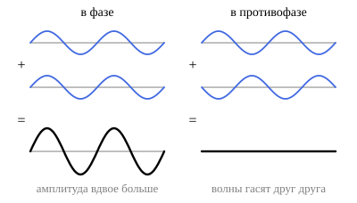
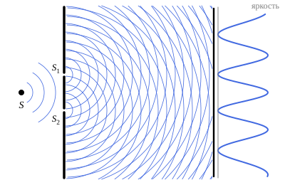

Брось в пруд два камня рядом. От каждого побегут круги, а там, где круги встретятся, вода в одних местах качается вдвое сильнее, а в других почти стоит. Две волны не отталкиваются и не ломают друг друга: каждая бежит дальше, как будто другой нет. Но в точке встречи их колебания складываются.

## Две волны в одной точке

Пусть в точку приходят две волны одинаковой частоты и амплитуды. Каждая раскачивает точку по-своему, и смещение точки — сумма двух смещений. Это правило называют **принципом суперпозиции**: колебания от разных волн просто складываются.

Всё решает, как соотносятся фазы волн (урок 14.7 из механики).

- Волны пришли **в фазе**: горб одной совпал с горбом другой, впадина с впадиной. Смещения всё время одного знака и складываются: амплитуда вдвое больше.
- Волны пришли **в противофазе**: горб одной совпал с впадиной другой. Смещения всё время равны и противоположны: сумма ноль, точка стоит.

Для света «качается» не вода, а электрическое поле волны (урок 13.3). Там, где поля складываются, светло; где гасят друг друга, темно.

**Пример.** Две одинаковые волны на воде с амплитудой ${2\ \text{мм}}$ приходят в точку в фазе: точка качается с амплитудой ${4\ \text{мм}.}$ Если в противофазе — точка неподвижна.

<pp-task id="ks-wopt-07"></pp-task>

## Интерференция

**Интерференция** — сложение волн, при котором в одних точках колебания устойчиво усиливаются, а в других ослабляются. Получается неподвижная картина: светлые и тёмные полосы на экране, неподвижные «горбатые» и «спокойные» полосы на воде.

Где же энергия, если в тёмных местах света нет? Энергия волны растёт как квадрат амплитуды, как у любых колебаний (урок 13.7 из механики). В светлой полосе амплитуда вдвое больше, значит, яркость вчетверо больше, чем от одной волны. В тёмной — ноль. В среднем выходит вдвое больше, чем от одной волны, — как и должно быть от двух. Энергия не пропадает, а **перераспределяется**: из тёмных мест в светлые.

Наименьшее отставание, при котором волны гасят друг друга, — полволны: тогда горб одной приходится на впадину другой.

<pp-task id="ks-wopt-01"></pp-task>

## Когерентные волны

Включи две одинаковые лампы — полос на стене не будет, только ровная освещённость. Почему? Лампа излучает свет не непрерывно, а короткими обрывками: каждый атом светит миллиардные доли секунды, и фаза каждого нового обрывка случайна. Разность фаз двух ламп скачет миллионы раз в секунду, усиление в данной точке тут же сменяется ослаблением, и глаз видит среднее.

Устойчивая картина получается только у **когерентных** волн: у них одинаковая частота и **постоянная разность фаз**.

Как получить когерентный свет? Разделить свет одного источника на два пучка. Тогда любой скачок фазы источника приходит в оба пучка сразу, и разность фаз не меняется.

## Опыт Юнга

Так в 1802 году сделал Томас Юнг. Свет от одного источника $S$ падал на непрозрачный экран с двумя узкими щелями $S_1$ и $S_2$ рядом. Каждая щель становилась новым источником волн, и эти два источника были когерентны: их питала одна волна. За щелями на экране получались чередующиеся светлые и тёмные полосы.

Опыт Юнга стал решающим доводом: свет — волна. Частицы, пролетев через две щели, дали бы два светлых пятна, а не полосы, и темноты там, куда свет из одной щели попадает, не возникло бы.

Проверь себя: на экран светят две одинаковые лазерные указки. Будут ли на нём полосы интерференции?

Нет. Две отдельные указки — независимые источники: их фазы меняются случайно и независимо, так что разность фаз непостоянна. Полосы даёт свет одной указки, разделённый на два пучка.

## Частые ловушки

- **Думают, что интерференцию дадут любые два источника.** Нужны когерентные: одна частота и постоянная разность фаз.
- **Думают, что в тёмной полосе энергия исчезла.** Она ушла в светлые полосы.
- **Считают, что в фазе яркость удваивается.** Удваивается амплитуда, а яркость (энергия) — вчетверо.
- **Путают условие гашения.** Гасят друг друга волны, отставшие на полволны, а не на целую волну.

## Коротко

- Колебания от разных волн складываются (суперпозиция).
- В фазе — амплитуда вдвое больше, в противофазе — ноль.
- Интерференция — устойчивая картина усилений и ослаблений; энергия перераспределяется.
- Интерферируют только когерентные волны; их получают, разделив свет одного источника (опыт Юнга).
