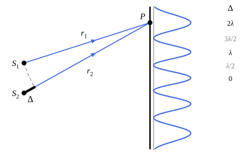
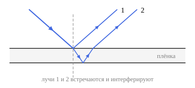

В опыте Юнга на экране чередуются светлые и тёмные полосы. Отчего в одной точке экрана светло, а в соседней темно? Обе получают свет от тех же двух щелей. Разница только в том, сколько пробегает каждая волна.

## Разность хода

Пусть два когерентных источника $S_1$ и $S_2$ колеблются в фазе. До точки $P$ волна от $S_1$ проходит путь ${r_1,}$ а от $S_2$ — путь ${r_2.}$

**Разность хода** — разность путей, пройденных волнами до точки:

$$
\Delta = r_2 - r_1.
$$

Дальняя волна опаздывает. Точка волны, которая дальше от источника на ${\Delta,}$ отстаёт по фазе на ${2\pi\Delta/\lambda}$ (урок 14.7 из механики). Значит, в точке $P$ две волны встречаются с разностью фаз

$$
\Delta\varphi = 2\pi\frac{\Delta}{\lambda}.
$$

## Условия максимума и минимума

Из урока 16.2: в фазе — усиление, в противофазе — гашение.

- **Максимум** (светло): ${\Delta = k\lambda,}$ где ${k = 0, 1, 2, \dots}$ Разность хода — целое число длин волн. Тогда ${\Delta\varphi = 2\pi k}$ — целое число оборотов, волны приходят в фазе.
- **Минимум** (темно): ${\Delta = (2k + 1)\dfrac{\lambda}{2}.}$ Разность хода — нечётное число полуволн. Тогда ${\Delta\varphi = \pi, 3\pi, \dots}$ — волны в противофазе.

Удобный приём: посчитай, сколько **полуволн** укладывается в ${\Delta.}$

$$
m = \frac{\Delta}{\lambda/2}.
$$

Чётное $m$ — максимум, нечётное — минимум. Целое число длин волн — это и есть чётное число полуволн.

**Пример.** Свет с длиной волны ${520\ \text{нм},}$ разность хода ${1{,}3\ \text{мкм} = 1300\ \text{нм}.}$ Полуволна — ${260\ \text{нм},}$ и

$$
m = \frac{1300}{260} = 5.
$$

Число нечётное: в точке минимум, темно.

<pp-task id="ks-wopt-02"></pp-task>

Полосы на экране Юнга — это места, где $\Delta$ равна ${0, \lambda, 2\lambda\dots}$ (светлые) и ${\lambda/2, 3\lambda/2\dots}$ (тёмные). В середине экрана ${\Delta = 0\text{:}}$ там всегда светлая полоса.

<pp-task id="ks-wopt-08"></pp-task>

Проверь себя: в точке экрана максимум. Свет заменили на свет вдвое большей длины волны. Что будет в этой точке?

Разность хода та же, а полуволна стала вдвое длиннее, значит, полуволн укладывается вдвое меньше. Было чётное число m: если m делилось на 4, останется чётное — снова максимум; если не делилось, станет нечётным — минимум. Заранее сказать нельзя, нужно знать саму разность хода.

Одна и та же разность хода даёт максимум для одних длин волн и минимум для других. Поэтому в белом свете полосы Юнга цветные.

<pp-task id="ks-wopt-09"></pp-task>

## Цвета тонких плёнок

Мыльный пузырь, плёнка бензина на луже, крылья стрекозы переливаются цветами — это тоже интерференция. Свет частично отражается от передней поверхности плёнки (луч 1), а частично входит в неё, отражается от задней поверхности и выходит (луч 2).

Обе волны рождены одним падающим лучом — они когерентны. Луч 2 прошёл лишний путь внутри плёнки туда и обратно, и разность хода зависит от толщины плёнки. Где для какого-то цвета волны усиливаются, плёнка блестит этим цветом. Толщина плёнки меняется от места к месту, и цвета ложатся полосами.

На этом же основано **просветление оптики**: на стёкла объективов и очков наносят тонкую плёнку такой толщины, чтобы отражённые волны гасили друг друга. Отражение слабеет, и больше света проходит внутрь.

## Частые ловушки

- **Считают целые волны вместо полуволн.** ${\Delta/\lambda = 6{,}5}$ — это 13 полуволн, нечётное число, минимум.
- **Не переводят единицы.** Разность хода в микрометрах, длину волны в нанометрах — переведи в одни.
- **Берут для минимума ${\Delta = k\lambda/2.}$** Это и максимумы тоже; минимум — только нечётное число полуволн.
- **Забывают, что в центре ${\Delta = 0.}$** Там максимум при любой длине волны.

## Коротко

- Разность хода ${\Delta = r_2 - r_1}$ для источников, колеблющихся в фазе.
- Максимум: ${\Delta = k\lambda;}$ минимум: ${\Delta = (2k + 1)\lambda/2.}$
- Приём: ${m = \Delta/(\lambda/2);}$ чётное — светло, нечётное — темно.
- Цвета тонких плёнок — интерференция волн, отражённых от двух поверхностей.
