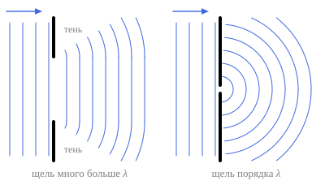

Из-за угла дома слышно, как разговаривают люди, но их не видно. Звук заворачивает за угол, а свет нет. Почему? Обе — волны. Дело в длине волны.

## Волна за щелью

Посмотрим на волны на воде. Ровные гребни бегут к стенке с проёмом. Что будет за проёмом, зависит от его ширины.

- **Широкая щель** (много длин волн). За ней идёт прямой «луч» волн шириной со щель, сбоку — тень. Лишь у краёв фронты немного загибаются в тень.
- **Узкая щель** (порядка длины волны или меньше). Из неё расходятся полукруглые волны, как от точечного источника, во все стороны, в том числе далеко в «тень».

**Дифракция** — огибание волнами препятствий, отклонение волн от прямолинейного распространения.

## Почему так: принцип Гюйгенса

Каждая точка фронта волны раскачивает соседние точки среды и сама становится источником маленьких круговых волн. Новый фронт — общая огибающая этих волночек. Это **принцип Гюйгенса**.

В широкой щели волночек много. В середине они складываются в прямой фронт, и только у краёв ничто не мешает им расходиться вбок. В узкой щели помещается лишь одна-две волночки, и за щелью остаётся круговая волна — она заходит всюду.

Чем уже щель по сравнению с длиной волны, тем шире волна расходится за ней. Заметна дифракция, когда размер щели или препятствия **сравним с длиной волны** или меньше её.

## Звук и свет

Длина звуковой волны ${\lambda = v/\nu}$ (урок 14.3 из механики). При скорости ${340\ \text{м/с}}$ и частоте ${170\ \text{Гц}}$

$$
\lambda = \frac{340}{170} = 2\ \text{м}.
$$

Двери, окна, углы домов — того же размера. Звук огибает их легко, поэтому мы слышим из-за угла.

А видимый свет — около половины микрометра (урок 13.4), в миллион раз короче. Для света дверь — огромная щель, и он проходит её прямо, давая резкую тень. Поэтому геометрическая оптика с прямыми лучами (урок 14.1) так хорошо работает в жизни.

<pp-task id="ks-wopt-10"></pp-task>

## Дифракция света

Свет тоже огибает препятствия, если они очень малы. Её видно:

- через узкую щель между двумя пальцами или лезвиями: на свету видны тонкие тёмные полоски;
- вокруг тонкого волоска в луче лазера: на стене вместо резкой тени — ряд полос;
- у края любой тени, если присмотреться: граница не идеально резкая, а с полосками.

За препятствием волны, обогнувшие его с разных сторон, встречаются и интерферируют. Поэтому дифракционная картина — это чередование светлых и тёмных полос.

Дифракция ставит предел оптике: в микроскоп нельзя разглядеть предмет меньше примерно половины длины волны света — свет просто обтекает его.

<pp-task id="ks-wopt-11"></pp-task>

Проверь себя: почему радиоприёмник ловит длинные волны за горой, а ультракороткие волны и телевидение — нет?

Длинные радиоволны — сотни метров и километры, они сравнимы с горой и огибают её. Ультракороткие волны — метры и меньше, для них гора огромна, и они дают за ней «тень», как свет.

## Частые ловушки

- **Думают, что свет не дифрагирует.** Дифрагирует, но заметно только на препятствиях размером порядка длины волны.
- **Путают, при какой щели дифракция сильнее.** Чем уже щель (ближе к $\lambda$), тем шире расходится волна.
- **Путают дифракцию с преломлением.** Преломление — поворот на границе двух сред, дифракция — огибание препятствия в одной среде.

## Коротко

- Дифракция — огибание волнами препятствий.
- Заметна, когда размер щели или препятствия сравним с $\lambda$ или меньше.
- Принцип Гюйгенса: каждая точка фронта — источник новых волн.
- Звук огибает дома, свет — только волоски и узкие щели.
