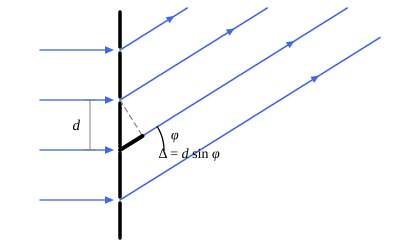
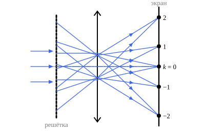

Две щели Юнга дают размытые полосы. Если щелей не две, а тысячи, полосы становятся тонкими и яркими, а между ними почти темно. По их положению длину волны света можно измерить с точностью до долей нанометра. Такой прибор — дифракционная решётка.

## Что такое решётка

**Дифракционная решётка** — пластинка, на которой нанесено много параллельных штрихов на одинаковом расстоянии. Свет проходит в узких промежутках между штрихами — это щели. Хорошие решётки содержат сотни и тысячи штрихов на каждый миллиметр. Радужные переливы на компакт-диске — тоже работа решётки: на нём дорожки идут через ${1{,}6\ \text{мкм}.}$

**Период решётки** $d$ — расстояние между соседними щелями (ширина щели плюс ширина штриха).

## Условие максимума

На решётку перпендикулярно падает свет одной длины волны ${\lambda.}$ Каждая щель становится источником волн (урок 16.4), и все они когерентны: их питает одна волна. Посмотрим на свет, который идёт от щелей под углом $\varphi$ к перпендикуляру.

Лучи от соседних щелей параллельны, но один длиннее другого. Опустим перпендикуляр от верхней щели на луч нижней. Получится прямоугольный треугольник с гипотенузой $d$ и углом ${\varphi,}$ и лишний кусок пути

$$
\Delta = d\sin\varphi.
$$

Если $\Delta$ — целое число длин волн, волны от соседних щелей приходят в фазе (урок 16.3). А раз от каждой следующей щели та же разность хода, в фазе приходят волны от **всех** щелей сразу, и получается очень яркий максимум. Условие главных максимумов решётки:

$$
d\sin\varphi = k\lambda,
\qquad
k = 0, 1, 2, \dots
$$

- $d$ — период решётки, м;
- $\varphi$ — угол между направлением на максимум и перпендикуляром к решётке;
- $k$ — **порядок** максимума;
- $\lambda$ — длина волны, м.

При ${k = 0}$ угол нулевой: центральный максимум — свет, прошедший прямо. Максимумы порядков ${1, 2, \dots}$ стоят симметрично по обе стороны от него. В других направлениях волны от тысяч щелей приходят с самыми разными фазами и почти полностью гасят друг друга, поэтому максимумы решётки тонкие и яркие, а между ними темно.

**Пример.** Период ${4\ \text{мкм},}$ свет ${600\ \text{нм}.}$ Максимум первого порядка:

$$
\sin\varphi = \frac{k\lambda}{d} = \frac{1 \cdot 6 \cdot 10^{-7}}{4 \cdot 10^{-6}} = 0{,}15,
\qquad
\varphi \approx 8{,}6^\circ.
$$

<pp-task id="ks-wopt-03"></pp-task>

## Как увидеть максимумы

Лучи одного направления выходят из решётки параллельным пучком. Чтобы получить из него точку, за решёткой ставят собирающую линзу, а экран — в её фокальной плоскости: параллельный пучок линза собирает в одну точку этой плоскости (уроки 15.1 и 15.3). Пучок под углом $\varphi$ сходится на расстоянии ${F\,\mathrm{tg}\,\varphi}$ от оси.

Роль линзы может сыграть и глаз: глядя через решётку на узкую щель с лампой, видишь по бокам от неё яркие линии.

Если экран далеко, а углы малы, линзу не ставят. Тогда расстояние от центра до максимума ${x = L\,\mathrm{tg}\,\varphi,}$ а при малых углах ${\mathrm{tg}\,\varphi \approx \sin\varphi,}$ так что ${x \approx L\dfrac{k\lambda}{d}.}$ В примере выше на экране в ${1\ \text{м}}$ первый максимум был бы примерно в ${15\ \text{см}}$ от центра.

<pp-task id="ks-wopt-13"></pp-task>

## Период по числу штрихов

На решётках пишут не период, а число штрихов на миллиметр ${N.}$ На один миллиметр приходится $N$ периодов, поэтому

$$
d = \frac{1}{N}\ \text{мм}.
$$

**Пример.** «250 штрихов на мм»:

$$
d = \frac{1}{250}\ \text{мм} = 0{,}004\ \text{мм} = 4 \cdot 10^{-6}\ \text{м}.
$$

Это решётка из примера выше. Не забудь перевести миллиметры в метры: длина волны в формулу идёт в метрах.

<pp-task id="ks-wopt-12"></pp-task>

## Спектроскоп

Решётка позволяет измерить длину волны. Знаем период, измеряем угол на максимум известного порядка и находим

$$
\lambda = \frac{d\sin\varphi}{k}.
$$

**Пример.** На решётке ${250}$ штрихов на миллиметр, максимум первого порядка виден под углом с ${\sin\varphi = 0{,}12.}$ Тогда ${\lambda = 4 \cdot 10^{-6} \cdot 0{,}12 = 4{,}8 \cdot 10^{-7}\ \text{м} = 480\ \text{нм}}$ — голубой свет.

Так работают спектроскопы: по линиям в спектре звезды узнают, из чего она состоит.

<pp-task id="ks-wopt-04"></pp-task>

Проверь себя: решётку заменили на другую, с вдвое большим числом штрихов на миллиметр. Как изменился угол на максимум первого порядка?

Штрихов вдвое больше — период вдвое меньше. Синус угла kλ/d вырос вдвое, и угол вырос (чуть больше чем вдвое, если угол не мал). Максимумы разъехались дальше от центра.

## Частые ловушки

- **Подставляют $N$ вместо ${d.}$** Период — обратная величина: ${d = 1/N}$ мм.
- **Забывают перевести миллиметры и нанометры в метры.**
- **Отвечают синусом вместо угла** или берут не тот порядок ${k.}$
- **Отсчитывают угол от плоскости решётки.** $\varphi$ — от перпендикуляра, то есть от направления падающего света.

## Коротко

- Решётка — много щелей с периодом ${d.}$
- Главные максимумы: ${d\sin\varphi = k\lambda,}$ $k$ — порядок.
- ${d = 1/N}$ мм, $N$ — число штрихов на миллиметр.
- Линза собирает каждый пучок в точку фокальной плоскости; при малых углах ${x \approx Lk\lambda/d.}$
- По углу и периоду находят длину волны.
